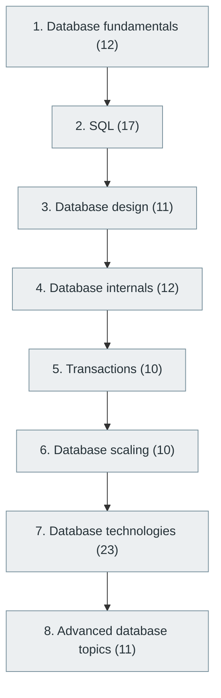

# 15. Database Management Systems (DBMS)

> [Home](../../../README.md) › [Part IV — Building Software Products](../index.md) › Subject 15

- **Status:** Not started (0 of 106 syllabus topics have a drafted lesson)
- **Source tags:** Essential
- **Syllabus size:** 8 chapters, 106 topics

## Introduction

Relational and non-relational databases: SQL, schema design, indexing and storage internals, transactions and isolation, scaling, and the major database technologies.

## Learning outcomes

After working through this subject you should be able to:

- Model data and write correct, efficient SQL
- Explain indexes, query plans and transaction isolation
- Choose between relational, document, key-value and other stores

## Prerequisites

- [2. Mathematics for Computer Science](../../01-computer-science-foundations/02-mathematics-for-computer-science/index.md)
- [9. Data Structures and Algorithms (DSA)](../../02-programming-and-software-development/09-data-structures-and-algorithms/index.md)

## Beginner-to-advanced progression

The chapters below follow the order of the source syllabus, which moves from foundational to advanced material. Colour shows documentation status (grey = not started, amber = in progress, green = drafted or better).

## Chapters and topics

### Chapter 1: Database fundamentals

12 topics · status: **Not started**

*Planned location:* `docs/04-building-software-products/15-database-management-systems/01-database-fundamentals/`. No lessons yet.

Syllabus topics in this chapter (12)

- `15.01.01` What is a database? — *not started*
- `15.01.02` DBMS — *not started*
- `15.01.03` RDBMS — *not started*
- `15.01.04` Tables — *not started*
- `15.01.05` Rows — *not started*
- `15.01.06` Columns — *not started*
- `15.01.07` Schemas — *not started*
- `15.01.08` Primary keys — *not started*
- `15.01.09` Foreign keys — *not started*
- `15.01.10` Constraints — *not started*
- `15.01.11` Relationships — *not started*
- `15.01.12` Data types — *not started*

### Chapter 2: SQL

17 topics · status: **Not started**

*Planned location:* `docs/04-building-software-products/15-database-management-systems/02-sql/`. No lessons yet.

Syllabus topics in this chapter (17)

- `15.02.01` SELECT — *not started*
- `15.02.02` INSERT — *not started*
- `15.02.03` UPDATE — *not started*
- `15.02.04` DELETE — *not started*
- `15.02.05` WHERE — *not started*
- `15.02.06` ORDER BY — *not started*
- `15.02.07` GROUP BY — *not started*
- `15.02.08` HAVING — *not started*
- `15.02.09` JOINs — *not started*
- `15.02.10` Subqueries — *not started*
- `15.02.11` Common table expressions — *not started*
- `15.02.12` Window functions — *not started*
- `15.02.13` Stored procedures — *not started*
- `15.02.14` Functions — *not started*
- `15.02.15` Triggers — *not started*
- `15.02.16` Views — *not started*
- `15.02.17` Materialized views — *not started*

### Chapter 3: Database design

11 topics · status: **Not started**

*Planned location:* `docs/04-building-software-products/15-database-management-systems/03-database-design/`. No lessons yet.

Syllabus topics in this chapter (11)

- `15.03.01` Entity-relationship diagrams — *not started*
- `15.03.02` Entity relationships — *not started*
- `15.03.03` Data modeling — *not started*
- `15.03.04` Normalization — *not started*
- `15.03.05` 1NF — *not started*
- `15.03.06` 2NF — *not started*
- `15.03.07` 3NF — *not started*
- `15.03.08` BCNF — *not started*
- `15.03.09` Denormalization — *not started*
- `15.03.10` Schema migrations — *not started*
- `15.03.11` Referential integrity — *not started*

### Chapter 4: Database internals

12 topics · status: **Not started**

*Planned location:* `docs/04-building-software-products/15-database-management-systems/04-database-internals/`. No lessons yet.

Syllabus topics in this chapter (12)

- `15.04.01` Query parsing — *not started*
- `15.04.02` Query optimization — *not started*
- `15.04.03` Query execution plans — *not started*
- `15.04.04` Indexing — *not started*
- `15.04.05` B-tree indexes — *not started*
- `15.04.06` Hash indexes — *not started*
- `15.04.07` Composite indexes — *not started*
- `15.04.08` Database statistics — *not started*
- `15.04.09` Buffer pools — *not started*
- `15.04.10` Write-ahead logs — *not started*
- `15.04.11` MVCC — *not started*
- `15.04.12` Storage engines — *not started*

### Chapter 5: Transactions

10 topics · status: **Not started**

*Planned location:* `docs/04-building-software-products/15-database-management-systems/05-transactions/`. No lessons yet.

Syllabus topics in this chapter (10)

- `15.05.01` ACID — *not started*
- `15.05.02` Isolation levels — *not started*
- `15.05.03` Dirty reads — *not started*
- `15.05.04` Non-repeatable reads — *not started*
- `15.05.05` Phantom reads — *not started*
- `15.05.06` Locks — *not started*
- `15.05.07` Deadlocks — *not started*
- `15.05.08` Optimistic locking — *not started*
- `15.05.09` Pessimistic locking — *not started*
- `15.05.10` Transaction management — *not started*

### Chapter 6: Database scaling

10 topics · status: **Not started**

*Planned location:* `docs/04-building-software-products/15-database-management-systems/06-database-scaling/`. No lessons yet.

Syllabus topics in this chapter (10)

- `15.06.01` Replication — *not started*
- `15.06.02` Primary-replica architecture — *not started*
- `15.06.03` Read replicas — *not started*
- `15.06.04` Sharding — *not started*
- `15.06.05` Partitioning — *not started*
- `15.06.06` Horizontal scaling — *not started*
- `15.06.07` Vertical scaling — *not started*
- `15.06.08` Distributed transactions — *not started*
- `15.06.09` Strong consistency — *not started*
- `15.06.10` Eventual consistency — *not started*

### Chapter 7: Database technologies

23 topics · status: **Not started**

*Planned location:* `docs/04-building-software-products/15-database-management-systems/07-database-technologies/`. No lessons yet.

Syllabus topics in this chapter (23)

**Relational databases**

- `15.07.01` **PostgreSQL** — Advanced relational database — *not started*
- `15.07.02` **MySQL** — Relational database — *not started*
- `15.07.03` MariaDB — *not started*
- `15.07.04` SQLite — *not started*
- `15.07.05` Oracle Database — *not started*
- `15.07.06` Microsoft SQL Server — *not started*
- `15.07.07` CockroachDB — *not started*
- `15.07.08` YugabyteDB — *not started*

**NoSQL databases**

- `15.07.09` MongoDB – document database — *not started*
- `15.07.10` Redis – in-memory key-value store — *not started*
- `15.07.11` Cassandra – wide-column database — *not started*
- `15.07.12` DynamoDB – managed key-value/document database — *not started*
- `15.07.13` Couchbase – document and key-value database — *not started*
- `15.07.14` Neo4j – graph database — *not started*
- `15.07.15` ScyllaDB – wide-column database — *not started*
- `15.07.16` HBase – distributed wide-column database — *not started*

**Specialized databases**

- `15.07.17` Elasticsearch, OpenSearch – search engines — *not started*
- `15.07.18` ClickHouse, Apache Druid – analytical databases — *not started*
- `15.07.19` InfluxDB, TimescaleDB – time-series databases — *not started*
- `15.07.20` Snowflake, BigQuery, Redshift – cloud data warehouses — *not started*
- `15.07.21` Milvus, Weaviate, Qdrant, Pinecone – vector databases — *not started*
- `15.07.22` DuckDB – analytical database engine — *not started*
- `15.07.23` Neo4j – graph data — *not started*

### Chapter 8: Advanced database topics

11 topics · status: **Not started**

*Planned location:* `docs/04-building-software-products/15-database-management-systems/08-advanced-database-topics/`. No lessons yet.

Syllabus topics in this chapter (11)

- `15.08.01` Distributed SQL — *not started*
- `15.08.02` NewSQL — *not started*
- `15.08.03` Vector indexing — *not started*
- `15.08.04` Full-text search — *not started*
- `15.08.05` Geospatial databases — *not started*
- `15.08.06` Time-series storage — *not started*
- `15.08.07` Graph traversal — *not started*
- `15.08.08` Database encryption — *not started*
- `15.08.09` Backup and point-in-time recovery — *not started*
- `15.08.10` Database high availability — *not started*
- `15.08.11` Multi-region data systems — *not started*

## Recommended reading order

1. Chapter 1 — Database fundamentals
2. Chapter 2 — SQL
3. Chapter 3 — Database design
4. Chapter 4 — Database internals
5. Chapter 5 — Transactions
6. Chapter 6 — Database scaling
7. Chapter 7 — Database technologies
8. Chapter 8 — Advanced database topics

Within a chapter, read lessons in numeric order. Pick the later chapters only when the earlier ones feel comfortable; the syllabus orders them from fundamental to advanced.

## Related subjects

- [16. Backend Development](../16-backend-development/index.md)
- [22. Distributed Systems](../../05-distributed-systems-and-system-design/22-distributed-systems/index.md)
- [32. Data Engineering](../../08-data-engineering-data-science-and-analytics/32-data-engineering/index.md)

## Suggested practical projects

- A normalised schema with migrations for a small application
- A key-value store with a write-ahead log

*Full project write-ups (requirements, architecture, stages, tests, extensions) are planned; see [ROADMAP.md](../../../ROADMAP.md).*

---

**Previous subject:** [14. Development Environments and Tools](../../03-professional-software-engineering/14-development-environments-and-tools/index.md) · **Up:** [Part IV](../index.md) · **Next subject:** [16. Backend Development](../16-backend-development/index.md)
