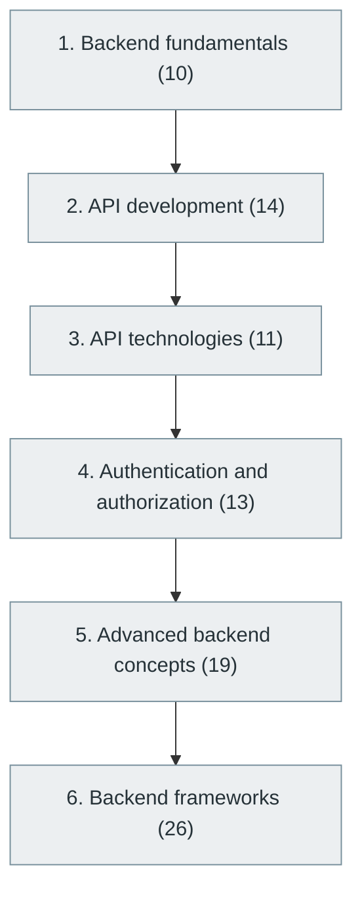

# 16. Backend Development

> [Home](../../../README.md) › [Part IV — Building Software Products](../index.md) › Subject 16

- **Status:** Not started (0 of 93 syllabus topics have a drafted lesson)
- **Source tags:** Major software engineering specialization
- **Syllabus size:** 6 chapters, 93 topics

## Introduction

Server-side engineering: request handling, business logic, API design, authentication and authorisation, advanced backend concerns and the major backend frameworks.

## Learning outcomes

After working through this subject you should be able to:

- Design and implement a REST API with validation and error handling
- Implement authentication and authorisation correctly
- Reason about caching, background jobs and scaling

## Prerequisites

- [5. Computer Networking](../../01-computer-science-foundations/05-computer-networking/index.md)
- [6. Programming Fundamentals](../../02-programming-and-software-development/06-programming-fundamentals/index.md)
- [15. Database Management Systems (DBMS)](../15-database-management-systems/index.md)

## Beginner-to-advanced progression

The chapters below follow the order of the source syllabus, which moves from foundational to advanced material. Colour shows documentation status (grey = not started, amber = in progress, green = drafted or better).

## Chapters and topics

### Chapter 1: Backend fundamentals

10 topics · status: **Not started**

*Planned location:* `docs/04-building-software-products/16-backend-development/01-backend-fundamentals/`. No lessons yet.

Syllabus topics in this chapter (10)

- `16.01.01` Client-server architecture — *not started*
- `16.01.02` Request-response lifecycle — *not started*
- `16.01.03` Server-side programming — *not started*
- `16.01.04` Business logic — *not started*
- `16.01.05` Routing — *not started*
- `16.01.06` Controllers — *not started*
- `16.01.07` Services — *not started*
- `16.01.08` Repositories — *not started*
- `16.01.09` Middleware — *not started*
- `16.01.10` Configuration management — *not started*

### Chapter 2: API development

14 topics · status: **Not started**

*Planned location:* `docs/04-building-software-products/16-backend-development/02-api-development/`. No lessons yet.

Syllabus topics in this chapter (14)

- `16.02.01` REST — *not started*
- `16.02.02` RESTful design — *not started*
- `16.02.03` HTTP methods — *not started*
- `16.02.04` Status codes — *not started*
- `16.02.05` Headers — *not started*
- `16.02.06` Request and response bodies — *not started*
- `16.02.07` JSON — *not started*
- `16.02.08` XML — *not started*
- `16.02.09` API versioning — *not started*
- `16.02.10` Pagination — *not started*
- `16.02.11` Filtering — *not started*
- `16.02.12` Sorting — *not started*
- `16.02.13` Rate limiting — *not started*
- `16.02.14` Idempotency — *not started*

### Chapter 3: API technologies

11 topics · status: **Not started**

*Planned location:* `docs/04-building-software-products/16-backend-development/03-api-technologies/`. No lessons yet.

Syllabus topics in this chapter (11)

- `16.03.01` REST API — *not started*
- `16.03.02` GraphQL — *not started*
- `16.03.03` gRPC — *not started*
- `16.03.04` SOAP — *not started*
- `16.03.05` WebSocket — *not started*
- `16.03.06` Server-sent events — *not started*
- `16.03.07` Webhooks — *not started*
- `16.03.08` JSON-RPC — *not started*
- `16.03.09` Protocol Buffers — *not started*
- `16.03.10` OpenAPI — *not started*
- `16.03.11` AsyncAPI — *not started*

### Chapter 4: Authentication and authorization

13 topics · status: **Not started**

*Planned location:* `docs/04-building-software-products/16-backend-development/04-authentication-and-authorization/`. No lessons yet.

Syllabus topics in this chapter (13)

- `16.04.01` Authentication — *not started*
- `16.04.02` Authorization — *not started*
- `16.04.03` Sessions — *not started*
- `16.04.04` Cookies — *not started*
- `16.04.05` Password hashing — *not started*
- `16.04.06` JWT — *not started*
- `16.04.07` OAuth 2.0 — *not started*
- `16.04.08` OpenID Connect — *not started*
- `16.04.09` SAML — *not started*
- `16.04.10` RBAC — *not started*
- `16.04.11` ABAC — *not started*
- `16.04.12` Multi-factor authentication — *not started*
- `16.04.13` Single sign-on — *not started*

### Chapter 5: Advanced backend concepts

19 topics · status: **Not started**

*Planned location:* `docs/04-building-software-products/16-backend-development/05-advanced-backend-concepts/`. No lessons yet.

Syllabus topics in this chapter (19)

- `16.05.01` Background tasks — *not started*
- `16.05.02` Job queues — *not started*
- `16.05.03` Caching — *not started*
- `16.05.04` Distributed locking — *not started*
- `16.05.05` Message brokers — *not started*
- `16.05.06` Event-driven processing — *not started*
- `16.05.07` Async processing — *not started*
- `16.05.08` Concurrency — *not started*
- `16.05.09` Database transactions — *not started*
- `16.05.10` Distributed transactions — *not started*
- `16.05.11` Rate limiting — *not started*
- `16.05.12` Circuit breakers — *not started*
- `16.05.13` Retry policies — *not started*
- `16.05.14` Bulkheads — *not started*
- `16.05.15` Multi-tenancy — *not started*
- `16.05.16` File processing — *not started*
- `16.05.17` Payment integrations — *not started*
- `16.05.18` Email services — *not started*
- `16.05.19` Notification systems — *not started*

### Chapter 6: Backend frameworks

26 topics · status: **Not started**

*Planned location:* `docs/04-building-software-products/16-backend-development/06-backend-frameworks/`. No lessons yet.

Syllabus topics in this chapter (26)

- `16.06.01` Spring Boot *(Java)* — *not started*
- `16.06.02` Jakarta EE *(Java)* — *not started*
- `16.06.03` Quarkus *(Java)* — *not started*
- `16.06.04` Micronaut *(Java)* — *not started*
- `16.06.05` Django *(Python)* — *not started*
- `16.06.06` FastAPI *(Python)* — *not started*
- `16.06.07` Flask *(Python)* — *not started*
- `16.06.08` Litestar *(Python)* — *not started*
- `16.06.09` Node.js *(JavaScript)* — *not started*
- `16.06.10` Express *(JavaScript)* — *not started*
- `16.06.11` NestJS *(JavaScript)* — *not started*
- `16.06.12` Fastify *(JavaScript)* — *not started*
- `16.06.13` Gin *(Go)* — *not started*
- `16.06.14` Echo *(Go)* — *not started*
- `16.06.15` Fiber *(Go)* — *not started*
- `16.06.16` Chi *(Go)* — *not started*
- `16.06.17` ASP.NET Core *(C#)* — *not started*
- `16.06.18` Laravel *(PHP)* — *not started*
- `16.06.19` Symfony *(PHP)* — *not started*
- `16.06.20` Rails *(Ruby)* — *not started*
- `16.06.21` Sinatra *(Ruby)* — *not started*
- `16.06.22` Axum *(Rust)* — *not started*
- `16.06.23` Actix Web *(Rust)* — *not started*
- `16.06.24` Rocket *(Rust)* — *not started*
- `16.06.25` Ktor *(Kotlin)* — *not started*
- `16.06.26` Spring Boot *(Kotlin)* — *not started*

## Recommended reading order

1. Chapter 1 — Backend fundamentals
2. Chapter 2 — API development
3. Chapter 3 — API technologies
4. Chapter 4 — Authentication and authorization
5. Chapter 5 — Advanced backend concepts
6. Chapter 6 — Backend frameworks

Within a chapter, read lessons in numeric order. Pick the later chapters only when the earlier ones feel comfortable; the syllabus orders them from fundamental to advanced.

## Related subjects

- [21. API Integration and Messaging Systems](../21-api-integration-and-messaging-systems/index.md)
- [23. System Design](../../05-distributed-systems-and-system-design/23-system-design/index.md)
- [31. Cybersecurity and Software Security](../../07-software-quality-and-cybersecurity/31-cybersecurity-and-software-security/index.md)

## Suggested practical projects

- A REST API with authentication and tests
- A URL shortener with rate limiting

*Full project write-ups (requirements, architecture, stages, tests, extensions) are planned; see [ROADMAP.md](../../../ROADMAP.md).*

---

**Previous subject:** [15. Database Management Systems (DBMS)](../15-database-management-systems/index.md) · **Up:** [Part IV](../index.md) · **Next subject:** [17. Frontend Development](../17-frontend-development/index.md)
