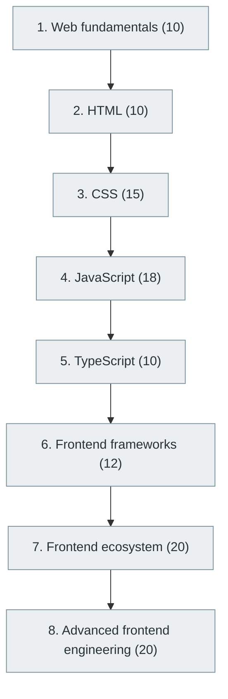

# 17. Frontend Development

> [Home](../../../README.md) › [Part IV — Building Software Products](../index.md) › Subject 17

- **Status:** Not started (0 of 115 syllabus topics have a drafted lesson)
- **Source tags:** —
- **Syllabus size:** 8 chapters, 115 topics

## Introduction

Browser-based user interfaces: HTML, CSS, JavaScript, TypeScript, major frameworks, the frontend ecosystem and advanced frontend engineering.

## Learning outcomes

After working through this subject you should be able to:

- Build accessible, responsive pages with semantic HTML and modern CSS
- Explain how the browser parses, lays out and paints a page
- Structure a component-based application with TypeScript

## Prerequisites

- [5. Computer Networking](../../01-computer-science-foundations/05-computer-networking/index.md)
- [6. Programming Fundamentals](../../02-programming-and-software-development/06-programming-fundamentals/index.md)

## Beginner-to-advanced progression

The chapters below follow the order of the source syllabus, which moves from foundational to advanced material. Colour shows documentation status (grey = not started, amber = in progress, green = drafted or better).

## Chapters and topics

### Chapter 1: Web fundamentals

10 topics · status: **Not started**

*Planned location:* `docs/04-building-software-products/17-frontend-development/01-web-fundamentals/`. No lessons yet.

Syllabus topics in this chapter (10)

- `17.01.01` Internet and web — *not started*
- `17.01.02` Browser architecture — *not started*
- `17.01.03` Client-server communication — *not started*
- `17.01.04` DOM — *not started*
- `17.01.05` BOM — *not started*
- `17.01.06` Rendering — *not started*
- `17.01.07` Browser storage — *not started*
- `17.01.08` Cookies — *not started*
- `17.01.09` Local storage — *not started*
- `17.01.10` Session storage — *not started*

### Chapter 2: HTML

10 topics · status: **Not started**

*Planned location:* `docs/04-building-software-products/17-frontend-development/02-html/`. No lessons yet.

Syllabus topics in this chapter (10)

- `17.02.01` Elements — *not started*
- `17.02.02` Attributes — *not started*
- `17.02.03` Semantic HTML — *not started*
- `17.02.04` Forms — *not started*
- `17.02.05` Tables — *not started*
- `17.02.06` Multimedia — *not started*
- `17.02.07` Accessibility — *not started*
- `17.02.08` SEO — *not started*
- `17.02.09` Structured data — *not started*
- `17.02.10` Web components — *not started*

### Chapter 3: CSS

15 topics · status: **Not started**

*Planned location:* `docs/04-building-software-products/17-frontend-development/03-css/`. No lessons yet.

Syllabus topics in this chapter (15)

- `17.03.01` Selectors — *not started*
- `17.03.02` Specificity — *not started*
- `17.03.03` Box model — *not started*
- `17.03.04` Positioning — *not started*
- `17.03.05` Display — *not started*
- `17.03.06` Flexbox — *not started*
- `17.03.07` Grid — *not started*
- `17.03.08` Transitions — *not started*
- `17.03.09` Animations — *not started*
- `17.03.10` Responsive design — *not started*
- `17.03.11` Media queries — *not started*
- `17.03.12` CSS variables — *not started*
- `17.03.13` Container queries — *not started*
- `17.03.14` CSS architecture — *not started*
- `17.03.15` Advanced rendering techniques — *not started*

### Chapter 4: JavaScript

18 topics · status: **Not started**

*Planned location:* `docs/04-building-software-products/17-frontend-development/04-javascript/`. No lessons yet.

Syllabus topics in this chapter (18)

- `17.04.01` Variables — *not started*
- `17.04.02` Data types — *not started*
- `17.04.03` Functions — *not started*
- `17.04.04` Scope — *not started*
- `17.04.05` Closures — *not started*
- `17.04.06` Objects — *not started*
- `17.04.07` Arrays — *not started*
- `17.04.08` Prototypes — *not started*
- `17.04.09` Classes — *not started*
- `17.04.10` Promises — *not started*
- `17.04.11` Async/await — *not started*
- `17.04.12` Event loop — *not started*
- `17.04.13` Event delegation — *not started*
- `17.04.14` Modules — *not started*
- `17.04.15` ES6+ — *not started*
- `17.04.16` Memory management — *not started*
- `17.04.17` Browser APIs — *not started*
- `17.04.18` Performance optimization — *not started*

### Chapter 5: TypeScript

10 topics · status: **Not started**

*Planned location:* `docs/04-building-software-products/17-frontend-development/05-typescript/`. No lessons yet.

Syllabus topics in this chapter (10)

- `17.05.01` Static types — *not started*
- `17.05.02` Interfaces — *not started*
- `17.05.03` Type aliases — *not started*
- `17.05.04` Generics — *not started*
- `17.05.05` Union types — *not started*
- `17.05.06` Intersection types — *not started*
- `17.05.07` Utility types — *not started*
- `17.05.08` Type narrowing — *not started*
- `17.05.09` Advanced type manipulation — *not started*
- `17.05.10` Declaration files — *not started*

### Chapter 6: Frontend frameworks

12 topics · status: **Not started**

*Planned location:* `docs/04-building-software-products/17-frontend-development/06-frontend-frameworks/`. No lessons yet.

Syllabus topics in this chapter (12)

- `17.06.01` **React** — Component-based UI — *not started*
- `17.06.02` **Angular** — Full frontend framework — *not started*
- `17.06.03` **Vue.js** — Progressive framework — *not started*
- `17.06.04` **Svelte** — Compiler-based UI — *not started*
- `17.06.05` SolidJS — *not started*
- `17.06.06` Preact — *not started*
- `17.06.07` Qwik — *not started*
- `17.06.08` Astro — *not started*
- `17.06.09` Lit — *not started*
- `17.06.10` Ember — *not started*
- `17.06.11` Backbone — *not started*
- `17.06.12` Alpine.js — *not started*

### Chapter 7: Frontend ecosystem

20 topics · status: **Not started**

*Planned location:* `docs/04-building-software-products/17-frontend-development/07-frontend-ecosystem/`. No lessons yet.

Syllabus topics in this chapter (20)

- `17.07.01` Next.js — *not started*
- `17.07.02` Nuxt — *not started*
- `17.07.03` Remix — *not started*
- `17.07.04` React Router — *not started*
- `17.07.05` TanStack Router — *not started*
- `17.07.06` Redux — *not started*
- `17.07.07` Zustand — *not started*
- `17.07.08` MobX — *not started*
- `17.07.09` NgRx — *not started*
- `17.07.10` Pinia — *not started*
- `17.07.11` React Query — *not started*
- `17.07.12` TanStack Query — *not started*
- `17.07.13` Tailwind CSS — *not started*
- `17.07.14` Bootstrap — *not started*
- `17.07.15` Sass — *not started*
- `17.07.16` Less — *not started*
- `17.07.17` Material UI — *not started*
- `17.07.18` Ant Design — *not started*
- `17.07.19` shadcn/ui — *not started*
- `17.07.20` Radix UI — *not started*

### Chapter 8: Advanced frontend engineering

20 topics · status: **Not started**

*Planned location:* `docs/04-building-software-products/17-frontend-development/08-advanced-frontend-engineering/`. No lessons yet.

Syllabus topics in this chapter (20)

- `17.08.01` SSR — *not started*
- `17.08.02` SSG — *not started*
- `17.08.03` ISR — *not started*
- `17.08.04` Hydration — *not started*
- `17.08.05` Server components — *not started*
- `17.08.06` Streaming rendering — *not started*
- `17.08.07` Micro-frontends — *not started*
- `17.08.08` Code splitting — *not started*
- `17.08.09` Lazy loading — *not started*
- `17.08.10` Tree shaking — *not started*
- `17.08.11` Web Workers — *not started*
- `17.08.12` Service Workers — *not started*
- `17.08.13` WebAssembly — *not started*
- `17.08.14` WebGPU — *not started*
- `17.08.15` Progressive Web Apps — *not started*
- `17.08.16` Browser security — *not started*
- `17.08.17` Rendering optimization — *not started*
- `17.08.18` Core Web Vitals — *not started*
- `17.08.19` Accessibility engineering — *not started*
- `17.08.20` Internationalization — *not started*

## Recommended reading order

1. Chapter 1 — Web fundamentals
2. Chapter 2 — HTML
3. Chapter 3 — CSS
4. Chapter 4 — JavaScript
5. Chapter 5 — TypeScript
6. Chapter 6 — Frontend frameworks
7. Chapter 7 — Frontend ecosystem
8. Chapter 8 — Advanced frontend engineering

Within a chapter, read lessons in numeric order. Pick the later chapters only when the earlier ones feel comfortable; the syllabus orders them from fundamental to advanced.

## Related subjects

- [16. Backend Development](../16-backend-development/index.md)
- [18. UI/UX and Human-Computer Interaction](../18-ui-ux-and-human-computer-interaction/index.md)
- [21. API Integration and Messaging Systems](../21-api-integration-and-messaging-systems/index.md)

## Suggested practical projects

- A responsive, accessible portfolio page
- A single-page application consuming a public API

*Full project write-ups (requirements, architecture, stages, tests, extensions) are planned; see [ROADMAP.md](../../../ROADMAP.md).*

---

**Previous subject:** [16. Backend Development](../16-backend-development/index.md) · **Up:** [Part IV](../index.md) · **Next subject:** [18. UI/UX and Human-Computer Interaction](../18-ui-ux-and-human-computer-interaction/index.md)
