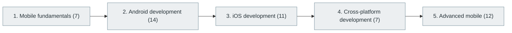

# 19. Mobile Application Development

> [Home](../../../README.md) › [Part IV — Building Software Products](../index.md) › Subject 19

- **Status:** Not started (0 of 51 syllabus topics have a drafted lesson)
- **Source tags:** —
- **Syllabus size:** 5 chapters, 51 topics

## Introduction

Mobile fundamentals, Android and iOS development, cross-platform approaches and advanced mobile engineering.

## Learning outcomes

After working through this subject you should be able to:

- Explain the mobile application lifecycle and its constraints
- Build a native or cross-platform app with local storage and networking
- Handle permissions, offline use and releases

## Prerequisites

- [6. Programming Fundamentals](../../02-programming-and-software-development/06-programming-fundamentals/index.md)
- [7. Programming Paradigms](../../02-programming-and-software-development/07-programming-paradigms/index.md)

## Beginner-to-advanced progression

The chapters below follow the order of the source syllabus, which moves from foundational to advanced material. Colour shows documentation status (grey = not started, amber = in progress, green = drafted or better).

## Chapters and topics

### Chapter 1: Mobile fundamentals

7 topics · status: **Not started**

*Planned location:* `docs/04-building-software-products/19-mobile-application-development/01-mobile-fundamentals/`. No lessons yet.

Syllabus topics in this chapter (7)

- `19.01.01` Mobile operating systems — *not started*
- `19.01.02` Mobile hardware — *not started*
- `19.01.03` App lifecycle — *not started*
- `19.01.04` Touch interfaces — *not started*
- `19.01.05` Device sensors — *not started*
- `19.01.06` Mobile networking — *not started*
- `19.01.07` Mobile storage — *not started*

### Chapter 2: Android development

14 topics · status: **Not started**

*Planned location:* `docs/04-building-software-products/19-mobile-application-development/02-android-development/`. No lessons yet.

Syllabus topics in this chapter (14)

- `19.02.01` Java — *not started*
- `19.02.02` Kotlin — *not started*
- `19.02.03` Android SDK — *not started*
- `19.02.04` Android Studio — *not started*
- `19.02.05` Activities — *not started*
- `19.02.06` Fragments — *not started*
- `19.02.07` Services — *not started*
- `19.02.08` Broadcast receivers — *not started*
- `19.02.09` Jetpack Compose — *not started*
- `19.02.10` Room — *not started*
- `19.02.11` WorkManager — *not started*
- `19.02.12` Navigation — *not started*
- `19.02.13` Dependency injection — *not started*
- `19.02.14` Android security — *not started*

### Chapter 3: iOS development

11 topics · status: **Not started**

*Planned location:* `docs/04-building-software-products/19-mobile-application-development/03-ios-development/`. No lessons yet.

Syllabus topics in this chapter (11)

- `19.03.01` Swift — *not started*
- `19.03.02` SwiftUI — *not started*
- `19.03.03` UIKit — *not started*
- `19.03.04` Xcode — *not started*
- `19.03.05` View controllers — *not started*
- `19.03.06` Core Data — *not started*
- `19.03.07` Combine — *not started*
- `19.03.08` Swift concurrency — *not started*
- `19.03.09` Core Animation — *not started*
- `19.03.10` iOS security — *not started*
- `19.03.11` App Store distribution — *not started*

### Chapter 4: Cross-platform development

7 topics · status: **Not started**

*Planned location:* `docs/04-building-software-products/19-mobile-application-development/04-cross-platform-development/`. No lessons yet.

Syllabus topics in this chapter (7)

- `19.04.01` Flutter — *not started*
- `19.04.02` React Native — *not started*
- `19.04.03` .NET MAUI — *not started*
- `19.04.04` Kotlin Multiplatform — *not started*
- `19.04.05` Ionic — *not started*
- `19.04.06` Capacitor — *not started*
- `19.04.07` NativeScript — *not started*

### Chapter 5: Advanced mobile

12 topics · status: **Not started**

*Planned location:* `docs/04-building-software-products/19-mobile-application-development/05-advanced-mobile/`. No lessons yet.

Syllabus topics in this chapter (12)

- `19.05.01` Offline-first applications — *not started*
- `19.05.02` Local synchronization — *not started*
- `19.05.03` Push notifications — *not started*
- `19.05.04` Background processing — *not started*
- `19.05.05` App signing — *not started*
- `19.05.06` Deep linking — *not started*
- `19.05.07` In-app purchases — *not started*
- `19.05.08` Mobile analytics — *not started*
- `19.05.09` Mobile testing — *not started*
- `19.05.10` Battery optimization — *not started*
- `19.05.11` App store optimization — *not started*
- `19.05.12` Mobile application security — *not started*

## Recommended reading order

1. Chapter 1 — Mobile fundamentals
2. Chapter 2 — Android development
3. Chapter 3 — iOS development
4. Chapter 4 — Cross-platform development
5. Chapter 5 — Advanced mobile

Within a chapter, read lessons in numeric order. Pick the later chapters only when the earlier ones feel comfortable; the syllabus orders them from fundamental to advanced.

## Related subjects

- [17. Frontend Development](../17-frontend-development/index.md)
- [18. UI/UX and Human-Computer Interaction](../18-ui-ux-and-human-computer-interaction/index.md)
- [21. API Integration and Messaging Systems](../21-api-integration-and-messaging-systems/index.md)

## Suggested practical projects

- A notes app with offline sync
- A small app published to a test track

*Full project write-ups (requirements, architecture, stages, tests, extensions) are planned; see [ROADMAP.md](../../../ROADMAP.md).*

---

**Previous subject:** [18. UI/UX and Human-Computer Interaction](../18-ui-ux-and-human-computer-interaction/index.md) · **Up:** [Part IV](../index.md) · **Next subject:** [20. Desktop Application Development](../20-desktop-application-development/index.md)
