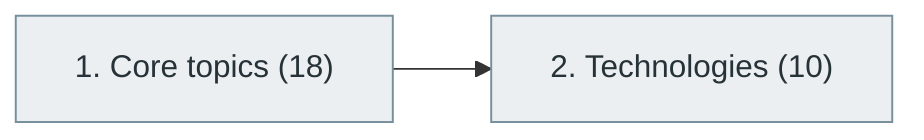

# 21. API Integration and Messaging Systems

> [Home](../../../README.md) › [Part IV — Building Software Products](../index.md) › Subject 21

- **Status:** Not started (0 of 28 syllabus topics have a drafted lesson)
- **Source tags:** —
- **Syllabus size:** 2 chapters, 28 topics

## Introduction

Connecting systems: integration patterns, API styles, message brokers, events, queues and the technologies that implement them.

> This is important in modern enterprise applications.

## Learning outcomes

After working through this subject you should be able to:

- Choose between synchronous APIs and asynchronous messaging
- Design idempotent, versioned integrations
- Handle retries, ordering and failure in messaging

## Prerequisites

- [5. Computer Networking](../../01-computer-science-foundations/05-computer-networking/index.md)
- [16. Backend Development](../16-backend-development/index.md)

## Beginner-to-advanced progression

The chapters below follow the order of the source syllabus, which moves from foundational to advanced material. Colour shows documentation status (grey = not started, amber = in progress, green = drafted or better).

## Chapters and topics

### Chapter 1: Core topics

18 topics · status: **Not started** · *heading synthesized (not in source)*

*Planned location:* `docs/04-building-software-products/21-api-integration-and-messaging-systems/01-core-topics/`. No lessons yet.

Syllabus topics in this chapter (18)

- `21.01.01` API consumption — *not started*
- `21.01.02` Third-party integrations — *not started*
- `21.01.03` Webhooks — *not started*
- `21.01.04` Event notifications — *not started*
- `21.01.05` Message queues — *not started*
- `21.01.06` Publish-subscribe patterns — *not started*
- `21.01.07` Point-to-point messaging — *not started*
- `21.01.08` Message serialization — *not started*
- `21.01.09` Message ordering — *not started*
- `21.01.10` Delivery guarantees — *not started*
- `21.01.11` At-most-once delivery — *not started*
- `21.01.12` At-least-once delivery — *not started*
- `21.01.13` Exactly-once processing semantics — *not started*
- `21.01.14` Dead-letter queues — *not started*
- `21.01.15` Retry mechanisms — *not started*
- `21.01.16` Consumer groups — *not started*
- `21.01.17` Message partitioning — *not started*
- `21.01.18` Event streaming — *not started*

### Chapter 2: Technologies

10 topics · status: **Not started**

*Planned location:* `docs/04-building-software-products/21-api-integration-and-messaging-systems/02-technologies/`. No lessons yet.

Syllabus topics in this chapter (10)

- `21.02.01` Apache Kafka — *not started*
- `21.02.02` RabbitMQ — *not started*
- `21.02.03` Apache Pulsar — *not started*
- `21.02.04` NATS — *not started*
- `21.02.05` Redis Streams — *not started*
- `21.02.06` Amazon SQS — *not started*
- `21.02.07` Amazon SNS — *not started*
- `21.02.08` Azure Service Bus — *not started*
- `21.02.09` Google Pub/Sub — *not started*
- `21.02.10` ActiveMQ — *not started*

## Recommended reading order

1. Chapter 1 — Core topics
2. Chapter 2 — Technologies

Within a chapter, read lessons in numeric order. Pick the later chapters only when the earlier ones feel comfortable; the syllabus orders them from fundamental to advanced.

## Related subjects

- [22. Distributed Systems](../../05-distributed-systems-and-system-design/22-distributed-systems/index.md)
- [23. System Design](../../05-distributed-systems-and-system-design/23-system-design/index.md)

## Suggested practical projects

- A producer/consumer pipeline over a message broker
- A webhook receiver with signature verification

*Full project write-ups (requirements, architecture, stages, tests, extensions) are planned; see [ROADMAP.md](../../../ROADMAP.md).*

---

**Previous subject:** [20. Desktop Application Development](../20-desktop-application-development/index.md) · **Up:** [Part IV](../index.md) · **Next subject:** [22. Distributed Systems](../../05-distributed-systems-and-system-design/22-distributed-systems/index.md)
