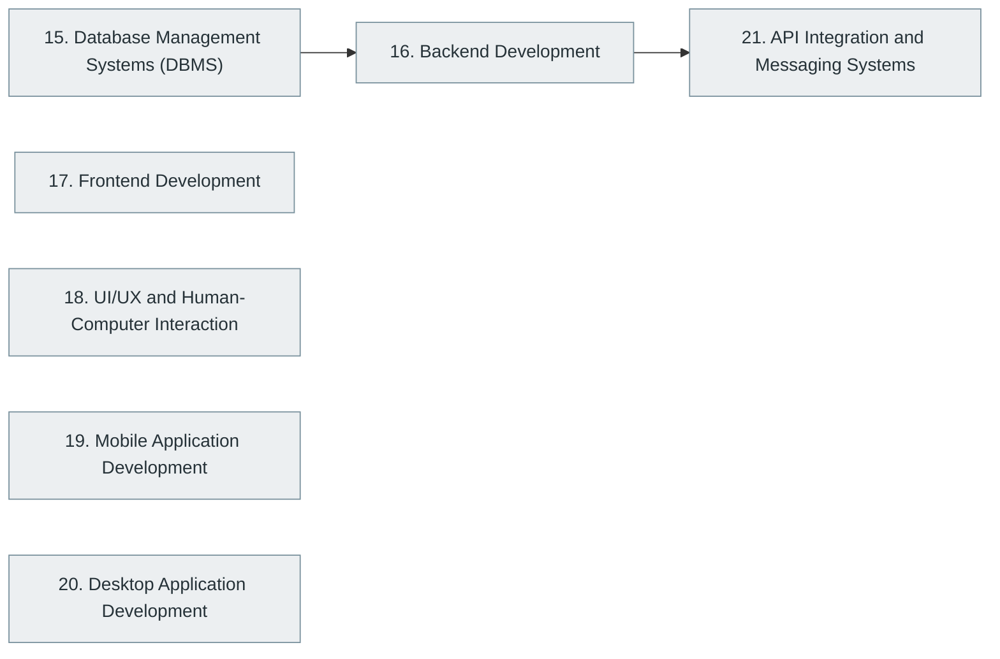

# Part IV — Building Software Products

> [Home](../../README.md) › Part IV

**Status:** Not started

The components of a product: databases, backends, APIs, frontends, mobile and desktop applications, user experience, and system integration.

## Subjects in this part

| # | Subject | What it covers | Topics | Status |
| --- | --- | --- | --- | --- |
| 15 | [Database Management Systems (DBMS)](15-database-management-systems/index.md) | Relational and non-relational databases: SQL, schema design, indexing and storage internals, transactions and isolation, scaling, and the major database technologies. | 106 | Not started |
| 16 | [Backend Development](16-backend-development/index.md) | Server-side engineering: request handling, business logic, API design, authentication and authorisation, advanced backend concerns and the major backend frameworks. | 93 | Not started |
| 17 | [Frontend Development](17-frontend-development/index.md) | Browser-based user interfaces: HTML, CSS, JavaScript, TypeScript, major frameworks, the frontend ecosystem and advanced frontend engineering. | 115 | Not started |
| 18 | [UI/UX and Human-Computer Interaction](18-ui-ux-and-human-computer-interaction/index.md) | How people interact with software: user research, interaction design, usability, accessibility, visual design and evaluation methods. | 31 | Not started |
| 19 | [Mobile Application Development](19-mobile-application-development/index.md) | Mobile fundamentals, Android and iOS development, cross-platform approaches and advanced mobile engineering. | 51 | Not started |
| 20 | [Desktop Application Development](20-desktop-application-development/index.md) | Native and cross-platform desktop applications, their UI toolkits, packaging, distribution and update mechanisms. | 20 | Not started |
| 21 | [API Integration and Messaging Systems](21-api-integration-and-messaging-systems/index.md) | Connecting systems: integration patterns, API styles, message brokers, events, queues and the technologies that implement them. | 28 | Not started |

## How the subjects depend on each other

Solid arrows point from a prerequisite to the subject that builds on it. Only dependencies inside this part are drawn.

## What you need from other parts

| Subject in this part | Prerequisite elsewhere |
| --- | --- |
| [15. Database Management Systems (DBMS)](15-database-management-systems/index.md) | [2. Mathematics for Computer Science](../01-computer-science-foundations/02-mathematics-for-computer-science/index.md) |
| [15. Database Management Systems (DBMS)](15-database-management-systems/index.md) | [9. Data Structures and Algorithms (DSA)](../02-programming-and-software-development/09-data-structures-and-algorithms/index.md) |
| [16. Backend Development](16-backend-development/index.md) | [5. Computer Networking](../01-computer-science-foundations/05-computer-networking/index.md) |
| [16. Backend Development](16-backend-development/index.md) | [6. Programming Fundamentals](../02-programming-and-software-development/06-programming-fundamentals/index.md) |
| [17. Frontend Development](17-frontend-development/index.md) | [5. Computer Networking](../01-computer-science-foundations/05-computer-networking/index.md) |
| [17. Frontend Development](17-frontend-development/index.md) | [6. Programming Fundamentals](../02-programming-and-software-development/06-programming-fundamentals/index.md) |
| [18. UI/UX and Human-Computer Interaction](18-ui-ux-and-human-computer-interaction/index.md) | [1. Computer Fundamentals](../01-computer-science-foundations/01-computer-fundamentals/index.md) |
| [19. Mobile Application Development](19-mobile-application-development/index.md) | [6. Programming Fundamentals](../02-programming-and-software-development/06-programming-fundamentals/index.md) |
| [19. Mobile Application Development](19-mobile-application-development/index.md) | [7. Programming Paradigms](../02-programming-and-software-development/07-programming-paradigms/index.md) |
| [20. Desktop Application Development](20-desktop-application-development/index.md) | [6. Programming Fundamentals](../02-programming-and-software-development/06-programming-fundamentals/index.md) |
| [20. Desktop Application Development](20-desktop-application-development/index.md) | [7. Programming Paradigms](../02-programming-and-software-development/07-programming-paradigms/index.md) |
| [21. API Integration and Messaging Systems](21-api-integration-and-messaging-systems/index.md) | [5. Computer Networking](../01-computer-science-foundations/05-computer-networking/index.md) |

---

**Previous part:** [Part III](../03-professional-software-engineering/index.md) · **Up:** [Master index](../../MASTER-INDEX.md) · **Next part:** [Part V](../05-distributed-systems-and-system-design/index.md)
