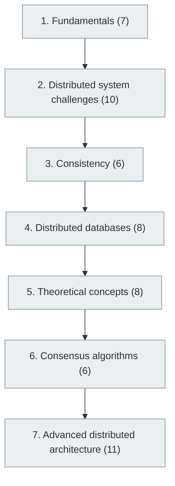

# 22. Distributed Systems

> [Home](../../../README.md) › [Part V — Distributed Systems and System Design](../index.md) › Subject 22

- **Status:** Not started (0 of 56 syllabus topics have a drafted lesson)
- **Source tags:** Advanced software engineering
- **Syllabus size:** 7 chapters, 56 topics

## Introduction

What changes when computation spans machines: partial failure, time, replication, consistency models, consensus, distributed databases and distributed architectures.

## Learning outcomes

After working through this subject you should be able to:

- State the CAP theorem and its limits precisely
- Explain how replication and consensus protocols such as Raft work
- Reason about failure modes and consistency guarantees

## Prerequisites

- [4. Operating Systems](../../01-computer-science-foundations/04-operating-systems/index.md)
- [5. Computer Networking](../../01-computer-science-foundations/05-computer-networking/index.md)
- [9. Data Structures and Algorithms (DSA)](../../02-programming-and-software-development/09-data-structures-and-algorithms/index.md)
- [15. Database Management Systems (DBMS)](../../04-building-software-products/15-database-management-systems/index.md)

## Beginner-to-advanced progression

The chapters below follow the order of the source syllabus, which moves from foundational to advanced material. Colour shows documentation status (grey = not started, amber = in progress, green = drafted or better).

## Chapters and topics

### Chapter 1: Fundamentals

7 topics · status: **Not started**

*Planned location:* `docs/05-distributed-systems-and-system-design/22-distributed-systems/01-fundamentals/`. No lessons yet.

Syllabus topics in this chapter (7)

- `22.01.01` Distributed computing — *not started*
- `22.01.02` Nodes — *not started*
- `22.01.03` Network communication — *not started*
- `22.01.04` Service-to-service communication — *not started*
- `22.01.05` Distributed resources — *not started*
- `22.01.06` Partial failures — *not started*
- `22.01.07` Network partitions — *not started*

### Chapter 2: Distributed system challenges

10 topics · status: **Not started**

*Planned location:* `docs/05-distributed-systems-and-system-design/22-distributed-systems/02-distributed-system-challenges/`. No lessons yet.

Syllabus topics in this chapter (10)

- `22.02.01` Latency — *not started*
- `22.02.02` Clock synchronization — *not started*
- `22.02.03` Clock drift — *not started*
- `22.02.04` Timeouts — *not started*
- `22.02.05` Retries — *not started*
- `22.02.06` Duplicate requests — *not started*
- `22.02.07` Message ordering — *not started*
- `22.02.08` Network failures — *not started*
- `22.02.09` Partial availability — *not started*
- `22.02.10` Split-brain conditions — *not started*

### Chapter 3: Consistency

6 topics · status: **Not started**

*Planned location:* `docs/05-distributed-systems-and-system-design/22-distributed-systems/03-consistency/`. No lessons yet.

Syllabus topics in this chapter (6)

- `22.03.01` Strong consistency — *not started*
- `22.03.02` Eventual consistency — *not started*
- `22.03.03` Causal consistency — *not started*
- `22.03.04` Sequential consistency — *not started*
- `22.03.05` Linearizability — *not started*
- `22.03.06` Read-your-writes consistency — *not started*

### Chapter 4: Distributed databases

8 topics · status: **Not started**

*Planned location:* `docs/05-distributed-systems-and-system-design/22-distributed-systems/04-distributed-databases/`. No lessons yet.

Syllabus topics in this chapter (8)

- `22.04.01` Replication — *not started*
- `22.04.02` Sharding — *not started*
- `22.04.03` Partitioning — *not started*
- `22.04.04` Leader-follower — *not started*
- `22.04.05` Leaderless systems — *not started*
- `22.04.06` Quorum reads and writes — *not started*
- `22.04.07` Conflict resolution — *not started*
- `22.04.08` Distributed transactions — *not started*

### Chapter 5: Theoretical concepts

8 topics · status: **Not started**

*Planned location:* `docs/05-distributed-systems-and-system-design/22-distributed-systems/05-theoretical-concepts/`. No lessons yet.

Syllabus topics in this chapter (8)

- `22.05.01` CAP theorem — *not started*
- `22.05.02` PACELC — *not started*
- `22.05.03` FLP impossibility — *not started*
- `22.05.04` Consensus — *not started*
- `22.05.05` Byzantine fault tolerance — *not started*
- `22.05.06` Failure detectors — *not started*
- `22.05.07` Logical clocks — *not started*
- `22.05.08` Vector clocks — *not started*

### Chapter 6: Consensus algorithms

6 topics · status: **Not started**

*Planned location:* `docs/05-distributed-systems-and-system-design/22-distributed-systems/06-consensus-algorithms/`. No lessons yet.

Syllabus topics in this chapter (6)

- `22.06.01` Paxos — *not started*
- `22.06.02` Raft — *not started*
- `22.06.03` Multi-Paxos — *not started*
- `22.06.04` Byzantine consensus — *not started*
- `22.06.05` Gossip protocols — *not started*
- `22.06.06` Leader election — *not started*

### Chapter 7: Advanced distributed architecture

11 topics · status: **Not started**

*Planned location:* `docs/05-distributed-systems-and-system-design/22-distributed-systems/07-advanced-distributed-architecture/`. No lessons yet.

Syllabus topics in this chapter (11)

- `22.07.01` Service discovery — *not started*
- `22.07.02` Distributed locking — *not started*
- `22.07.03` Distributed caching — *not started*
- `22.07.04` Global load balancing — *not started*
- `22.07.05` Multi-region deployments — *not started*
- `22.07.06` Geo-replication — *not started*
- `22.07.07` Disaster recovery — *not started*
- `22.07.08` Distributed tracing — *not started*
- `22.07.09` Stream processing — *not started*
- `22.07.10` Distributed schedulers — *not started*
- `22.07.11` Federated systems — *not started*

## Recommended reading order

1. Chapter 1 — Fundamentals
2. Chapter 2 — Distributed system challenges
3. Chapter 3 — Consistency
4. Chapter 4 — Distributed databases
5. Chapter 5 — Theoretical concepts
6. Chapter 6 — Consensus algorithms
7. Chapter 7 — Advanced distributed architecture

Within a chapter, read lessons in numeric order. Pick the later chapters only when the earlier ones feel comfortable; the syllabus orders them from fundamental to advanced.

## Related subjects

- [23. System Design](../23-system-design/index.md)
- [24. Cloud Computing](../../06-cloud-devops-and-infrastructure/24-cloud-computing/index.md)
- [27. Site Reliability Engineering (SRE)](../../06-cloud-devops-and-infrastructure/27-site-reliability-engineering/index.md)

## Suggested practical projects

- A replicated key-value store using Raft
- A fault-injection test harness for a toy service

*Full project write-ups (requirements, architecture, stages, tests, extensions) are planned; see [ROADMAP.md](../../../ROADMAP.md).*

---

**Previous subject:** [21. API Integration and Messaging Systems](../../04-building-software-products/21-api-integration-and-messaging-systems/index.md) · **Up:** [Part V](../index.md) · **Next subject:** [23. System Design](../23-system-design/index.md)
