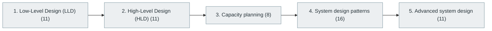

# 23. System Design

> [Home](../../../README.md) › [Part V — Distributed Systems and System Design](../index.md) › Subject 23

- **Status:** Not started (0 of 57 syllabus topics have a drafted lesson)
- **Source tags:** —
- **Syllabus size:** 5 chapters, 57 topics

## Introduction

Designing whole systems: low-level (class and component) design, high-level architecture, capacity planning, common design patterns and advanced scenarios.

> This is a separate skill from simply knowing frameworks.

## Learning outcomes

After working through this subject you should be able to:

- Turn vague requirements into an architecture with justified trade-offs
- Do back-of-the-envelope capacity estimates
- Present and defend a design

## Prerequisites

- [12. Software Design Principles and Architecture](../../03-professional-software-engineering/12-software-design-principles-and-architecture/index.md)
- [15. Database Management Systems (DBMS)](../../04-building-software-products/15-database-management-systems/index.md)
- [22. Distributed Systems](../22-distributed-systems/index.md)

## Beginner-to-advanced progression

The chapters below follow the order of the source syllabus, which moves from foundational to advanced material. Colour shows documentation status (grey = not started, amber = in progress, green = drafted or better).

## Chapters and topics

### Chapter 1: Low-Level Design (LLD)

11 topics · status: **Not started**

*Planned location:* `docs/05-distributed-systems-and-system-design/23-system-design/01-low-level-design-lld/`. No lessons yet.

Syllabus topics in this chapter (11)

- `23.01.01` Object-oriented design — *not started*
- `23.01.02` Class relationships — *not started*
- `23.01.03` Interface design — *not started*
- `23.01.04` SOLID — *not started*
- `23.01.05` Design patterns — *not started*
- `23.01.06` Class diagrams — *not started*
- `23.01.07` Entity modeling — *not started*
- `23.01.08` API contracts — *not started*
- `23.01.09` Component design — *not started*
- `23.01.10` Extensibility — *not started*
- `23.01.11` Reusability — *not started*

### Chapter 2: High-Level Design (HLD)

11 topics · status: **Not started**

*Planned location:* `docs/05-distributed-systems-and-system-design/23-system-design/02-high-level-design-hld/`. No lessons yet.

Syllabus topics in this chapter (11)

- `23.02.01` Requirements — *not started*
- `23.02.02` Architecture selection — *not started*
- `23.02.03` Component identification — *not started*
- `23.02.04` Service boundaries — *not started*
- `23.02.05` Database selection — *not started*
- `23.02.06` Caching strategy — *not started*
- `23.02.07` Load balancing — *not started*
- `23.02.08` Message queues — *not started*
- `23.02.09` Network architecture — *not started*
- `23.02.10` Scaling strategy — *not started*
- `23.02.11` Reliability design — *not started*

### Chapter 3: Capacity planning

8 topics · status: **Not started**

*Planned location:* `docs/05-distributed-systems-and-system-design/23-system-design/03-capacity-planning/`. No lessons yet.

Syllabus topics in this chapter (8)

- `23.03.01` Traffic estimation — *not started*
- `23.03.02` Requests per second — *not started*
- `23.03.03` Daily active users — *not started*
- `23.03.04` Storage estimation — *not started*
- `23.03.05` Bandwidth estimation — *not started*
- `23.03.06` Read/write ratios — *not started*
- `23.03.07` Peak load — *not started*
- `23.03.08` Resource utilization — *not started*

### Chapter 4: System design patterns

16 topics · status: **Not started**

*Planned location:* `docs/05-distributed-systems-and-system-design/23-system-design/04-system-design-patterns/`. No lessons yet.

Syllabus topics in this chapter (16)

- `23.04.01` URL shortener — *not started*
- `23.04.02` Social media platform — *not started*
- `23.04.03` Chat application — *not started*
- `23.04.04` Video streaming — *not started*
- `23.04.05` File storage — *not started*
- `23.04.06` Notification platform — *not started*
- `23.04.07` Payment platform — *not started*
- `23.04.08` Ride booking — *not started*
- `23.04.09` E-commerce system — *not started*
- `23.04.10` Search engine — *not started*
- `23.04.11` Recommendation system — *not started*
- `23.04.12` News feed — *not started*
- `23.04.13` Real-time collaboration — *not started*
- `23.04.14` Distributed task scheduler — *not started*
- `23.04.15` Logging platform — *not started*
- `23.04.16` Rate limiter — *not started*

### Chapter 5: Advanced system design

11 topics · status: **Not started**

*Planned location:* `docs/05-distributed-systems-and-system-design/23-system-design/05-advanced-system-design/`. No lessons yet.

Syllabus topics in this chapter (11)

- `23.05.01` Multi-region architecture — *not started*
- `23.05.02` Active-active systems — *not started*
- `23.05.03` Active-passive systems — *not started*
- `23.05.04` Global consistency — *not started*
- `23.05.05` Multi-tenant systems — *not started*
- `23.05.06` Event-driven systems — *not started*
- `23.05.07` Serverless architecture — *not started*
- `23.05.08` Fault isolation — *not started*
- `23.05.09` Resilience engineering — *not started*
- `23.05.10` Cost-aware architecture — *not started*
- `23.05.11` Data-intensive architecture — *not started*

## Recommended reading order

1. Chapter 1 — Low-Level Design (LLD)
2. Chapter 2 — High-Level Design (HLD)
3. Chapter 3 — Capacity planning
4. Chapter 4 — System design patterns
5. Chapter 5 — Advanced system design

Within a chapter, read lessons in numeric order. Pick the later chapters only when the earlier ones feel comfortable; the syllabus orders them from fundamental to advanced.

## Related subjects

- [16. Backend Development](../../04-building-software-products/16-backend-development/index.md)
- [24. Cloud Computing](../../06-cloud-devops-and-infrastructure/24-cloud-computing/index.md)
- [29. Performance Engineering](../../06-cloud-devops-and-infrastructure/29-performance-engineering/index.md)

## Suggested practical projects

- A design document for a chat system
- A distributed cache design with an implementation sketch

*Full project write-ups (requirements, architecture, stages, tests, extensions) are planned; see [ROADMAP.md](../../../ROADMAP.md).*

---

**Previous subject:** [22. Distributed Systems](../22-distributed-systems/index.md) · **Up:** [Part V](../index.md) · **Next subject:** [24. Cloud Computing](../../06-cloud-devops-and-infrastructure/24-cloud-computing/index.md)
