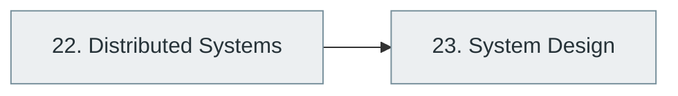

# Part V — Distributed Systems and System Design

> [Home](../../README.md) › Part V

**Status:** Not started

What changes when software runs on many machines, and how to design systems that stay correct, available and scalable.

## Subjects in this part

| # | Subject | What it covers | Topics | Status |
| --- | --- | --- | --- | --- |
| 22 | [Distributed Systems](22-distributed-systems/index.md) | What changes when computation spans machines: partial failure, time, replication, consistency models, consensus, distributed databases and distributed architectures. | 56 | Not started |
| 23 | [System Design](23-system-design/index.md) | Designing whole systems: low-level (class and component) design, high-level architecture, capacity planning, common design patterns and advanced scenarios. | 57 | Not started |

## How the subjects depend on each other

Solid arrows point from a prerequisite to the subject that builds on it. Only dependencies inside this part are drawn.

## What you need from other parts

| Subject in this part | Prerequisite elsewhere |
| --- | --- |
| [22. Distributed Systems](22-distributed-systems/index.md) | [4. Operating Systems](../01-computer-science-foundations/04-operating-systems/index.md) |
| [22. Distributed Systems](22-distributed-systems/index.md) | [5. Computer Networking](../01-computer-science-foundations/05-computer-networking/index.md) |
| [22. Distributed Systems](22-distributed-systems/index.md) | [9. Data Structures and Algorithms (DSA)](../02-programming-and-software-development/09-data-structures-and-algorithms/index.md) |
| [22. Distributed Systems](22-distributed-systems/index.md) | [15. Database Management Systems (DBMS)](../04-building-software-products/15-database-management-systems/index.md) |
| [23. System Design](23-system-design/index.md) | [12. Software Design Principles and Architecture](../03-professional-software-engineering/12-software-design-principles-and-architecture/index.md) |
| [23. System Design](23-system-design/index.md) | [15. Database Management Systems (DBMS)](../04-building-software-products/15-database-management-systems/index.md) |

---

**Previous part:** [Part IV](../04-building-software-products/index.md) · **Up:** [Master index](../../MASTER-INDEX.md) · **Next part:** [Part VI](../06-cloud-devops-and-infrastructure/index.md)
