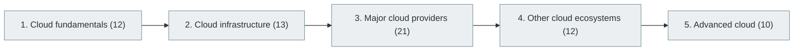

# 24. Cloud Computing

> [Home](../../../README.md) › [Part VI — Cloud, DevOps and Infrastructure](../index.md) › Subject 24

- **Status:** Not started (0 of 68 syllabus topics have a drafted lesson)
- **Source tags:** —
- **Syllabus size:** 5 chapters, 68 topics

## Introduction

Cloud fundamentals and infrastructure, the three major providers (AWS, Azure, Google Cloud), other ecosystems and advanced cloud engineering.

## Learning outcomes

After working through this subject you should be able to:

- Explain IaaS, PaaS, SaaS and the shared-responsibility model
- Build a small multi-tier deployment on a cloud provider
- Estimate and control cloud cost

## Prerequisites

- [4. Operating Systems](../../01-computer-science-foundations/04-operating-systems/index.md)
- [5. Computer Networking](../../01-computer-science-foundations/05-computer-networking/index.md)

## Beginner-to-advanced progression

The chapters below follow the order of the source syllabus, which moves from foundational to advanced material. Colour shows documentation status (grey = not started, amber = in progress, green = drafted or better).

## Chapters and topics

### Chapter 1: Cloud fundamentals

12 topics · status: **Not started**

*Planned location:* `docs/06-cloud-devops-and-infrastructure/24-cloud-computing/01-cloud-fundamentals/`. No lessons yet.

Syllabus topics in this chapter (12)

- `24.01.01` What is cloud computing? — *not started*
- `24.01.02` IaaS — *not started*
- `24.01.03` PaaS — *not started*
- `24.01.04` SaaS — *not started*
- `24.01.05` FaaS — *not started*
- `24.01.06` Public cloud — *not started*
- `24.01.07` Private cloud — *not started*
- `24.01.08` Hybrid cloud — *not started*
- `24.01.09` Multi-cloud — *not started*
- `24.01.10` Cloud regions — *not started*
- `24.01.11` Availability zones — *not started*
- `24.01.12` Edge computing — *not started*

### Chapter 2: Cloud infrastructure

13 topics · status: **Not started**

*Planned location:* `docs/06-cloud-devops-and-infrastructure/24-cloud-computing/02-cloud-infrastructure/`. No lessons yet.

Syllabus topics in this chapter (13)

- `24.02.01` Virtual machines — *not started*
- `24.02.02` Storage — *not started*
- `24.02.03` Networking — *not started*
- `24.02.04` Load balancers — *not started*
- `24.02.05` Firewalls — *not started*
- `24.02.06` DNS — *not started*
- `24.02.07` CDNs — *not started*
- `24.02.08` IAM — *not started*
- `24.02.09` Secrets — *not started*
- `24.02.10` Autoscaling — *not started*
- `24.02.11` Monitoring — *not started*
- `24.02.12` Billing — *not started*
- `24.02.13` Disaster recovery — *not started*

### Chapter 3: Major cloud providers

21 topics · status: **Not started**

*Planned location:* `docs/06-cloud-devops-and-infrastructure/24-cloud-computing/03-major-cloud-providers/`. No lessons yet.

Syllabus topics in this chapter (21)

- `24.03.01` **Amazon Web Services** — EC2, S3, RDS, Lambda, EKS, DynamoDB, CloudFront, SQS — *not started*
- `24.03.02` EC2 *(service of Amazon Web Services)* — *not started*
- `24.03.03` S3 *(service of Amazon Web Services)* — *not started*
- `24.03.04` RDS *(service of Amazon Web Services)* — *not started*
- `24.03.05` Lambda *(service of Amazon Web Services)* — *not started*
- `24.03.06` EKS *(service of Amazon Web Services)* — *not started*
- `24.03.07` DynamoDB *(service of Amazon Web Services)* — *not started*
- `24.03.08` CloudFront *(service of Amazon Web Services)* — *not started*
- `24.03.09` SQS *(service of Amazon Web Services)* — *not started*
- `24.03.10` **Microsoft Azure** — Virtual Machines, Blob Storage, Functions, AKS, Azure SQL — *not started*
- `24.03.11` Virtual Machines *(service of Microsoft Azure)* — *not started*
- `24.03.12` Blob Storage *(service of Microsoft Azure)* — *not started*
- `24.03.13` Functions *(service of Microsoft Azure)* — *not started*
- `24.03.14` AKS *(service of Microsoft Azure)* — *not started*
- `24.03.15` Azure SQL *(service of Microsoft Azure)* — *not started*
- `24.03.16` **Google Cloud** — Compute Engine, GKE, Cloud Run, BigQuery, Cloud Storage — *not started*
- `24.03.17` Compute Engine *(service of Google Cloud)* — *not started*
- `24.03.18` GKE *(service of Google Cloud)* — *not started*
- `24.03.19` Cloud Run *(service of Google Cloud)* — *not started*
- `24.03.20` BigQuery *(service of Google Cloud)* — *not started*
- `24.03.21` Cloud Storage *(service of Google Cloud)* — *not started*

### Chapter 4: Other cloud ecosystems

12 topics · status: **Not started**

*Planned location:* `docs/06-cloud-devops-and-infrastructure/24-cloud-computing/04-other-cloud-ecosystems/`. No lessons yet.

Syllabus topics in this chapter (12)

- `24.04.01` Oracle Cloud — *not started*
- `24.04.02` IBM Cloud — *not started*
- `24.04.03` Alibaba Cloud — *not started*
- `24.04.04` DigitalOcean — *not started*
- `24.04.05` Cloudflare — *not started*
- `24.04.06` Akamai — *not started*
- `24.04.07` OVHcloud — *not started*
- `24.04.08` Hetzner — *not started*
- `24.04.09` Vercel — *not started*
- `24.04.10` Netlify — *not started*
- `24.04.11` Fly.io — *not started*
- `24.04.12` Render — *not started*

### Chapter 5: Advanced cloud

10 topics · status: **Not started**

*Planned location:* `docs/06-cloud-devops-and-infrastructure/24-cloud-computing/05-advanced-cloud/`. No lessons yet.

Syllabus topics in this chapter (10)

- `24.05.01` Cloud-native architecture — *not started*
- `24.05.02` Hybrid networking — *not started*
- `24.05.03` Multi-cloud architecture — *not started*
- `24.05.04` Cloud migration — *not started*
- `24.05.05` Cloud security — *not started*
- `24.05.06` Cloud governance — *not started*
- `24.05.07` Cloud cost optimization — *not started*
- `24.05.08` Cloud automation — *not started*
- `24.05.09` Cloud-native databases — *not started*
- `24.05.10` Cloud-native AI infrastructure — *not started*

## Recommended reading order

1. Chapter 1 — Cloud fundamentals
2. Chapter 2 — Cloud infrastructure
3. Chapter 3 — Major cloud providers
4. Chapter 4 — Other cloud ecosystems
5. Chapter 5 — Advanced cloud

Within a chapter, read lessons in numeric order. Pick the later chapters only when the earlier ones feel comfortable; the syllabus orders them from fundamental to advanced.

## Related subjects

- [25. Containers and Container Orchestration](../25-containers-and-orchestration/index.md)
- [26. DevOps Engineering](../26-devops-engineering/index.md)
- [31. Cybersecurity and Software Security](../../07-software-quality-and-cybersecurity/31-cybersecurity-and-software-security/index.md)

## Suggested practical projects

- A three-tier application deployed to one provider
- A cost and architecture comparison across providers

*Full project write-ups (requirements, architecture, stages, tests, extensions) are planned; see [ROADMAP.md](../../../ROADMAP.md).*

---

**Previous subject:** [23. System Design](../../05-distributed-systems-and-system-design/23-system-design/index.md) · **Up:** [Part VI](../index.md) · **Next subject:** [25. Containers and Container Orchestration](../25-containers-and-orchestration/index.md)
