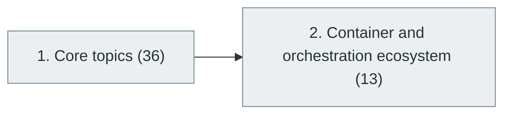

# 25. Containers and Container Orchestration

> [Home](../../../README.md) › [Part VI — Cloud, DevOps and Infrastructure](../index.md) › Subject 25

- **Status:** Not started (0 of 49 syllabus topics have a drafted lesson)
- **Source tags:** —
- **Syllabus size:** 2 chapters, 49 topics

## Introduction

Containers, images and Docker, then Kubernetes and the surrounding orchestration ecosystem.

## Learning outcomes

After working through this subject you should be able to:

- Explain what a container is at the operating-system level
- Write efficient, secure Dockerfiles
- Deploy and operate an application on Kubernetes

## Prerequisites

- [4. Operating Systems](../../01-computer-science-foundations/04-operating-systems/index.md)
- [24. Cloud Computing](../24-cloud-computing/index.md)

## Beginner-to-advanced progression

The chapters below follow the order of the source syllabus, which moves from foundational to advanced material. Colour shows documentation status (grey = not started, amber = in progress, green = drafted or better).

## Chapters and topics

### Chapter 1: Core topics

36 topics · status: **Not started** · *heading synthesized (not in source)*

*Planned location:* `docs/06-cloud-devops-and-infrastructure/25-containers-and-orchestration/01-core-topics/`. No lessons yet.

Syllabus topics in this chapter (36)

- `25.01.01` Virtualization — *not started*
- `25.01.02` Hypervisors — *not started*
- `25.01.03` Virtual machines — *not started*
- `25.01.04` Container fundamentals — *not started*
- `25.01.05` Docker — *not started*
- `25.01.06` Docker images — *not started*
- `25.01.07` Dockerfiles — *not started*
- `25.01.08` Docker Compose — *not started*
- `25.01.09` Container registries — *not started*
- `25.01.10` Container networking — *not started*
- `25.01.11` Container storage — *not started*
- `25.01.12` Container security — *not started*
- `25.01.13` Image scanning — *not started*
- `25.01.14` Kubernetes — *not started*
- `25.01.15` Pods — *not started*
- `25.01.16` Deployments — *not started*
- `25.01.17` ReplicaSets — *not started*
- `25.01.18` Services — *not started*
- `25.01.19` ConfigMaps — *not started*
- `25.01.20` Secrets — *not started*
- `25.01.21` Namespaces — *not started*
- `25.01.22` Ingress — *not started*
- `25.01.23` Persistent volumes — *not started*
- `25.01.24` StatefulSets — *not started*
- `25.01.25` DaemonSets — *not started*
- `25.01.26` Jobs — *not started*
- `25.01.27` CronJobs — *not started*
- `25.01.28` Helm — *not started*
- `25.01.29` Kustomize — *not started*
- `25.01.30` Operators — *not started*
- `25.01.31` Custom resources — *not started*
- `25.01.32` Kubernetes networking — *not started*
- `25.01.33` Kubernetes scheduling — *not started*
- `25.01.34` Cluster autoscaling — *not started*
- `25.01.35` Federation — *not started*
- `25.01.36` Multi-cluster management — *not started*

### Chapter 2: Container and orchestration ecosystem

13 topics · status: **Not started**

*Planned location:* `docs/06-cloud-devops-and-infrastructure/25-containers-and-orchestration/02-container-and-orchestration-ecosystem/`. No lessons yet.

Syllabus topics in this chapter (13)

- `25.02.01` Docker — *not started*
- `25.02.02` Podman — *not started*
- `25.02.03` containerd — *not started*
- `25.02.04` CRI-O — *not started*
- `25.02.05` Kubernetes — *not started*
- `25.02.06` OpenShift — *not started*
- `25.02.07` Amazon EKS — *not started*
- `25.02.08` Azure AKS — *not started*
- `25.02.09` Google GKE — *not started*
- `25.02.10` Nomad — *not started*
- `25.02.11` Rancher — *not started*
- `25.02.12` Helm — *not started*
- `25.02.13` K3s — *not started*

## Recommended reading order

1. Chapter 1 — Core topics
2. Chapter 2 — Container and orchestration ecosystem

Within a chapter, read lessons in numeric order. Pick the later chapters only when the earlier ones feel comfortable; the syllabus orders them from fundamental to advanced.

## Related subjects

- [26. DevOps Engineering](../26-devops-engineering/index.md)
- [27. Site Reliability Engineering (SRE)](../27-site-reliability-engineering/index.md)

## Suggested practical projects

- A multi-container application with Compose
- A Kubernetes deployment with health checks and autoscaling

*Full project write-ups (requirements, architecture, stages, tests, extensions) are planned; see [ROADMAP.md](../../../ROADMAP.md).*

---

**Previous subject:** [24. Cloud Computing](../24-cloud-computing/index.md) · **Up:** [Part VI](../index.md) · **Next subject:** [26. DevOps Engineering](../26-devops-engineering/index.md)
