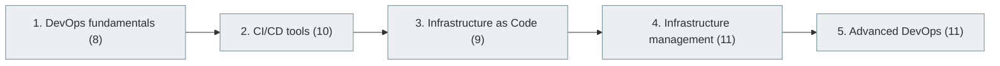

# 26. DevOps Engineering

> [Home](../../../README.md) › [Part VI — Cloud, DevOps and Infrastructure](../index.md) › Subject 26

- **Status:** Not started (0 of 49 syllabus topics have a drafted lesson)
- **Source tags:** —
- **Syllabus size:** 5 chapters, 49 topics

## Introduction

DevOps culture and practice: CI/CD, infrastructure as code, infrastructure management and advanced DevOps.

## Learning outcomes

After working through this subject you should be able to:

- Build a CI/CD pipeline from commit to deployment
- Manage infrastructure with code and review it like code
- Release safely with progressive delivery

## Prerequisites

- [13. Version Control and Developer Workflow](../../03-professional-software-engineering/13-version-control-and-developer-workflow/index.md)
- [24. Cloud Computing](../24-cloud-computing/index.md)
- [25. Containers and Container Orchestration](../25-containers-and-orchestration/index.md)

## Beginner-to-advanced progression

The chapters below follow the order of the source syllabus, which moves from foundational to advanced material. Colour shows documentation status (grey = not started, amber = in progress, green = drafted or better).

## Chapters and topics

### Chapter 1: DevOps fundamentals

8 topics · status: **Not started**

*Planned location:* `docs/06-cloud-devops-and-infrastructure/26-devops-engineering/01-devops-fundamentals/`. No lessons yet.

Syllabus topics in this chapter (8)

- `26.01.01` Development and operations collaboration — *not started*
- `26.01.02` Infrastructure automation — *not started*
- `26.01.03` Continuous integration — *not started*
- `26.01.04` Continuous delivery — *not started*
- `26.01.05` Continuous deployment — *not started*
- `26.01.06` Continuous testing — *not started*
- `26.01.07` Release engineering — *not started*
- `26.01.08` Configuration management — *not started*

### Chapter 2: CI/CD tools

10 topics · status: **Not started**

*Planned location:* `docs/06-cloud-devops-and-infrastructure/26-devops-engineering/02-ci-cd-tools/`. No lessons yet.

Syllabus topics in this chapter (10)

- `26.02.01` GitHub Actions — *not started*
- `26.02.02` GitLab CI/CD — *not started*
- `26.02.03` Jenkins — *not started*
- `26.02.04` CircleCI — *not started*
- `26.02.05` Travis CI — *not started*
- `26.02.06` Azure Pipelines — *not started*
- `26.02.07` Buildkite — *not started*
- `26.02.08` TeamCity — *not started*
- `26.02.09` Argo CD — *not started*
- `26.02.10` Flux CD — *not started*

### Chapter 3: Infrastructure as Code

9 topics · status: **Not started**

*Planned location:* `docs/06-cloud-devops-and-infrastructure/26-devops-engineering/03-infrastructure-as-code/`. No lessons yet.

Syllabus topics in this chapter (9)

- `26.03.01` Terraform — *not started*
- `26.03.02` OpenTofu — *not started*
- `26.03.03` Pulumi — *not started*
- `26.03.04` AWS CloudFormation — *not started*
- `26.03.05` Azure Bicep — *not started*
- `26.03.06` Ansible — *not started*
- `26.03.07` Chef — *not started*
- `26.03.08` Puppet — *not started*
- `26.03.09` Salt — *not started*

### Chapter 4: Infrastructure management

11 topics · status: **Not started**

*Planned location:* `docs/06-cloud-devops-and-infrastructure/26-devops-engineering/04-infrastructure-management/`. No lessons yet.

Syllabus topics in this chapter (11)

- `26.04.01` Environment provisioning — *not started*
- `26.04.02` Configuration management — *not started*
- `26.04.03` Secrets management — *not started*
- `26.04.04` Certificate management — *not started*
- `26.04.05` Automated deployments — *not started*
- `26.04.06` Blue-green deployment — *not started*
- `26.04.07` Canary deployment — *not started*
- `26.04.08` Rolling deployment — *not started*
- `26.04.09` Rollbacks — *not started*
- `26.04.10` GitOps — *not started*
- `26.04.11` Immutable infrastructure — *not started*

### Chapter 5: Advanced DevOps

11 topics · status: **Not started**

*Planned location:* `docs/06-cloud-devops-and-infrastructure/26-devops-engineering/05-advanced-devops/`. No lessons yet.

Syllabus topics in this chapter (11)

- `26.05.01` Platform engineering — *not started*
- `26.05.02` Internal developer platforms — *not started*
- `26.05.03` Developer portals — *not started*
- `26.05.04` Golden paths — *not started*
- `26.05.05` Infrastructure automation — *not started*
- `26.05.06` Policy as Code — *not started*
- `26.05.07` Software supply chain management — *not started*
- `26.05.08` Artifact management — *not started*
- `26.05.09` Deployment orchestration — *not started*
- `26.05.10` Environment management — *not started*
- `26.05.11` DevSecOps — *not started*

## Recommended reading order

1. Chapter 1 — DevOps fundamentals
2. Chapter 2 — CI/CD tools
3. Chapter 3 — Infrastructure as Code
4. Chapter 4 — Infrastructure management
5. Chapter 5 — Advanced DevOps

Within a chapter, read lessons in numeric order. Pick the later chapters only when the earlier ones feel comfortable; the syllabus orders them from fundamental to advanced.

## Related subjects

- [27. Site Reliability Engineering (SRE)](../27-site-reliability-engineering/index.md)
- [28. Observability and Monitoring](../28-observability-and-monitoring/index.md)
- [30. Software Testing and Quality Assurance](../../07-software-quality-and-cybersecurity/30-software-testing-and-quality-assurance/index.md)

## Suggested practical projects

- A pipeline that builds, tests and deploys a container
- Infrastructure as code for a small environment

*Full project write-ups (requirements, architecture, stages, tests, extensions) are planned; see [ROADMAP.md](../../../ROADMAP.md).*

---

**Previous subject:** [25. Containers and Container Orchestration](../25-containers-and-orchestration/index.md) · **Up:** [Part VI](../index.md) · **Next subject:** [27. Site Reliability Engineering (SRE)](../27-site-reliability-engineering/index.md)
