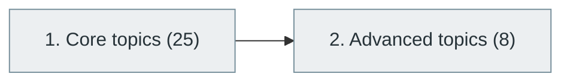

# 28. Observability and Monitoring

> [Home](../../../README.md) › [Part VI — Cloud, DevOps and Infrastructure](../index.md) › Subject 28

- **Status:** Not started (0 of 33 syllabus topics have a drafted lesson)
- **Source tags:** —
- **Syllabus size:** 2 chapters, 33 topics

## Introduction

Metrics, logs and traces, alerting, dashboards and the tooling that makes running systems understandable.

## Learning outcomes

After working through this subject you should be able to:

- Instrument a service with metrics, logs and traces
- Design alerts that signal real problems
- Control telemetry cost and cardinality

## Prerequisites

- [16. Backend Development](../../04-building-software-products/16-backend-development/index.md)

## Beginner-to-advanced progression

The chapters below follow the order of the source syllabus, which moves from foundational to advanced material. Colour shows documentation status (grey = not started, amber = in progress, green = drafted or better).

## Chapters and topics

### Chapter 1: Core topics

25 topics · status: **Not started** · *heading synthesized (not in source)*

*Planned location:* `docs/06-cloud-devops-and-infrastructure/28-observability-and-monitoring/01-core-topics/`. No lessons yet.

Syllabus topics in this chapter (25)

- `28.01.01` Application logging — *not started*
- `28.01.02` Structured logging — *not started*
- `28.01.03` Log aggregation — *not started*
- `28.01.04` Metrics — *not started*
- `28.01.05` Distributed tracing — *not started*
- `28.01.06` Profiling — *not started*
- `28.01.07` Error tracking — *not started*
- `28.01.08` Alerting — *not started*
- `28.01.09` Dashboards — *not started*
- `28.01.10` Health checks — *not started*
- `28.01.11` Synthetic monitoring — *not started*
- `28.01.12` Real-user monitoring — *not started*
- `28.01.13` OpenTelemetry — *not started*
- `28.01.14` Prometheus — *not started*
- `28.01.15` Grafana — *not started*
- `28.01.16` Loki — *not started*
- `28.01.17` Jaeger — *not started*
- `28.01.18` Tempo — *not started*
- `28.01.19` ELK Stack — *not started*
- `28.01.20` OpenSearch — *not started*
- `28.01.21` Datadog — *not started*
- `28.01.22` New Relic — *not started*
- `28.01.23` Splunk — *not started*
- `28.01.24` Sentry — *not started*
- `28.01.25` PagerDuty — *not started*

### Chapter 2: Advanced topics

8 topics · status: **Not started**

*Planned location:* `docs/06-cloud-devops-and-infrastructure/28-observability-and-monitoring/02-advanced-topics/`. No lessons yet.

Syllabus topics in this chapter (8)

- `28.02.01` Cardinality management — *not started*
- `28.02.02` Trace sampling — *not started*
- `28.02.03` Service maps — *not started*
- `28.02.04` Correlation IDs — *not started*
- `28.02.05` Telemetry pipelines — *not started*
- `28.02.06` Anomaly detection — *not started*
- `28.02.07` AIOps — *not started*
- `28.02.08` Automated remediation — *not started*

## Recommended reading order

1. Chapter 1 — Core topics
2. Chapter 2 — Advanced topics

Within a chapter, read lessons in numeric order. Pick the later chapters only when the earlier ones feel comfortable; the syllabus orders them from fundamental to advanced.

## Related subjects

- [26. DevOps Engineering](../26-devops-engineering/index.md)
- [27. Site Reliability Engineering (SRE)](../27-site-reliability-engineering/index.md)
- [29. Performance Engineering](../29-performance-engineering/index.md)

## Suggested practical projects

- An OpenTelemetry-instrumented service
- A dashboard and alert set for a demo application

*Full project write-ups (requirements, architecture, stages, tests, extensions) are planned; see [ROADMAP.md](../../../ROADMAP.md).*

---

**Previous subject:** [27. Site Reliability Engineering (SRE)](../27-site-reliability-engineering/index.md) · **Up:** [Part VI](../index.md) · **Next subject:** [29. Performance Engineering](../29-performance-engineering/index.md)
