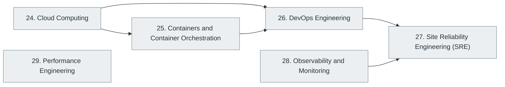

# Part VI — Cloud, DevOps and Infrastructure

> [Home](../../README.md) › Part VI

**Status:** Not started

Running software in production: cloud platforms, containers, delivery pipelines, reliability engineering, observability and performance.

## Subjects in this part

| # | Subject | What it covers | Topics | Status |
| --- | --- | --- | --- | --- |
| 24 | [Cloud Computing](24-cloud-computing/index.md) | Cloud fundamentals and infrastructure, the three major providers (AWS, Azure, Google Cloud), other ecosystems and advanced cloud engineering. | 68 | Not started |
| 25 | [Containers and Container Orchestration](25-containers-and-orchestration/index.md) | Containers, images and Docker, then Kubernetes and the surrounding orchestration ecosystem. | 49 | Not started |
| 26 | [DevOps Engineering](26-devops-engineering/index.md) | DevOps culture and practice: CI/CD, infrastructure as code, infrastructure management and advanced DevOps. | 49 | Not started |
| 27 | [Site Reliability Engineering (SRE)](27-site-reliability-engineering/index.md) | Reliability as an engineering discipline: service-level objectives, error budgets, incident response, capacity and toil reduction. | 27 | Not started |
| 28 | [Observability and Monitoring](28-observability-and-monitoring/index.md) | Metrics, logs and traces, alerting, dashboards and the tooling that makes running systems understandable. | 33 | Not started |
| 29 | [Performance Engineering](29-performance-engineering/index.md) | Measuring and improving performance: profiling, benchmarking, load and stress testing, tuning across the stack and capacity. | 21 | Not started |

## How the subjects depend on each other

Solid arrows point from a prerequisite to the subject that builds on it. Only dependencies inside this part are drawn.

## What you need from other parts

| Subject in this part | Prerequisite elsewhere |
| --- | --- |
| [24. Cloud Computing](24-cloud-computing/index.md) | [4. Operating Systems](../01-computer-science-foundations/04-operating-systems/index.md) |
| [24. Cloud Computing](24-cloud-computing/index.md) | [5. Computer Networking](../01-computer-science-foundations/05-computer-networking/index.md) |
| [25. Containers and Container Orchestration](25-containers-and-orchestration/index.md) | [4. Operating Systems](../01-computer-science-foundations/04-operating-systems/index.md) |
| [26. DevOps Engineering](26-devops-engineering/index.md) | [13. Version Control and Developer Workflow](../03-professional-software-engineering/13-version-control-and-developer-workflow/index.md) |
| [27. Site Reliability Engineering (SRE)](27-site-reliability-engineering/index.md) | [22. Distributed Systems](../05-distributed-systems-and-system-design/22-distributed-systems/index.md) |
| [28. Observability and Monitoring](28-observability-and-monitoring/index.md) | [16. Backend Development](../04-building-software-products/16-backend-development/index.md) |
| [29. Performance Engineering](29-performance-engineering/index.md) | [3. Digital Logic and Computer Organization](../01-computer-science-foundations/03-digital-logic-and-computer-organization/index.md) |
| [29. Performance Engineering](29-performance-engineering/index.md) | [4. Operating Systems](../01-computer-science-foundations/04-operating-systems/index.md) |
| [29. Performance Engineering](29-performance-engineering/index.md) | [9. Data Structures and Algorithms (DSA)](../02-programming-and-software-development/09-data-structures-and-algorithms/index.md) |

---

**Previous part:** [Part V](../05-distributed-systems-and-system-design/index.md) · **Up:** [Master index](../../MASTER-INDEX.md) · **Next part:** [Part VII](../07-software-quality-and-cybersecurity/index.md)
