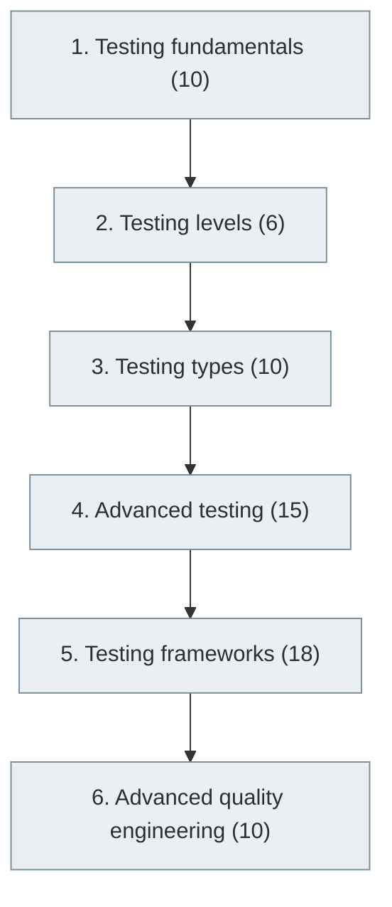

# 30. Software Testing and Quality Assurance

> [Home](../../../README.md) › [Part VII — Software Quality and Cybersecurity](../index.md) › Subject 30

- **Status:** Not started (0 of 69 syllabus topics have a drafted lesson)
- **Source tags:** Essential
- **Syllabus size:** 6 chapters, 69 topics

## Introduction

Testing fundamentals, levels and types, advanced testing, test frameworks and quality engineering.

## Learning outcomes

After working through this subject you should be able to:

- Design effective unit, integration and end-to-end tests
- Use mocks, fixtures and property-based testing appropriately
- Measure and improve test quality

## Prerequisites

- [6. Programming Fundamentals](../../02-programming-and-software-development/06-programming-fundamentals/index.md)
- [11. Software Development Lifecycle (SDLC)](../../03-professional-software-engineering/11-software-development-lifecycle/index.md)

## Beginner-to-advanced progression

The chapters below follow the order of the source syllabus, which moves from foundational to advanced material. Colour shows documentation status (grey = not started, amber = in progress, green = drafted or better).

## Chapters and topics

### Chapter 1: Testing fundamentals

10 topics · status: **Not started**

*Planned location:* `docs/07-software-quality-and-cybersecurity/30-software-testing-and-quality-assurance/01-testing-fundamentals/`. No lessons yet.

Syllabus topics in this chapter (10)

- `30.01.01` Verification vs validation — *not started*
- `30.01.02` Test cases — *not started*
- `30.01.03` Test scenarios — *not started*
- `30.01.04` Test data — *not started*
- `30.01.05` Test coverage — *not started*
- `30.01.06` Assertions — *not started*
- `30.01.07` Defects — *not started*
- `30.01.08` Bugs — *not started*
- `30.01.09` Test plans — *not started*
- `30.01.10` Test strategies — *not started*

### Chapter 2: Testing levels

6 topics · status: **Not started**

*Planned location:* `docs/07-software-quality-and-cybersecurity/30-software-testing-and-quality-assurance/02-testing-levels/`. No lessons yet.

Syllabus topics in this chapter (6)

- `30.02.01` Unit testing — *not started*
- `30.02.02` Integration testing — *not started*
- `30.02.03` Component testing — *not started*
- `30.02.04` System testing — *not started*
- `30.02.05` Acceptance testing — *not started*
- `30.02.06` End-to-end testing — *not started*

### Chapter 3: Testing types

10 topics · status: **Not started**

*Planned location:* `docs/07-software-quality-and-cybersecurity/30-software-testing-and-quality-assurance/03-testing-types/`. No lessons yet.

Syllabus topics in this chapter (10)

- `30.03.01` Functional testing — *not started*
- `30.03.02` Non-functional testing — *not started*
- `30.03.03` Regression testing — *not started*
- `30.03.04` Smoke testing — *not started*
- `30.03.05` Sanity testing — *not started*
- `30.03.06` Exploratory testing — *not started*
- `30.03.07` Compatibility testing — *not started*
- `30.03.08` Cross-browser testing — *not started*
- `30.03.09` Accessibility testing — *not started*
- `30.03.10` Localization testing — *not started*

### Chapter 4: Advanced testing

15 topics · status: **Not started**

*Planned location:* `docs/07-software-quality-and-cybersecurity/30-software-testing-and-quality-assurance/04-advanced-testing/`. No lessons yet.

Syllabus topics in this chapter (15)

- `30.04.01` Load testing — *not started*
- `30.04.02` Stress testing — *not started*
- `30.04.03` Spike testing — *not started*
- `30.04.04` Soak testing — *not started*
- `30.04.05` Chaos testing — *not started*
- `30.04.06` Security testing — *not started*
- `30.04.07` Fuzz testing — *not started*
- `30.04.08` Mutation testing — *not started*
- `30.04.09` Property-based testing — *not started*
- `30.04.10` Snapshot testing — *not started*
- `30.04.11` Contract testing — *not started*
- `30.04.12` Visual regression testing — *not started*
- `30.04.13` Differential testing — *not started*
- `30.04.14` Metamorphic testing — *not started*
- `30.04.15` Formal verification — *not started*

### Chapter 5: Testing frameworks

18 topics · status: **Not started**

*Planned location:* `docs/07-software-quality-and-cybersecurity/30-software-testing-and-quality-assurance/05-testing-frameworks/`. No lessons yet.

Syllabus topics in this chapter (18)

- `30.05.01` JUnit — *not started*
- `30.05.02` TestNG — *not started*
- `30.05.03` PyTest — *not started*
- `30.05.04` Unittest — *not started*
- `30.05.05` Jest — *not started*
- `30.05.06` Vitest — *not started*
- `30.05.07` Mocha — *not started*
- `30.05.08` Cypress — *not started*
- `30.05.09` Playwright — *not started*
- `30.05.10` Selenium — *not started*
- `30.05.11` Appium — *not started*
- `30.05.12` Robot Framework — *not started*
- `30.05.13` Postman — *not started*
- `30.05.14` REST Assured — *not started*
- `30.05.15` k6 — *not started*
- `30.05.16` JMeter — *not started*
- `30.05.17` Gatling — *not started*
- `30.05.18` Locust — *not started*

### Chapter 6: Advanced quality engineering

10 topics · status: **Not started**

*Planned location:* `docs/07-software-quality-and-cybersecurity/30-software-testing-and-quality-assurance/06-advanced-quality-engineering/`. No lessons yet.

Syllabus topics in this chapter (10)

- `30.06.01` Test automation — *not started*
- `30.06.02` Continuous testing — *not started*
- `30.06.03` Test pyramid — *not started*
- `30.06.04` Test coverage analysis — *not started*
- `30.06.05` Flaky test management — *not started*
- `30.06.06` Test data management — *not started*
- `30.06.07` Quality gates — *not started*
- `30.06.08` Shift-left testing — *not started*
- `30.06.09` Risk-based testing — *not started*
- `30.06.10` Defect prediction — *not started*

## Recommended reading order

1. Chapter 1 — Testing fundamentals
2. Chapter 2 — Testing levels
3. Chapter 3 — Testing types
4. Chapter 4 — Advanced testing
5. Chapter 5 — Testing frameworks
6. Chapter 6 — Advanced quality engineering

Within a chapter, read lessons in numeric order. Pick the later chapters only when the earlier ones feel comfortable; the syllabus orders them from fundamental to advanced.

## Related subjects

- [12. Software Design Principles and Architecture](../../03-professional-software-engineering/12-software-design-principles-and-architecture/index.md)
- [26. DevOps Engineering](../../06-cloud-devops-and-infrastructure/26-devops-engineering/index.md)
- [59. Engineering Standards and Software Quality](../../12-professional-engineering-practices/59-engineering-standards-and-software-quality/index.md)

## Suggested practical projects

- A test suite with measured coverage for an existing library
- A property-based test for a data structure

*Full project write-ups (requirements, architecture, stages, tests, extensions) are planned; see [ROADMAP.md](../../../ROADMAP.md).*

---

**Previous subject:** [29. Performance Engineering](../../06-cloud-devops-and-infrastructure/29-performance-engineering/index.md) · **Up:** [Part VII](../index.md) · **Next subject:** [31. Cybersecurity and Software Security](../31-cybersecurity-and-software-security/index.md)
