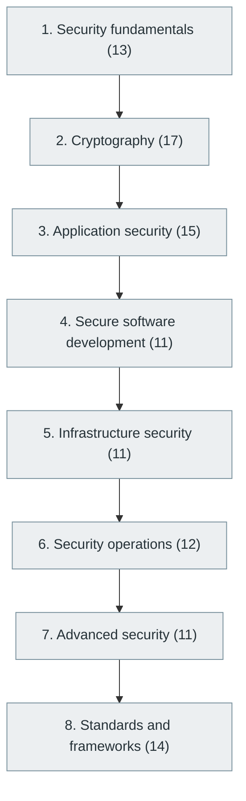

# 31. Cybersecurity and Software Security

> [Home](../../../README.md) › [Part VII — Software Quality and Cybersecurity](../index.md) › Subject 31

- **Status:** Not started (0 of 104 syllabus topics have a drafted lesson)
- **Source tags:** Important for every professional engineer
- **Syllabus size:** 8 chapters, 104 topics

## Introduction

Security fundamentals, cryptography, application security, secure development, infrastructure security, security operations, advanced security and the major standards.

## Learning outcomes

After working through this subject you should be able to:

- Threat-model a system
- Avoid the common application vulnerabilities
- Use cryptographic primitives correctly, and know when not to build your own

## Prerequisites

- [2. Mathematics for Computer Science](../../01-computer-science-foundations/02-mathematics-for-computer-science/index.md)
- [5. Computer Networking](../../01-computer-science-foundations/05-computer-networking/index.md)

## Beginner-to-advanced progression

The chapters below follow the order of the source syllabus, which moves from foundational to advanced material. Colour shows documentation status (grey = not started, amber = in progress, green = drafted or better).

## Chapters and topics

### Chapter 1: Security fundamentals

13 topics · status: **Not started**

*Planned location:* `docs/07-software-quality-and-cybersecurity/31-cybersecurity-and-software-security/01-security-fundamentals/`. No lessons yet.

Syllabus topics in this chapter (13)

- `31.01.01` Confidentiality — *not started*
- `31.01.02` Integrity — *not started*
- `31.01.03` Availability — *not started*
- `31.01.04` CIA triad — *not started*
- `31.01.05` Authentication — *not started*
- `31.01.06` Authorization — *not started*
- `31.01.07` Accountability — *not started*
- `31.01.08` Non-repudiation — *not started*
- `31.01.09` Threats — *not started*
- `31.01.10` Vulnerabilities — *not started*
- `31.01.11` Risks — *not started*
- `31.01.12` Attack surfaces — *not started*
- `31.01.13` Threat modeling — *not started*

### Chapter 2: Cryptography

17 topics · status: **Not started**

*Planned location:* `docs/07-software-quality-and-cybersecurity/31-cybersecurity-and-software-security/02-cryptography/`. No lessons yet.

Syllabus topics in this chapter (17)

- `31.02.01` Plaintext and ciphertext — *not started*
- `31.02.02` Encryption and decryption — *not started*
- `31.02.03` Symmetric encryption — *not started*
- `31.02.04` AES — *not started*
- `31.02.05` Asymmetric encryption — *not started*
- `31.02.06` RSA — *not started*
- `31.02.07` Elliptic curve cryptography — *not started*
- `31.02.08` Digital signatures — *not started*
- `31.02.09` Hashing — *not started*
- `31.02.10` SHA-256 — *not started*
- `31.02.11` Password hashing — *not started*
- `31.02.12` Salting — *not started*
- `31.02.13` HMAC — *not started*
- `31.02.14` PKI — *not started*
- `31.02.15` Digital certificates — *not started*
- `31.02.16` TLS — *not started*
- `31.02.17` Key management — *not started*

### Chapter 3: Application security

15 topics · status: **Not started**

*Planned location:* `docs/07-software-quality-and-cybersecurity/31-cybersecurity-and-software-security/03-application-security/`. No lessons yet.

Syllabus topics in this chapter (15)

- `31.03.01` OWASP Top 10 — *not started*
- `31.03.02` SQL injection — *not started*
- `31.03.03` Cross-site scripting — *not started*
- `31.03.04` CSRF — *not started*
- `31.03.05` SSRF — *not started*
- `31.03.06` Command injection — *not started*
- `31.03.07` Path traversal — *not started*
- `31.03.08` Broken access control — *not started*
- `31.03.09` Insecure deserialization — *not started*
- `31.03.10` Authentication vulnerabilities — *not started*
- `31.03.11` Session hijacking — *not started*
- `31.03.12` Clickjacking — *not started*
- `31.03.13` Security headers — *not started*
- `31.03.14` Input validation — *not started*
- `31.03.15` Output encoding — *not started*

### Chapter 4: Secure software development

11 topics · status: **Not started**

*Planned location:* `docs/07-software-quality-and-cybersecurity/31-cybersecurity-and-software-security/04-secure-software-development/`. No lessons yet.

Syllabus topics in this chapter (11)

- `31.04.01` Secure coding — *not started*
- `31.04.02` Secure architecture — *not started*
- `31.04.03` Security requirements — *not started*
- `31.04.04` Security testing — *not started*
- `31.04.05` Security reviews — *not started*
- `31.04.06` Dependency security — *not started*
- `31.04.07` Secrets management — *not started*
- `31.04.08` Software supply chain security — *not started*
- `31.04.09` SBOM — *not started*
- `31.04.10` Code signing — *not started*
- `31.04.11` Artifact verification — *not started*

### Chapter 5: Infrastructure security

11 topics · status: **Not started**

*Planned location:* `docs/07-software-quality-and-cybersecurity/31-cybersecurity-and-software-security/05-infrastructure-security/`. No lessons yet.

Syllabus topics in this chapter (11)

- `31.05.01` Network security — *not started*
- `31.05.02` Firewall management — *not started*
- `31.05.03` Cloud security — *not started*
- `31.05.04` Container security — *not started*
- `31.05.05` Kubernetes security — *not started*
- `31.05.06` IAM — *not started*
- `31.05.07` Privilege management — *not started*
- `31.05.08` Zero trust — *not started*
- `31.05.09` Endpoint security — *not started*
- `31.05.10` Infrastructure hardening — *not started*
- `31.05.11` Vulnerability management — *not started*

### Chapter 6: Security operations

12 topics · status: **Not started**

*Planned location:* `docs/07-software-quality-and-cybersecurity/31-cybersecurity-and-software-security/06-security-operations/`. No lessons yet.

Syllabus topics in this chapter (12)

- `31.06.01` Security monitoring — *not started*
- `31.06.02` SIEM — *not started*
- `31.06.03` SOAR — *not started*
- `31.06.04` Incident response — *not started*
- `31.06.05` Digital forensics — *not started*
- `31.06.06` Threat intelligence — *not started*
- `31.06.07` Malware analysis — *not started*
- `31.06.08` Security auditing — *not started*
- `31.06.09` Intrusion detection — *not started*
- `31.06.10` Intrusion prevention — *not started*
- `31.06.11` Penetration testing — *not started*
- `31.06.12` Risk management — *not started*

### Chapter 7: Advanced security

11 topics · status: **Not started**

*Planned location:* `docs/07-software-quality-and-cybersecurity/31-cybersecurity-and-software-security/07-advanced-security/`. No lessons yet.

Syllabus topics in this chapter (11)

- `31.07.01` Formal security verification — *not started*
- `31.07.02` Hardware security — *not started*
- `31.07.03` Trusted execution environments — *not started*
- `31.07.04` Secure enclaves — *not started*
- `31.07.05` Side-channel resistance — *not started*
- `31.07.06` Homomorphic encryption — *not started*
- `31.07.07` Secure multiparty computation — *not started*
- `31.07.08` Zero-knowledge proofs — *not started*
- `31.07.09` Privacy-preserving computation — *not started*
- `31.07.10` Post-quantum cryptography — *not started*
- `31.07.11` Cryptographic agility — *not started*

### Chapter 8: Standards and frameworks

14 topics · status: **Not started**

*Planned location:* `docs/07-software-quality-and-cybersecurity/31-cybersecurity-and-software-security/08-standards-and-frameworks/`. No lessons yet.

Syllabus topics in this chapter (14)

- `31.08.01` OWASP — *not started*
- `31.08.02` NIST Cybersecurity Framework — *not started*
- `31.08.03` NIST SP 800 series — *not started*
- `31.08.04` ISO 27001 — *not started*
- `31.08.05` ISO 27002 — *not started*
- `31.08.06` SOC 2 — *not started*
- `31.08.07` PCI DSS — *not started*
- `31.08.08` GDPR — *not started*
- `31.08.09` HIPAA — *not started*
- `31.08.10` CIS Benchmarks — *not started*
- `31.08.11` MITRE ATT&CK — *not started*
- `31.08.12` CWE — *not started*
- `31.08.13` CVE — *not started*
- `31.08.14` CVSS — *not started*

## Recommended reading order

1. Chapter 1 — Security fundamentals
2. Chapter 2 — Cryptography
3. Chapter 3 — Application security
4. Chapter 4 — Secure software development
5. Chapter 5 — Infrastructure security
6. Chapter 6 — Security operations
7. Chapter 7 — Advanced security
8. Chapter 8 — Standards and frameworks

Within a chapter, read lessons in numeric order. Pick the later chapters only when the earlier ones feel comfortable; the syllabus orders them from fundamental to advanced.

## Related subjects

- [16. Backend Development](../../04-building-software-products/16-backend-development/index.md)
- [24. Cloud Computing](../../06-cloud-devops-and-infrastructure/24-cloud-computing/index.md)
- [30. Software Testing and Quality Assurance](../30-software-testing-and-quality-assurance/index.md)

## Suggested practical projects

- A threat model for a small web application
- A secure authentication flow with documented attack analysis

*Full project write-ups (requirements, architecture, stages, tests, extensions) are planned; see [ROADMAP.md](../../../ROADMAP.md).*

---

**Previous subject:** [30. Software Testing and Quality Assurance](../30-software-testing-and-quality-assurance/index.md) · **Up:** [Part VII](../index.md) · **Next subject:** [32. Data Engineering](../../08-data-engineering-data-science-and-analytics/32-data-engineering/index.md)
