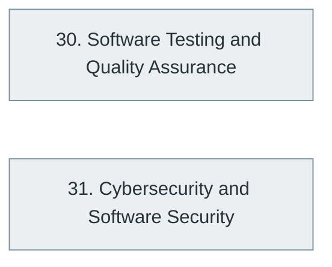

# Part VII — Software Quality and Cybersecurity

> [Home](../../README.md) › Part VII

**Status:** Not started

Showing software is correct and keeping it safe: testing, quality engineering, security fundamentals, cryptography and secure development.

## Subjects in this part

| # | Subject | What it covers | Topics | Status |
| --- | --- | --- | --- | --- |
| 30 | [Software Testing and Quality Assurance](30-software-testing-and-quality-assurance/index.md) | Testing fundamentals, levels and types, advanced testing, test frameworks and quality engineering. | 69 | Not started |
| 31 | [Cybersecurity and Software Security](31-cybersecurity-and-software-security/index.md) | Security fundamentals, cryptography, application security, secure development, infrastructure security, security operations, advanced security and the major standards. | 104 | Not started |

## How the subjects depend on each other

Solid arrows point from a prerequisite to the subject that builds on it. Only dependencies inside this part are drawn.

## What you need from other parts

| Subject in this part | Prerequisite elsewhere |
| --- | --- |
| [30. Software Testing and Quality Assurance](30-software-testing-and-quality-assurance/index.md) | [6. Programming Fundamentals](../02-programming-and-software-development/06-programming-fundamentals/index.md) |
| [30. Software Testing and Quality Assurance](30-software-testing-and-quality-assurance/index.md) | [11. Software Development Lifecycle (SDLC)](../03-professional-software-engineering/11-software-development-lifecycle/index.md) |
| [31. Cybersecurity and Software Security](31-cybersecurity-and-software-security/index.md) | [2. Mathematics for Computer Science](../01-computer-science-foundations/02-mathematics-for-computer-science/index.md) |
| [31. Cybersecurity and Software Security](31-cybersecurity-and-software-security/index.md) | [5. Computer Networking](../01-computer-science-foundations/05-computer-networking/index.md) |

---

**Previous part:** [Part VI](../06-cloud-devops-and-infrastructure/index.md) · **Up:** [Master index](../../MASTER-INDEX.md) · **Next part:** [Part VIII](../08-data-engineering-data-science-and-analytics/index.md)
