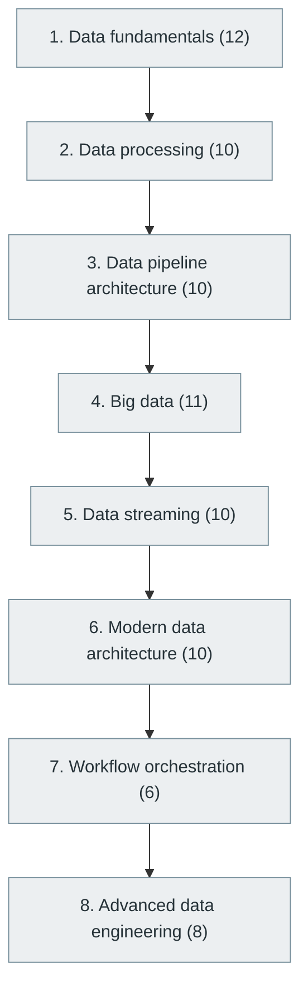

# 32. Data Engineering

> [Home](../../../README.md) › [Part VIII — Data Engineering, Data Science and Analytics](../index.md) › Subject 32

- **Status:** Not started (0 of 77 syllabus topics have a drafted lesson)
- **Source tags:** —
- **Syllabus size:** 8 chapters, 77 topics

## Introduction

Data fundamentals and processing, pipeline architecture, big data, streaming, modern data architectures, orchestration and advanced data engineering.

## Learning outcomes

After working through this subject you should be able to:

- Design batch and streaming pipelines
- Choose among warehouses, lakes and lakehouses
- Make pipelines idempotent and observable

## Prerequisites

- [6. Programming Fundamentals](../../02-programming-and-software-development/06-programming-fundamentals/index.md)
- [15. Database Management Systems (DBMS)](../../04-building-software-products/15-database-management-systems/index.md)

## Beginner-to-advanced progression

The chapters below follow the order of the source syllabus, which moves from foundational to advanced material. Colour shows documentation status (grey = not started, amber = in progress, green = drafted or better).

## Chapters and topics

### Chapter 1: Data fundamentals

12 topics · status: **Not started**

*Planned location:* `docs/08-data-engineering-data-science-and-analytics/32-data-engineering/01-data-fundamentals/`. No lessons yet.

Syllabus topics in this chapter (12)

- `32.01.01` Structured data — *not started*
- `32.01.02` Semi-structured data — *not started*
- `32.01.03` Unstructured data — *not started*
- `32.01.04` Data sources — *not started*
- `32.01.05` Data formats — *not started*
- `32.01.06` CSV — *not started*
- `32.01.07` JSON — *not started*
- `32.01.08` XML — *not started*
- `32.01.09` Parquet — *not started*
- `32.01.10` Avro — *not started*
- `32.01.11` ORC — *not started*
- `32.01.12` Data ingestion — *not started*

### Chapter 2: Data processing

10 topics · status: **Not started**

*Planned location:* `docs/08-data-engineering-data-science-and-analytics/32-data-engineering/02-data-processing/`. No lessons yet.

Syllabus topics in this chapter (10)

- `32.02.01` Batch processing — *not started*
- `32.02.02` Stream processing — *not started*
- `32.02.03` Real-time processing — *not started*
- `32.02.04` ETL — *not started*
- `32.02.05` ELT — *not started*
- `32.02.06` Data transformation — *not started*
- `32.02.07` Data cleansing — *not started*
- `32.02.08` Data validation — *not started*
- `32.02.09` Data deduplication — *not started*
- `32.02.10` Schema evolution — *not started*

### Chapter 3: Data pipeline architecture

10 topics · status: **Not started**

*Planned location:* `docs/08-data-engineering-data-science-and-analytics/32-data-engineering/03-data-pipeline-architecture/`. No lessons yet.

Syllabus topics in this chapter (10)

- `32.03.01` Data pipelines — *not started*
- `32.03.02` Workflow orchestration — *not started*
- `32.03.03` Scheduling — *not started*
- `32.03.04` Dependency management — *not started*
- `32.03.05` Data lineage — *not started*
- `32.03.06` Data quality — *not started*
- `32.03.07` Metadata management — *not started*
- `32.03.08` Data observability — *not started*
- `32.03.09` CDC — *not started*
- `32.03.10` Data contracts — *not started*

### Chapter 4: Big data

11 topics · status: **Not started**

*Planned location:* `docs/08-data-engineering-data-science-and-analytics/32-data-engineering/04-big-data/`. No lessons yet.

Syllabus topics in this chapter (11)

- `32.04.01` Distributed storage — *not started*
- `32.04.02` Distributed processing — *not started*
- `32.04.03` Hadoop — *not started*
- `32.04.04` HDFS — *not started*
- `32.04.05` MapReduce — *not started*
- `32.04.06` Apache Spark — *not started*
- `32.04.07` Apache Flink — *not started*
- `32.04.08` Apache Beam — *not started*
- `32.04.09` Hive — *not started*
- `32.04.10` Presto — *not started*
- `32.04.11` Trino — *not started*

### Chapter 5: Data streaming

10 topics · status: **Not started**

*Planned location:* `docs/08-data-engineering-data-science-and-analytics/32-data-engineering/05-data-streaming/`. No lessons yet.

Syllabus topics in this chapter (10)

- `32.05.01` Apache Kafka — *not started*
- `32.05.02` Kafka Streams — *not started*
- `32.05.03` Apache Pulsar — *not started*
- `32.05.04` Apache Flink — *not started*
- `32.05.05` Spark Streaming — *not started*
- `32.05.06` Debezium — *not started*
- `32.05.07` Stream joins — *not started*
- `32.05.08` Event-time processing — *not started*
- `32.05.09` Windowing — *not started*
- `32.05.10` Watermarks — *not started*

### Chapter 6: Modern data architecture

10 topics · status: **Not started**

*Planned location:* `docs/08-data-engineering-data-science-and-analytics/32-data-engineering/06-modern-data-architecture/`. No lessons yet.

Syllabus topics in this chapter (10)

- `32.06.01` Data warehouses — *not started*
- `32.06.02` Data lakes — *not started*
- `32.06.03` Lakehouses — *not started*
- `32.06.04` Data marts — *not started*
- `32.06.05` Data mesh — *not started*
- `32.06.06` Data fabric — *not started*
- `32.06.07` Medallion architecture — *not started*
- `32.06.08` Data virtualization — *not started*
- `32.06.09` Reverse ETL — *not started*
- `32.06.10` Data products — *not started*

### Chapter 7: Workflow orchestration

6 topics · status: **Not started**

*Planned location:* `docs/08-data-engineering-data-science-and-analytics/32-data-engineering/07-workflow-orchestration/`. No lessons yet.

Syllabus topics in this chapter (6)

- `32.07.01` Apache Airflow — *not started*
- `32.07.02` Dagster — *not started*
- `32.07.03` Prefect — *not started*
- `32.07.04` Luigi — *not started*
- `32.07.05` Argo Workflows — *not started*
- `32.07.06` Mage — *not started*

### Chapter 8: Advanced data engineering

8 topics · status: **Not started**

*Planned location:* `docs/08-data-engineering-data-science-and-analytics/32-data-engineering/08-advanced-data-engineering/`. No lessons yet.

Syllabus topics in this chapter (8)

- `32.08.01` Distributed query processing — *not started*
- `32.08.02` Petabyte-scale processing — *not started*
- `32.08.03` Data governance — *not started*
- `32.08.04` Data cataloging — *not started*
- `32.08.05` Privacy engineering — *not started*
- `32.08.06` Data reliability — *not started*
- `32.08.07` Streaming architectures — *not started*
- `32.08.08` Real-time analytics — *not started*

## Recommended reading order

1. Chapter 1 — Data fundamentals
2. Chapter 2 — Data processing
3. Chapter 3 — Data pipeline architecture
4. Chapter 4 — Big data
5. Chapter 5 — Data streaming
6. Chapter 6 — Modern data architecture
7. Chapter 7 — Workflow orchestration
8. Chapter 8 — Advanced data engineering

Within a chapter, read lessons in numeric order. Pick the later chapters only when the earlier ones feel comfortable; the syllabus orders them from fundamental to advanced.

## Related subjects

- [22. Distributed Systems](../../05-distributed-systems-and-system-design/22-distributed-systems/index.md)
- [33. Data Science and Business Intelligence](../33-data-science-and-business-intelligence/index.md)

## Suggested practical projects

- An ELT pipeline with tests and scheduling
- A streaming aggregation over a message queue

*Full project write-ups (requirements, architecture, stages, tests, extensions) are planned; see [ROADMAP.md](../../../ROADMAP.md).*

---

**Previous subject:** [31. Cybersecurity and Software Security](../../07-software-quality-and-cybersecurity/31-cybersecurity-and-software-security/index.md) · **Up:** [Part VIII](../index.md) · **Next subject:** [33. Data Science and Business Intelligence](../33-data-science-and-business-intelligence/index.md)
