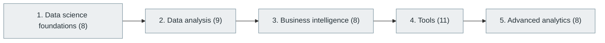

# 33. Data Science and Business Intelligence

> [Home](../../../README.md) › [Part VIII — Data Engineering, Data Science and Analytics](../index.md) › Subject 33

- **Status:** Not started (0 of 44 syllabus topics have a drafted lesson)
- **Source tags:** —
- **Syllabus size:** 5 chapters, 44 topics

## Introduction

Data science foundations, exploratory analysis, business intelligence, tooling and advanced analytics.

## Learning outcomes

After working through this subject you should be able to:

- Clean, explore and summarise a dataset
- Communicate findings with appropriate visualisations
- Frame business questions as analyses

## Prerequisites

- [2. Mathematics for Computer Science](../../01-computer-science-foundations/02-mathematics-for-computer-science/index.md)
- [6. Programming Fundamentals](../../02-programming-and-software-development/06-programming-fundamentals/index.md)

## Beginner-to-advanced progression

The chapters below follow the order of the source syllabus, which moves from foundational to advanced material. Colour shows documentation status (grey = not started, amber = in progress, green = drafted or better).

## Chapters and topics

### Chapter 1: Data science foundations

8 topics · status: **Not started**

*Planned location:* `docs/08-data-engineering-data-science-and-analytics/33-data-science-and-business-intelligence/01-data-science-foundations/`. No lessons yet.

Syllabus topics in this chapter (8)

- `33.01.01` Data collection — *not started*
- `33.01.02` Data cleaning — *not started*
- `33.01.03` Exploratory data analysis — *not started*
- `33.01.04` Feature engineering — *not started*
- `33.01.05` Statistical analysis — *not started*
- `33.01.06` Data visualization — *not started*
- `33.01.07` Hypothesis testing — *not started*
- `33.01.08` Statistical modeling — *not started*

### Chapter 2: Data analysis

9 topics · status: **Not started**

*Planned location:* `docs/08-data-engineering-data-science-and-analytics/33-data-science-and-business-intelligence/02-data-analysis/`. No lessons yet.

Syllabus topics in this chapter (9)

- `33.02.01` Descriptive analytics — *not started*
- `33.02.02` Diagnostic analytics — *not started*
- `33.02.03` Predictive analytics — *not started*
- `33.02.04` Prescriptive analytics — *not started*
- `33.02.05` Cohort analysis — *not started*
- `33.02.06` Funnel analysis — *not started*
- `33.02.07` Retention analysis — *not started*
- `33.02.08` Customer segmentation — *not started*
- `33.02.09` Time-series analysis — *not started*

### Chapter 3: Business intelligence

8 topics · status: **Not started**

*Planned location:* `docs/08-data-engineering-data-science-and-analytics/33-data-science-and-business-intelligence/03-business-intelligence/`. No lessons yet.

Syllabus topics in this chapter (8)

- `33.03.01` Business metrics — *not started*
- `33.03.02` KPIs — *not started*
- `33.03.03` Dashboards — *not started*
- `33.03.04` Reporting — *not started*
- `33.03.05` OLAP — *not started*
- `33.03.06` Data cubes — *not started*
- `33.03.07` Drill-down analysis — *not started*
- `33.03.08` Self-service BI — *not started*

### Chapter 4: Tools

11 topics · status: **Not started**

*Planned location:* `docs/08-data-engineering-data-science-and-analytics/33-data-science-and-business-intelligence/04-tools/`. No lessons yet.

Syllabus topics in this chapter (11)

- `33.04.01` Excel — *not started*
- `33.04.02` Python — *not started*
- `33.04.03` R — *not started*
- `33.04.04` SQL — *not started*
- `33.04.05` Tableau — *not started*
- `33.04.06` Power BI — *not started*
- `33.04.07` Looker — *not started*
- `33.04.08` Metabase — *not started*
- `33.04.09` Apache Superset — *not started*
- `33.04.10` Jupyter — *not started*
- `33.04.11` Google Colab — *not started*

### Chapter 5: Advanced analytics

8 topics · status: **Not started**

*Planned location:* `docs/08-data-engineering-data-science-and-analytics/33-data-science-and-business-intelligence/05-advanced-analytics/`. No lessons yet.

Syllabus topics in this chapter (8)

- `33.05.01` A/B testing — *not started*
- `33.05.02` Causal inference — *not started*
- `33.05.03` Predictive modeling — *not started*
- `33.05.04` Regression analysis — *not started*
- `33.05.05` Time-series forecasting — *not started*
- `33.05.06` Bayesian analytics — *not started*
- `33.05.07` Experimentation platforms — *not started*
- `33.05.08` Decision science — *not started*

## Recommended reading order

1. Chapter 1 — Data science foundations
2. Chapter 2 — Data analysis
3. Chapter 3 — Business intelligence
4. Chapter 4 — Tools
5. Chapter 5 — Advanced analytics

Within a chapter, read lessons in numeric order. Pick the later chapters only when the earlier ones feel comfortable; the syllabus orders them from fundamental to advanced.

## Related subjects

- [32. Data Engineering](../32-data-engineering/index.md)
- [36. Machine Learning](../../09-artificial-intelligence-and-machine-learning/36-machine-learning/index.md)

## Suggested practical projects

- An exploratory analysis notebook on a public dataset
- A BI dashboard with defined metrics

*Full project write-ups (requirements, architecture, stages, tests, extensions) are planned; see [ROADMAP.md](../../../ROADMAP.md).*

---

**Previous subject:** [32. Data Engineering](../32-data-engineering/index.md) · **Up:** [Part VIII](../index.md) · **Next subject:** [34. Artificial Intelligence Fundamentals](../../09-artificial-intelligence-and-machine-learning/34-artificial-intelligence-fundamentals/index.md)
