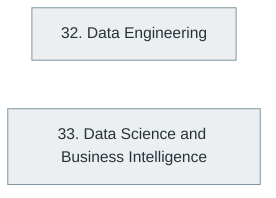

# Part VIII — Data Engineering, Data Science and Analytics

> [Home](../../README.md) › Part VIII

**Status:** Not started

Moving, storing, processing and analysing data at scale, from pipelines and streaming to statistics and business intelligence.

## Subjects in this part

| # | Subject | What it covers | Topics | Status |
| --- | --- | --- | --- | --- |
| 32 | [Data Engineering](32-data-engineering/index.md) | Data fundamentals and processing, pipeline architecture, big data, streaming, modern data architectures, orchestration and advanced data engineering. | 77 | Not started |
| 33 | [Data Science and Business Intelligence](33-data-science-and-business-intelligence/index.md) | Data science foundations, exploratory analysis, business intelligence, tooling and advanced analytics. | 44 | Not started |

## How the subjects depend on each other

Solid arrows point from a prerequisite to the subject that builds on it. Only dependencies inside this part are drawn.

## What you need from other parts

| Subject in this part | Prerequisite elsewhere |
| --- | --- |
| [32. Data Engineering](32-data-engineering/index.md) | [6. Programming Fundamentals](../02-programming-and-software-development/06-programming-fundamentals/index.md) |
| [32. Data Engineering](32-data-engineering/index.md) | [15. Database Management Systems (DBMS)](../04-building-software-products/15-database-management-systems/index.md) |
| [33. Data Science and Business Intelligence](33-data-science-and-business-intelligence/index.md) | [2. Mathematics for Computer Science](../01-computer-science-foundations/02-mathematics-for-computer-science/index.md) |
| [33. Data Science and Business Intelligence](33-data-science-and-business-intelligence/index.md) | [6. Programming Fundamentals](../02-programming-and-software-development/06-programming-fundamentals/index.md) |

---

**Previous part:** [Part VII](../07-software-quality-and-cybersecurity/index.md) · **Up:** [Master index](../../MASTER-INDEX.md) · **Next part:** [Part IX](../09-artificial-intelligence-and-machine-learning/index.md)
