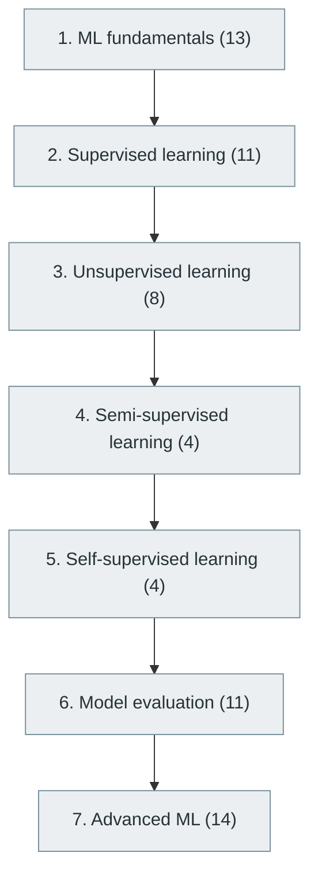

# 36. Machine Learning

> [Home](../../../README.md) › [Part IX — Artificial Intelligence and Machine Learning](../index.md) › Subject 36

- **Status:** Not started (0 of 65 syllabus topics have a drafted lesson)
- **Source tags:** Beginner → Advanced
- **Syllabus size:** 7 chapters, 65 topics

## Introduction

Machine-learning fundamentals, supervised, unsupervised, semi-supervised and self-supervised learning, model evaluation and advanced topics.

## Learning outcomes

After working through this subject you should be able to:

- Train, tune and evaluate classical models without leaking data
- Explain bias, variance and regularisation
- Choose metrics that match the real objective

## Prerequisites

- [34. Artificial Intelligence Fundamentals](../34-artificial-intelligence-fundamentals/index.md)
- [35. Mathematics for Machine Learning](../35-mathematics-for-machine-learning/index.md)
- [6. Programming Fundamentals](../../02-programming-and-software-development/06-programming-fundamentals/index.md)

## Beginner-to-advanced progression

The chapters below follow the order of the source syllabus, which moves from foundational to advanced material. Colour shows documentation status (grey = not started, amber = in progress, green = drafted or better).

## Chapters and topics

### Chapter 1: ML fundamentals

13 topics · status: **Not started**

*Planned location:* `docs/09-artificial-intelligence-and-machine-learning/36-machine-learning/01-ml-fundamentals/`. No lessons yet.

Syllabus topics in this chapter (13)

- `36.01.01` What is machine learning? — *not started*
- `36.01.02` Training data — *not started*
- `36.01.03` Testing data — *not started*
- `36.01.04` Validation data — *not started*
- `36.01.05` Features — *not started*
- `36.01.06` Labels — *not started*
- `36.01.07` Models — *not started*
- `36.01.08` Training — *not started*
- `36.01.09` Inference — *not started*
- `36.01.10` Overfitting — *not started*
- `36.01.11` Underfitting — *not started*
- `36.01.12` Bias-variance tradeoff — *not started*
- `36.01.13` Generalization — *not started*

### Chapter 2: Supervised learning

11 topics · status: **Not started**

*Planned location:* `docs/09-artificial-intelligence-and-machine-learning/36-machine-learning/02-supervised-learning/`. No lessons yet.

Syllabus topics in this chapter (11)

- `36.02.01` Linear regression — *not started*
- `36.02.02` Logistic regression — *not started*
- `36.02.03` Decision trees — *not started*
- `36.02.04` Random forests — *not started*
- `36.02.05` Support vector machines — *not started*
- `36.02.06` K-nearest neighbors — *not started*
- `36.02.07` Naive Bayes — *not started*
- `36.02.08` Gradient boosting — *not started*
- `36.02.09` XGBoost — *not started*
- `36.02.10` LightGBM — *not started*
- `36.02.11` CatBoost — *not started*

### Chapter 3: Unsupervised learning

8 topics · status: **Not started**

*Planned location:* `docs/09-artificial-intelligence-and-machine-learning/36-machine-learning/03-unsupervised-learning/`. No lessons yet.

Syllabus topics in this chapter (8)

- `36.03.01` K-means — *not started*
- `36.03.02` Hierarchical clustering — *not started*
- `36.03.03` DBSCAN — *not started*
- `36.03.04` Gaussian mixture models — *not started*
- `36.03.05` Principal component analysis — *not started*
- `36.03.06` Independent component analysis — *not started*
- `36.03.07` Dimensionality reduction — *not started*
- `36.03.08` Anomaly detection — *not started*

### Chapter 4: Semi-supervised learning

4 topics · status: **Not started**

*Planned location:* `docs/09-artificial-intelligence-and-machine-learning/36-machine-learning/04-semi-supervised-learning/`. No lessons yet.

Syllabus topics in this chapter (4)

- `36.04.01` Pseudo-labeling — *not started*
- `36.04.02` Self-training — *not started*
- `36.04.03` Consistency regularization — *not started*
- `36.04.04` Label propagation — *not started*

### Chapter 5: Self-supervised learning

4 topics · status: **Not started**

*Planned location:* `docs/09-artificial-intelligence-and-machine-learning/36-machine-learning/05-self-supervised-learning/`. No lessons yet.

Syllabus topics in this chapter (4)

- `36.05.01` Contrastive learning — *not started*
- `36.05.02` Masked prediction — *not started*
- `36.05.03` Representation learning — *not started*
- `36.05.04` Predictive learning — *not started*

### Chapter 6: Model evaluation

11 topics · status: **Not started**

*Planned location:* `docs/09-artificial-intelligence-and-machine-learning/36-machine-learning/06-model-evaluation/`. No lessons yet.

Syllabus topics in this chapter (11)

- `36.06.01` Accuracy — *not started*
- `36.06.02` Precision — *not started*
- `36.06.03` Recall — *not started*
- `36.06.04` F1-score — *not started*
- `36.06.05` ROC — *not started*
- `36.06.06` AUC — *not started*
- `36.06.07` Confusion matrix — *not started*
- `36.06.08` Mean squared error — *not started*
- `36.06.09` Mean absolute error — *not started*
- `36.06.10` Cross-validation — *not started*
- `36.06.11` Model calibration — *not started*

### Chapter 7: Advanced ML

14 topics · status: **Not started**

*Planned location:* `docs/09-artificial-intelligence-and-machine-learning/36-machine-learning/07-advanced-ml/`. No lessons yet.

Syllabus topics in this chapter (14)

- `36.07.01` Ensemble learning — *not started*
- `36.07.02` Stacking — *not started*
- `36.07.03` Boosting — *not started*
- `36.07.04` Bagging — *not started*
- `36.07.05` AutoML — *not started*
- `36.07.06` Active learning — *not started*
- `36.07.07` Transfer learning — *not started*
- `36.07.08` Few-shot learning — *not started*
- `36.07.09` Online learning — *not started*
- `36.07.10` Continual learning — *not started*
- `36.07.11` Federated learning — *not started*
- `36.07.12` Explainable AI — *not started*
- `36.07.13` Causal machine learning — *not started*
- `36.07.14` Graph machine learning — *not started*

## Recommended reading order

1. Chapter 1 — ML fundamentals
2. Chapter 2 — Supervised learning
3. Chapter 3 — Unsupervised learning
4. Chapter 4 — Semi-supervised learning
5. Chapter 5 — Self-supervised learning
6. Chapter 6 — Model evaluation
7. Chapter 7 — Advanced ML

Within a chapter, read lessons in numeric order. Pick the later chapters only when the earlier ones feel comfortable; the syllabus orders them from fundamental to advanced.

## Related subjects

- [33. Data Science and Business Intelligence](../../08-data-engineering-data-science-and-analytics/33-data-science-and-business-intelligence/index.md)
- [37. Deep Learning](../37-deep-learning/index.md)

## Suggested practical projects

- Linear and logistic regression from scratch
- An end-to-end tabular model with a proper evaluation protocol

*Full project write-ups (requirements, architecture, stages, tests, extensions) are planned; see [ROADMAP.md](../../../ROADMAP.md).*

---

**Previous subject:** [35. Mathematics for Machine Learning](../35-mathematics-for-machine-learning/index.md) · **Up:** [Part IX](../index.md) · **Next subject:** [37. Deep Learning](../37-deep-learning/index.md)
