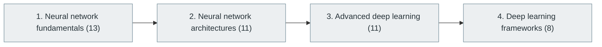

# 37. Deep Learning

> [Home](../../../README.md) › [Part IX — Artificial Intelligence and Machine Learning](../index.md) › Subject 37

- **Status:** Not started (0 of 43 syllabus topics have a drafted lesson)
- **Source tags:** —
- **Syllabus size:** 4 chapters, 43 topics

## Introduction

Neural-network fundamentals, major architectures, advanced deep learning and the main frameworks.

## Learning outcomes

After working through this subject you should be able to:

- Implement backpropagation by hand for a small network
- Train a network and diagnose training failures
- Choose an architecture for a data type

## Prerequisites

- [36. Machine Learning](../36-machine-learning/index.md)

## Beginner-to-advanced progression

The chapters below follow the order of the source syllabus, which moves from foundational to advanced material. Colour shows documentation status (grey = not started, amber = in progress, green = drafted or better).

## Chapters and topics

### Chapter 1: Neural network fundamentals

13 topics · status: **Not started**

*Planned location:* `docs/09-artificial-intelligence-and-machine-learning/37-deep-learning/01-neural-network-fundamentals/`. No lessons yet.

Syllabus topics in this chapter (13)

- `37.01.01` Artificial neurons — *not started*
- `37.01.02` Weights — *not started*
- `37.01.03` Biases — *not started*
- `37.01.04` Activation functions — *not started*
- `37.01.05` Layers — *not started*
- `37.01.06` Forward propagation — *not started*
- `37.01.07` Backpropagation — *not started*
- `37.01.08` Loss functions — *not started*
- `37.01.09` Optimizers — *not started*
- `37.01.10` Gradient descent — *not started*
- `37.01.11` Learning rate — *not started*
- `37.01.12` Batch size — *not started*
- `37.01.13` Epochs — *not started*

### Chapter 2: Neural network architectures

11 topics · status: **Not started**

*Planned location:* `docs/09-artificial-intelligence-and-machine-learning/37-deep-learning/02-neural-network-architectures/`. No lessons yet.

Syllabus topics in this chapter (11)

- `37.02.01` Feedforward neural networks — *not started*
- `37.02.02` Multilayer perceptrons — *not started*
- `37.02.03` Convolutional neural networks — *not started*
- `37.02.04` Recurrent neural networks — *not started*
- `37.02.05` LSTM — *not started*
- `37.02.06` GRU — *not started*
- `37.02.07` Autoencoders — *not started*
- `37.02.08` Variational autoencoders — *not started*
- `37.02.09` Generative adversarial networks — *not started*
- `37.02.10` Graph neural networks — *not started*
- `37.02.11` Siamese networks — *not started*

### Chapter 3: Advanced deep learning

11 topics · status: **Not started**

*Planned location:* `docs/09-artificial-intelligence-and-machine-learning/37-deep-learning/03-advanced-deep-learning/`. No lessons yet.

Syllabus topics in this chapter (11)

- `37.03.01` Attention mechanisms — *not started*
- `37.03.02` Self-attention — *not started*
- `37.03.03` Transformers — *not started*
- `37.03.04` Encoder-decoder architectures — *not started*
- `37.03.05` Positional embeddings — *not started*
- `37.03.06` Residual connections — *not started*
- `37.03.07` Normalization — *not started*
- `37.03.08` Mixture of Experts — *not started*
- `37.03.09` Sparse neural networks — *not started*
- `37.03.10` Neural scaling laws — *not started*
- `37.03.11` Multimodal neural networks — *not started*

### Chapter 4: Deep learning frameworks

8 topics · status: **Not started**

*Planned location:* `docs/09-artificial-intelligence-and-machine-learning/37-deep-learning/04-deep-learning-frameworks/`. No lessons yet.

Syllabus topics in this chapter (8)

- `37.04.01` PyTorch — *not started*
- `37.04.02` TensorFlow — *not started*
- `37.04.03` Keras — *not started*
- `37.04.04` JAX — *not started*
- `37.04.05` MXNet — *not started*
- `37.04.06` ONNX — *not started*
- `37.04.07` Hugging Face — *not started*
- `37.04.08` TensorRT — *not started*

## Recommended reading order

1. Chapter 1 — Neural network fundamentals
2. Chapter 2 — Neural network architectures
3. Chapter 3 — Advanced deep learning
4. Chapter 4 — Deep learning frameworks

Within a chapter, read lessons in numeric order. Pick the later chapters only when the earlier ones feel comfortable; the syllabus orders them from fundamental to advanced.

## Related subjects

- [38. Natural Language Processing (NLP)](../38-natural-language-processing/index.md)
- [39. Computer Vision](../39-computer-vision/index.md)
- [41. Generative AI](../41-generative-ai/index.md)

## Suggested practical projects

- A small neural network in NumPy
- A convolutional classifier in a deep-learning framework

*Full project write-ups (requirements, architecture, stages, tests, extensions) are planned; see [ROADMAP.md](../../../ROADMAP.md).*

---

**Previous subject:** [36. Machine Learning](../36-machine-learning/index.md) · **Up:** [Part IX](../index.md) · **Next subject:** [38. Natural Language Processing (NLP)](../38-natural-language-processing/index.md)
