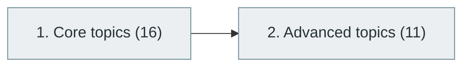

# 39. Computer Vision

> [Home](../../../README.md) › [Part IX — Artificial Intelligence and Machine Learning](../index.md) › Subject 39

- **Status:** Not started (0 of 27 syllabus topics have a drafted lesson)
- **Source tags:** —
- **Syllabus size:** 2 chapters, 27 topics

## Introduction

Image formation, classical vision, convolutional and transformer-based models, detection, segmentation and advanced topics.

## Learning outcomes

After working through this subject you should be able to:

- Apply classical image processing
- Train and evaluate an image classifier
- Explain detection and segmentation pipelines

## Prerequisites

- [37. Deep Learning](../37-deep-learning/index.md)

## Beginner-to-advanced progression

The chapters below follow the order of the source syllabus, which moves from foundational to advanced material. Colour shows documentation status (grey = not started, amber = in progress, green = drafted or better).

## Chapters and topics

### Chapter 1: Core topics

16 topics · status: **Not started** · *heading synthesized (not in source)*

*Planned location:* `docs/09-artificial-intelligence-and-machine-learning/39-computer-vision/01-core-topics/`. No lessons yet.

Syllabus topics in this chapter (16)

- `39.01.01` Image processing — *not started*
- `39.01.02` Image representation — *not started*
- `39.01.03` Image filtering — *not started*
- `39.01.04` Edge detection — *not started*
- `39.01.05` Image segmentation — *not started*
- `39.01.06` Image classification — *not started*
- `39.01.07` Object detection — *not started*
- `39.01.08` Feature extraction — *not started*
- `39.01.09` Image recognition — *not started*
- `39.01.10` Face detection — *not started*
- `39.01.11` Pose estimation — *not started*
- `39.01.12` Optical flow — *not started*
- `39.01.13` OCR — *not started*
- `39.01.14` Video analysis — *not started*
- `39.01.15` Motion detection — *not started*
- `39.01.16` Visual tracking — *not started*

### Chapter 2: Advanced topics

11 topics · status: **Not started**

*Planned location:* `docs/09-artificial-intelligence-and-machine-learning/39-computer-vision/02-advanced-topics/`. No lessons yet.

Syllabus topics in this chapter (11)

- `39.02.01` CNN architectures — *not started*
- `39.02.02` YOLO — *not started*
- `39.02.03` Vision Transformers — *not started*
- `39.02.04` Mask R-CNN — *not started*
- `39.02.05` U-Net — *not started*
- `39.02.06` Diffusion-based vision — *not started*
- `39.02.07` Multimodal vision-language models — *not started*
- `39.02.08` 3D reconstruction — *not started*
- `39.02.09` Neural radiance fields — *not started*
- `39.02.10` Gaussian splatting — *not started*
- `39.02.11` Vision-language-action models — *not started*

## Recommended reading order

1. Chapter 1 — Core topics
2. Chapter 2 — Advanced topics

Within a chapter, read lessons in numeric order. Pick the later chapters only when the earlier ones feel comfortable; the syllabus orders them from fundamental to advanced.

## Related subjects

- [51. Robotics and Autonomous Systems](../../10-specialized-software-engineering-domains/51-robotics-and-autonomous-systems/index.md)
- [48. AR, VR, MR and Spatial Computing](../../10-specialized-software-engineering-domains/48-ar-vr-mr-and-spatial-computing/index.md)

## Suggested practical projects

- An image classifier with data augmentation
- An object-detection demo with an evaluation report

*Full project write-ups (requirements, architecture, stages, tests, extensions) are planned; see [ROADMAP.md](../../../ROADMAP.md).*

---

**Previous subject:** [38. Natural Language Processing (NLP)](../38-natural-language-processing/index.md) · **Up:** [Part IX](../index.md) · **Next subject:** [40. Reinforcement Learning](../40-reinforcement-learning/index.md)
