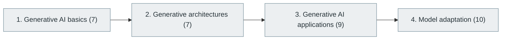

# 41. Generative AI

> [Home](../../../README.md) › [Part IX — Artificial Intelligence and Machine Learning](../index.md) › Subject 41

- **Status:** Not started (0 of 33 syllabus topics have a drafted lesson)
- **Source tags:** Modern AI engineering
- **Syllabus size:** 4 chapters, 33 topics

## Introduction

Generative modelling basics, generative architectures, applications and techniques for adapting models.

## Learning outcomes

After working through this subject you should be able to:

- Compare autoregressive, diffusion, GAN and VAE approaches
- Explain how generative models are trained and sampled
- Choose an adaptation technique for a task

## Prerequisites

- [37. Deep Learning](../37-deep-learning/index.md)

## Beginner-to-advanced progression

The chapters below follow the order of the source syllabus, which moves from foundational to advanced material. Colour shows documentation status (grey = not started, amber = in progress, green = drafted or better).

## Chapters and topics

### Chapter 1: Generative AI basics

7 topics · status: **Not started**

*Planned location:* `docs/09-artificial-intelligence-and-machine-learning/41-generative-ai/01-generative-ai-basics/`. No lessons yet.

Syllabus topics in this chapter (7)

- `41.01.01` Discriminative vs generative models — *not started*
- `41.01.02` Generative modeling — *not started*
- `41.01.03` Probability distributions — *not started*
- `41.01.04` Latent spaces — *not started*
- `41.01.05` Sampling — *not started*
- `41.01.06` Conditional generation — *not started*
- `41.01.07` Unconditional generation — *not started*

### Chapter 2: Generative architectures

7 topics · status: **Not started**

*Planned location:* `docs/09-artificial-intelligence-and-machine-learning/41-generative-ai/02-generative-architectures/`. No lessons yet.

Syllabus topics in this chapter (7)

- `41.02.01` Autoregressive models — *not started*
- `41.02.02` Transformer models — *not started*
- `41.02.03` Variational autoencoders — *not started*
- `41.02.04` Generative adversarial networks — *not started*
- `41.02.05` Diffusion models — *not started*
- `41.02.06` Flow-based models — *not started*
- `41.02.07` Energy-based models — *not started*

### Chapter 3: Generative AI applications

9 topics · status: **Not started**

*Planned location:* `docs/09-artificial-intelligence-and-machine-learning/41-generative-ai/03-generative-ai-applications/`. No lessons yet.

Syllabus topics in this chapter (9)

- `41.03.01` Text generation — *not started*
- `41.03.02` Image generation — *not started*
- `41.03.03` Audio generation — *not started*
- `41.03.04` Music generation — *not started*
- `41.03.05` Video generation — *not started*
- `41.03.06` 3D generation — *not started*
- `41.03.07` Code generation — *not started*
- `41.03.08` Synthetic data generation — *not started*
- `41.03.09` Conversational assistants — *not started*

### Chapter 4: Model adaptation

10 topics · status: **Not started**

*Planned location:* `docs/09-artificial-intelligence-and-machine-learning/41-generative-ai/04-model-adaptation/`. No lessons yet.

Syllabus topics in this chapter (10)

- `41.04.01` Pretraining — *not started*
- `41.04.02` Fine-tuning — *not started*
- `41.04.03` Instruction tuning — *not started*
- `41.04.04` Supervised fine-tuning — *not started*
- `41.04.05` LoRA — *not started*
- `41.04.06` QLoRA — *not started*
- `41.04.07` Parameter-efficient fine-tuning — *not started*
- `41.04.08` Knowledge distillation — *not started*
- `41.04.09` Quantization — *not started*
- `41.04.10` Pruning — *not started*

## Recommended reading order

1. Chapter 1 — Generative AI basics
2. Chapter 2 — Generative architectures
3. Chapter 3 — Generative AI applications
4. Chapter 4 — Model adaptation

Within a chapter, read lessons in numeric order. Pick the later chapters only when the earlier ones feel comfortable; the syllabus orders them from fundamental to advanced.

## Related subjects

- [38. Natural Language Processing (NLP)](../38-natural-language-processing/index.md)
- [39. Computer Vision](../39-computer-vision/index.md)
- [42. Large Language Models (LLMs)](../42-large-language-models/index.md)

## Suggested practical projects

- A small variational autoencoder
- A fine-tuning experiment with a before-and-after evaluation

*Full project write-ups (requirements, architecture, stages, tests, extensions) are planned; see [ROADMAP.md](../../../ROADMAP.md).*

---

**Previous subject:** [40. Reinforcement Learning](../40-reinforcement-learning/index.md) · **Up:** [Part IX](../index.md) · **Next subject:** [42. Large Language Models (LLMs)](../42-large-language-models/index.md)
