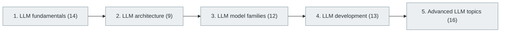

# 42. Large Language Models (LLMs)

> [Home](../../../README.md) › [Part IX — Artificial Intelligence and Machine Learning](../index.md) › Subject 42

- **Status:** Not started (0 of 64 syllabus topics have a drafted lesson)
- **Source tags:** Advanced AI engineering
- **Syllabus size:** 5 chapters, 64 topics

## Introduction

LLM fundamentals, the transformer architecture, model families, development practice and advanced topics.

## Learning outcomes

After working through this subject you should be able to:

- Explain attention and the transformer end to end
- Describe pre-training, instruction tuning and preference tuning
- Evaluate LLM behaviour and its failure modes

## Prerequisites

- [37. Deep Learning](../37-deep-learning/index.md)
- [38. Natural Language Processing (NLP)](../38-natural-language-processing/index.md)

## Beginner-to-advanced progression

The chapters below follow the order of the source syllabus, which moves from foundational to advanced material. Colour shows documentation status (grey = not started, amber = in progress, green = drafted or better).

## Chapters and topics

### Chapter 1: LLM fundamentals

14 topics · status: **Not started**

*Planned location:* `docs/09-artificial-intelligence-and-machine-learning/42-large-language-models/01-llm-fundamentals/`. No lessons yet.

Syllabus topics in this chapter (14)

- `42.01.01` Language modeling — *not started*
- `42.01.02` Tokenization — *not started*
- `42.01.03` Tokens — *not started*
- `42.01.04` Vocabulary — *not started*
- `42.01.05` Embeddings — *not started*
- `42.01.06` Context windows — *not started*
- `42.01.07` Attention — *not started*
- `42.01.08` Transformers — *not started*
- `42.01.09` Autoregressive generation — *not started*
- `42.01.10` Logits — *not started*
- `42.01.11` Sampling — *not started*
- `42.01.12` Temperature — *not started*
- `42.01.13` Top-k sampling — *not started*
- `42.01.14` Top-p sampling — *not started*

### Chapter 2: LLM architecture

9 topics · status: **Not started**

*Planned location:* `docs/09-artificial-intelligence-and-machine-learning/42-large-language-models/02-llm-architecture/`. No lessons yet.

Syllabus topics in this chapter (9)

- `42.02.01` Decoder-only models — *not started*
- `42.02.02` Encoder-only models — *not started*
- `42.02.03` Encoder-decoder models — *not started*
- `42.02.04` Multi-head attention — *not started*
- `42.02.05` Rotary positional embeddings — *not started*
- `42.02.06` KV caching — *not started*
- `42.02.07` Grouped-query attention — *not started*
- `42.02.08` Mixture of Experts — *not started*
- `42.02.09` Long-context architectures — *not started*

### Chapter 3: LLM model families

12 topics · status: **Not started**

*Planned location:* `docs/09-artificial-intelligence-and-machine-learning/42-large-language-models/03-llm-model-families/`. No lessons yet.

Syllabus topics in this chapter (12)

- `42.03.01` GPT-style models — *not started*
- `42.03.02` BERT-style models — *not started*
- `42.03.03` Llama — *not started*
- `42.03.04` Qwen — *not started*
- `42.03.05` Gemma — *not started*
- `42.03.06` Mistral — *not started*
- `42.03.07` DeepSeek — *not started*
- `42.03.08` Phi — *not started*
- `42.03.09` T5 — *not started*
- `42.03.10` FLAN-T5 — *not started*
- `42.03.11` Claude-family models — *not started*
- `42.03.12` Gemini-family models — *not started*

### Chapter 4: LLM development

13 topics · status: **Not started**

*Planned location:* `docs/09-artificial-intelligence-and-machine-learning/42-large-language-models/04-llm-development/`. No lessons yet.

Syllabus topics in this chapter (13)

- `42.04.01` Model selection — *not started*
- `42.04.02` Prompt design — *not started*
- `42.04.03` System prompts — *not started*
- `42.04.04` Few-shot prompting — *not started*
- `42.04.05` Chain-of-thought concepts — *not started*
- `42.04.06` Structured outputs — *not started*
- `42.04.07` Function calling — *not started*
- `42.04.08` Tool calling — *not started*
- `42.04.09` Context engineering — *not started*
- `42.04.10` Model routing — *not started*
- `42.04.11` Model evaluation — *not started*
- `42.04.12` Hallucination mitigation — *not started*
- `42.04.13` Safety evaluation — *not started*

### Chapter 5: Advanced LLM topics

16 topics · status: **Not started**

*Planned location:* `docs/09-artificial-intelligence-and-machine-learning/42-large-language-models/05-advanced-llm-topics/`. No lessons yet.

Syllabus topics in this chapter (16)

- `42.05.01` Retrieval-augmented generation — *not started*
- `42.05.02` Fine-tuning — *not started*
- `42.05.03` Preference optimization — *not started*
- `42.05.04` RLHF — *not started*
- `42.05.05` DPO — *not started*
- `42.05.06` Model alignment — *not started*
- `42.05.07` Synthetic data — *not started*
- `42.05.08` Long-context retrieval — *not started*
- `42.05.09` LLM inference optimization — *not started*
- `42.05.10` Speculative decoding — *not started*
- `42.05.11` Paged attention — *not started*
- `42.05.12` Continuous batching — *not started*
- `42.05.13` Model parallelism — *not started*
- `42.05.14` Tensor parallelism — *not started*
- `42.05.15` Pipeline parallelism — *not started*
- `42.05.16` Distributed inference — *not started*

## Recommended reading order

1. Chapter 1 — LLM fundamentals
2. Chapter 2 — LLM architecture
3. Chapter 3 — LLM model families
4. Chapter 4 — LLM development
5. Chapter 5 — Advanced LLM topics

Within a chapter, read lessons in numeric order. Pick the later chapters only when the earlier ones feel comfortable; the syllabus orders them from fundamental to advanced.

## Related subjects

- [41. Generative AI](../41-generative-ai/index.md)
- [43. Retrieval-Augmented Generation (RAG)](../43-retrieval-augmented-generation/index.md)
- [44. AI Agents and Agentic Systems](../44-ai-agents-and-agentic-systems/index.md)

## Suggested practical projects

- A tiny transformer language model trained on a small corpus
- An evaluation harness comparing prompts and models

*Full project write-ups (requirements, architecture, stages, tests, extensions) are planned; see [ROADMAP.md](../../../ROADMAP.md).*

---

**Previous subject:** [41. Generative AI](../41-generative-ai/index.md) · **Up:** [Part IX](../index.md) · **Next subject:** [43. Retrieval-Augmented Generation (RAG)](../43-retrieval-augmented-generation/index.md)
