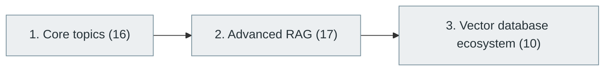

# 43. Retrieval-Augmented Generation (RAG)

> [Home](../../../README.md) › [Part IX — Artificial Intelligence and Machine Learning](../index.md) › Subject 43

- **Status:** Not started (0 of 43 syllabus topics have a drafted lesson)
- **Source tags:** —
- **Syllabus size:** 3 chapters, 43 topics

## Introduction

Combining retrieval with generation: chunking, embeddings, vector search, advanced RAG techniques and the vector-database ecosystem.

## Learning outcomes

After working through this subject you should be able to:

- Build a retrieval pipeline and measure retrieval quality
- Diagnose whether failures come from retrieval or generation
- Choose chunking and indexing strategies

## Prerequisites

- [15. Database Management Systems (DBMS)](../../04-building-software-products/15-database-management-systems/index.md)
- [42. Large Language Models (LLMs)](../42-large-language-models/index.md)

## Beginner-to-advanced progression

The chapters below follow the order of the source syllabus, which moves from foundational to advanced material. Colour shows documentation status (grey = not started, amber = in progress, green = drafted or better).

## Chapters and topics

### Chapter 1: Core topics

16 topics · status: **Not started** · *heading synthesized (not in source)*

*Planned location:* `docs/09-artificial-intelligence-and-machine-learning/43-retrieval-augmented-generation/01-core-topics/`. No lessons yet.

Syllabus topics in this chapter (16)

- `43.01.01` RAG fundamentals — *not started*
- `43.01.02` Document ingestion — *not started*
- `43.01.03` Document parsing — *not started*
- `43.01.04` Data cleaning — *not started*
- `43.01.05` Chunking — *not started*
- `43.01.06` Overlapping chunks — *not started*
- `43.01.07` Embedding generation — *not started*
- `43.01.08` Vector similarity — *not started*
- `43.01.09` Cosine similarity — *not started*
- `43.01.10` Nearest-neighbor search — *not started*
- `43.01.11` Vector indexing — *not started*
- `43.01.12` Metadata filtering — *not started*
- `43.01.13` Retrieval — *not started*
- `43.01.14` Prompt augmentation — *not started*
- `43.01.15` Answer generation — *not started*
- `43.01.16` Citation generation — *not started*

### Chapter 2: Advanced RAG

17 topics · status: **Not started**

*Planned location:* `docs/09-artificial-intelligence-and-machine-learning/43-retrieval-augmented-generation/02-advanced-rag/`. No lessons yet.

Syllabus topics in this chapter (17)

- `43.02.01` Hybrid search — *not started*
- `43.02.02` Dense retrieval — *not started*
- `43.02.03` Sparse retrieval — *not started*
- `43.02.04` BM25 — *not started*
- `43.02.05` Reranking — *not started*
- `43.02.06` Query expansion — *not started*
- `43.02.07` Query decomposition — *not started*
- `43.02.08` Multi-query retrieval — *not started*
- `43.02.09` HyDE — *not started*
- `43.02.10` Context compression — *not started*
- `43.02.11` Graph RAG — *not started*
- `43.02.12` Agentic RAG — *not started*
- `43.02.13` Corrective RAG — *not started*
- `43.02.14` Adaptive retrieval — *not started*
- `43.02.15` Multimodal RAG — *not started*
- `43.02.16` Retrieval evaluation — *not started*
- `43.02.17` Groundedness evaluation — *not started*

### Chapter 3: Vector database ecosystem

10 topics · status: **Not started**

*Planned location:* `docs/09-artificial-intelligence-and-machine-learning/43-retrieval-augmented-generation/03-vector-database-ecosystem/`. No lessons yet.

Syllabus topics in this chapter (10)

- `43.03.01` FAISS — *not started*
- `43.03.02` Milvus — *not started*
- `43.03.03` Qdrant — *not started*
- `43.03.04` Weaviate — *not started*
- `43.03.05` Pinecone — *not started*
- `43.03.06` Chroma — *not started*
- `43.03.07` pgvector — *not started*
- `43.03.08` Elasticsearch — *not started*
- `43.03.09` OpenSearch — *not started*
- `43.03.10` Vespa — *not started*

## Recommended reading order

1. Chapter 1 — Core topics
2. Chapter 2 — Advanced RAG
3. Chapter 3 — Vector database ecosystem

Within a chapter, read lessons in numeric order. Pick the later chapters only when the earlier ones feel comfortable; the syllabus orders them from fundamental to advanced.

## Related subjects

- [44. AI Agents and Agentic Systems](../44-ai-agents-and-agentic-systems/index.md)
- [45. AI Engineering and MLOps](../45-ai-engineering-and-mlops/index.md)

## Suggested practical projects

- A RAG question-answering system over a document set with an evaluation set
- A comparison of retrieval strategies

*Full project write-ups (requirements, architecture, stages, tests, extensions) are planned; see [ROADMAP.md](../../../ROADMAP.md).*

---

**Previous subject:** [42. Large Language Models (LLMs)](../42-large-language-models/index.md) · **Up:** [Part IX](../index.md) · **Next subject:** [44. AI Agents and Agentic Systems](../44-ai-agents-and-agentic-systems/index.md)
