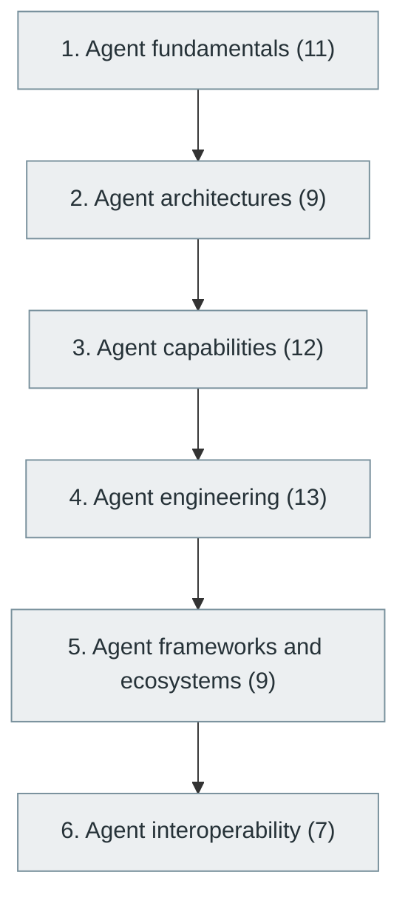

# 44. AI Agents and Agentic Systems

> [Home](../../../README.md) › [Part IX — Artificial Intelligence and Machine Learning](../index.md) › Subject 44

- **Status:** Not started (0 of 61 syllabus topics have a drafted lesson)
- **Source tags:** Advanced and rapidly evolving area
- **Syllabus size:** 6 chapters, 61 topics

## Introduction

Agent fundamentals and architectures, capabilities such as tool use and planning, agent engineering, frameworks and interoperability.

## Learning outcomes

After working through this subject you should be able to:

- Design an agent loop with tools, memory and guardrails
- Evaluate agents beyond a single success rate
- Limit the blast radius of agent actions

## Prerequisites

- [42. Large Language Models (LLMs)](../42-large-language-models/index.md)
- [43. Retrieval-Augmented Generation (RAG)](../43-retrieval-augmented-generation/index.md)

## Beginner-to-advanced progression

The chapters below follow the order of the source syllabus, which moves from foundational to advanced material. Colour shows documentation status (grey = not started, amber = in progress, green = drafted or better).

## Chapters and topics

### Chapter 1: Agent fundamentals

11 topics · status: **Not started**

*Planned location:* `docs/09-artificial-intelligence-and-machine-learning/44-ai-agents-and-agentic-systems/01-agent-fundamentals/`. No lessons yet.

Syllabus topics in this chapter (11)

- `44.01.01` What is an AI agent? — *not started*
- `44.01.02` Agent vs chatbot — *not started*
- `44.01.03` Autonomous agents — *not started*
- `44.01.04` Goals — *not started*
- `44.01.05` State — *not started*
- `44.01.06` Memory — *not started*
- `44.01.07` Planning — *not started*
- `44.01.08` Reasoning — *not started*
- `44.01.09` Action selection — *not started*
- `44.01.10` Tool usage — *not started*
- `44.01.11` Environment interaction — *not started*

### Chapter 2: Agent architectures

9 topics · status: **Not started**

*Planned location:* `docs/09-artificial-intelligence-and-machine-learning/44-ai-agents-and-agentic-systems/02-agent-architectures/`. No lessons yet.

Syllabus topics in this chapter (9)

- `44.02.01` ReAct — *not started*
- `44.02.02` Plan-and-execute — *not started*
- `44.02.03` Reflection — *not started*
- `44.02.04` Hierarchical agents — *not started*
- `44.02.05` Supervisor-worker — *not started*
- `44.02.06` Multi-agent systems — *not started*
- `44.02.07` Agent swarms — *not started*
- `44.02.08` Workflow-based agents — *not started*
- `44.02.09` Event-driven agents — *not started*

### Chapter 3: Agent capabilities

12 topics · status: **Not started**

*Planned location:* `docs/09-artificial-intelligence-and-machine-learning/44-ai-agents-and-agentic-systems/03-agent-capabilities/`. No lessons yet.

Syllabus topics in this chapter (12)

- `44.03.01` Tool calling — *not started*
- `44.03.02` Function calling — *not started*
- `44.03.03` Browser interaction — *not started*
- `44.03.04` Code execution — *not started*
- `44.03.05` Database queries — *not started*
- `44.03.06` API invocation — *not started*
- `44.03.07` File handling — *not started*
- `44.03.08` Memory retrieval — *not started*
- `44.03.09` Task decomposition — *not started*
- `44.03.10` Planning and scheduling — *not started*
- `44.03.11` Human approval — *not started*
- `44.03.12` Long-running tasks — *not started*

### Chapter 4: Agent engineering

13 topics · status: **Not started**

*Planned location:* `docs/09-artificial-intelligence-and-machine-learning/44-ai-agents-and-agentic-systems/04-agent-engineering/`. No lessons yet.

Syllabus topics in this chapter (13)

- `44.04.01` Agent orchestration — *not started*
- `44.04.02` Agent state management — *not started*
- `44.04.03` Context management — *not started*
- `44.04.04` Memory systems — *not started*
- `44.04.05` Checkpointing — *not started*
- `44.04.06` Agent evaluation — *not started*
- `44.04.07` Tool reliability — *not started*
- `44.04.08` Permission boundaries — *not started*
- `44.04.09` Sandboxing — *not started*
- `44.04.10` Human-in-the-loop — *not started*
- `44.04.11` Prompt injection defense — *not started*
- `44.04.12` Observability — *not started*
- `44.04.13` Cost management — *not started*

### Chapter 5: Agent frameworks and ecosystems

9 topics · status: **Not started**

*Planned location:* `docs/09-artificial-intelligence-and-machine-learning/44-ai-agents-and-agentic-systems/05-agent-frameworks-and-ecosystems/`. No lessons yet.

Syllabus topics in this chapter (9)

- `44.05.01` LangChain — *not started*
- `44.05.02` LangGraph — *not started*
- `44.05.03` LlamaIndex — *not started*
- `44.05.04` Semantic Kernel — *not started*
- `44.05.05` AutoGen — *not started*
- `44.05.06` CrewAI — *not started*
- `44.05.07` Haystack — *not started*
- `44.05.08` DSPy — *not started*
- `44.05.09` OpenAI Agents SDK — *not started*

### Chapter 6: Agent interoperability

7 topics · status: **Not started**

*Planned location:* `docs/09-artificial-intelligence-and-machine-learning/44-ai-agents-and-agentic-systems/06-agent-interoperability/`. No lessons yet.

Syllabus topics in this chapter (7)

- `44.06.01` Model Context Protocol (MCP) — *not started*
- `44.06.02` Agent-to-agent communication — *not started*
- `44.06.03` Tool discovery — *not started*
- `44.06.04` Structured tool interfaces — *not started*
- `44.06.05` Agent identity — *not started*
- `44.06.06` Delegation and authorization — *not started*
- `44.06.07` Interoperability standards — *not started*

## Recommended reading order

1. Chapter 1 — Agent fundamentals
2. Chapter 2 — Agent architectures
3. Chapter 3 — Agent capabilities
4. Chapter 4 — Agent engineering
5. Chapter 5 — Agent frameworks and ecosystems
6. Chapter 6 — Agent interoperability

Within a chapter, read lessons in numeric order. Pick the later chapters only when the earlier ones feel comfortable; the syllabus orders them from fundamental to advanced.

## Related subjects

- [45. AI Engineering and MLOps](../45-ai-engineering-and-mlops/index.md)
- [46. Responsible AI, AI Safety and AI Governance](../46-responsible-ai-safety-and-governance/index.md)
- [58. AI Tools Used by Modern Software Engineers](../../11-ai-assisted-software-engineering/58-ai-tools-for-software-engineers/index.md)

## Suggested practical projects

- A tool-using agent with permissions and an audit log
- A multi-step agent benchmark with failure analysis

*Full project write-ups (requirements, architecture, stages, tests, extensions) are planned; see [ROADMAP.md](../../../ROADMAP.md).*

---

**Previous subject:** [43. Retrieval-Augmented Generation (RAG)](../43-retrieval-augmented-generation/index.md) · **Up:** [Part IX](../index.md) · **Next subject:** [45. AI Engineering and MLOps](../45-ai-engineering-and-mlops/index.md)
