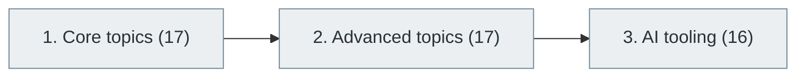

# 45. AI Engineering and MLOps

> [Home](../../../README.md) › [Part IX — Artificial Intelligence and Machine Learning](../index.md) › Subject 45

- **Status:** Not started (0 of 50 syllabus topics have a drafted lesson)
- **Source tags:** —
- **Syllabus size:** 3 chapters, 50 topics

## Introduction

Taking AI systems to production: data and model pipelines, deployment, monitoring, evaluation, infrastructure and the tooling ecosystem.

## Learning outcomes

After working through this subject you should be able to:

- Build a reproducible training and deployment pipeline
- Monitor drift and quality in production
- Manage cost and latency of model serving

## Prerequisites

- [26. DevOps Engineering](../../06-cloud-devops-and-infrastructure/26-devops-engineering/index.md)
- [36. Machine Learning](../36-machine-learning/index.md)

## Beginner-to-advanced progression

The chapters below follow the order of the source syllabus, which moves from foundational to advanced material. Colour shows documentation status (grey = not started, amber = in progress, green = drafted or better).

## Chapters and topics

### Chapter 1: Core topics

17 topics · status: **Not started** · *heading synthesized (not in source)*

*Planned location:* `docs/09-artificial-intelligence-and-machine-learning/45-ai-engineering-and-mlops/01-core-topics/`. No lessons yet.

Syllabus topics in this chapter (17)

- `45.01.01` Model training pipelines — *not started*
- `45.01.02` Dataset management — *not started*
- `45.01.03` Experiment tracking — *not started*
- `45.01.04` Model versioning — *not started*
- `45.01.05` Model registries — *not started*
- `45.01.06` Model deployment — *not started*
- `45.01.07` Model serving — *not started*
- `45.01.08` Batch inference — *not started*
- `45.01.09` Online inference — *not started*
- `45.01.10` GPU scheduling — *not started*
- `45.01.11` Feature stores — *not started*
- `45.01.12` Data drift — *not started*
- `45.01.13` Concept drift — *not started*
- `45.01.14` Model monitoring — *not started*
- `45.01.15` Model evaluation — *not started*
- `45.01.16` Model retraining — *not started*
- `45.01.17` Pipeline orchestration — *not started*

### Chapter 2: Advanced topics

17 topics · status: **Not started**

*Planned location:* `docs/09-artificial-intelligence-and-machine-learning/45-ai-engineering-and-mlops/02-advanced-topics/`. No lessons yet.

Syllabus topics in this chapter (17)

- `45.02.01` Distributed training — *not started*
- `45.02.02` GPU clusters — *not started*
- `45.02.03` Parameter servers — *not started*
- `45.02.04` Training optimization — *not started*
- `45.02.05` Model compression — *not started*
- `45.02.06` Quantization — *not started*
- `45.02.07` Distillation — *not started*
- `45.02.08` Serving optimization — *not started*
- `45.02.09` Model caching — *not started*
- `45.02.10` Inference routing — *not started*
- `45.02.11` LLM gateways — *not started*
- `45.02.12` Guardrails — *not started*
- `45.02.13` Red teaming — *not started*
- `45.02.14` AI security — *not started*
- `45.02.15` AI observability — *not started*
- `45.02.16` LLMOps — *not started*
- `45.02.17` Evaluation-driven development — *not started*

### Chapter 3: AI tooling

16 topics · status: **Not started**

*Planned location:* `docs/09-artificial-intelligence-and-machine-learning/45-ai-engineering-and-mlops/03-ai-tooling/`. No lessons yet.

Syllabus topics in this chapter (16)

- `45.03.01` MLflow — *not started*
- `45.03.02` Kubeflow — *not started*
- `45.03.03` Ray — *not started*
- `45.03.04` Weights & Biases — *not started*
- `45.03.05` DVC — *not started*
- `45.03.06` Hugging Face — *not started*
- `45.03.07` BentoML — *not started*
- `45.03.08` KServe — *not started*
- `45.03.09` Seldon — *not started*
- `45.03.10` NVIDIA Triton — *not started*
- `45.03.11` vLLM — *not started*
- `45.03.12` Ollama — *not started*
- `45.03.13` LiteLLM — *not started*
- `45.03.14` Langfuse — *not started*
- `45.03.15` Arize — *not started*
- `45.03.16` Evidently — *not started*

## Recommended reading order

1. Chapter 1 — Core topics
2. Chapter 2 — Advanced topics
3. Chapter 3 — AI tooling

Within a chapter, read lessons in numeric order. Pick the later chapters only when the earlier ones feel comfortable; the syllabus orders them from fundamental to advanced.

## Related subjects

- [42. Large Language Models (LLMs)](../42-large-language-models/index.md)
- [43. Retrieval-Augmented Generation (RAG)](../43-retrieval-augmented-generation/index.md)
- [44. AI Agents and Agentic Systems](../44-ai-agents-and-agentic-systems/index.md)

## Suggested practical projects

- A model-serving service with monitoring
- A CI pipeline that evaluates a model before release

*Full project write-ups (requirements, architecture, stages, tests, extensions) are planned; see [ROADMAP.md](../../../ROADMAP.md).*

---

**Previous subject:** [44. AI Agents and Agentic Systems](../44-ai-agents-and-agentic-systems/index.md) · **Up:** [Part IX](../index.md) · **Next subject:** [46. Responsible AI, AI Safety and AI Governance](../46-responsible-ai-safety-and-governance/index.md)
