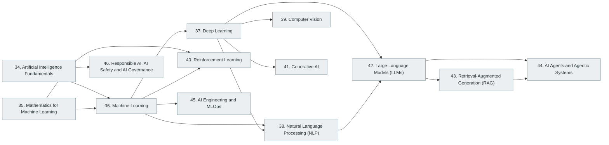

# Part IX — Artificial Intelligence and Machine Learning

> [Home](../../README.md) › Part IX

**Status:** Not started

A single progression from mathematics and statistics through classical machine learning, deep learning, language and vision, to LLMs, RAG, agents, MLOps and AI safety.

*Source tag: Major modern engineering discipline*

## Subjects in this part

| # | Subject | What it covers | Topics | Status |
| --- | --- | --- | --- | --- |
| 34 | [Artificial Intelligence Fundamentals](34-artificial-intelligence-fundamentals/index.md) | What AI is and is not: its history, problem formulations, search, knowledge representation, learning and the landscape of approaches, before any machine-learning or LLM specifics. | 17 | Not started |
| 35 | [Mathematics for Machine Learning](35-mathematics-for-machine-learning/index.md) | The linear algebra, calculus, probability, statistics and optimisation that machine-learning algorithms are built from. | 17 | Not started |
| 36 | [Machine Learning](36-machine-learning/index.md) | Machine-learning fundamentals, supervised, unsupervised, semi-supervised and self-supervised learning, model evaluation and advanced topics. | 65 | Not started |
| 37 | [Deep Learning](37-deep-learning/index.md) | Neural-network fundamentals, major architectures, advanced deep learning and the main frameworks. | 43 | Not started |
| 38 | [Natural Language Processing (NLP)](38-natural-language-processing/index.md) | Representing and processing human language: classical NLP, embeddings, sequence models and advanced topics. | 32 | Not started |
| 39 | [Computer Vision](39-computer-vision/index.md) | Image formation, classical vision, convolutional and transformer-based models, detection, segmentation and advanced topics. | 27 | Not started |
| 40 | [Reinforcement Learning](40-reinforcement-learning/index.md) | Sequential decision making: Markov decision processes, value and policy methods, deep reinforcement learning and applications. | 24 | Not started |
| 41 | [Generative AI](41-generative-ai/index.md) | Generative modelling basics, generative architectures, applications and techniques for adapting models. | 33 | Not started |
| 42 | [Large Language Models (LLMs)](42-large-language-models/index.md) | LLM fundamentals, the transformer architecture, model families, development practice and advanced topics. | 64 | Not started |
| 43 | [Retrieval-Augmented Generation (RAG)](43-retrieval-augmented-generation/index.md) | Combining retrieval with generation: chunking, embeddings, vector search, advanced RAG techniques and the vector-database ecosystem. | 43 | Not started |
| 44 | [AI Agents and Agentic Systems](44-ai-agents-and-agentic-systems/index.md) | Agent fundamentals and architectures, capabilities such as tool use and planning, agent engineering, frameworks and interoperability. | 61 | Not started |
| 45 | [AI Engineering and MLOps](45-ai-engineering-and-mlops/index.md) | Taking AI systems to production: data and model pipelines, deployment, monitoring, evaluation, infrastructure and the tooling ecosystem. | 50 | Not started |
| 46 | [Responsible AI, AI Safety and AI Governance](46-responsible-ai-safety-and-governance/index.md) | Fairness, transparency, privacy, safety, security of AI systems, governance frameworks and regulation. | 23 | Not started |

## How the subjects depend on each other

Solid arrows point from a prerequisite to the subject that builds on it. Only dependencies inside this part are drawn.

## What you need from other parts

| Subject in this part | Prerequisite elsewhere |
| --- | --- |
| [34. Artificial Intelligence Fundamentals](34-artificial-intelligence-fundamentals/index.md) | [2. Mathematics for Computer Science](../01-computer-science-foundations/02-mathematics-for-computer-science/index.md) |
| [34. Artificial Intelligence Fundamentals](34-artificial-intelligence-fundamentals/index.md) | [6. Programming Fundamentals](../02-programming-and-software-development/06-programming-fundamentals/index.md) |
| [35. Mathematics for Machine Learning](35-mathematics-for-machine-learning/index.md) | [2. Mathematics for Computer Science](../01-computer-science-foundations/02-mathematics-for-computer-science/index.md) |
| [36. Machine Learning](36-machine-learning/index.md) | [6. Programming Fundamentals](../02-programming-and-software-development/06-programming-fundamentals/index.md) |
| [43. Retrieval-Augmented Generation (RAG)](43-retrieval-augmented-generation/index.md) | [15. Database Management Systems (DBMS)](../04-building-software-products/15-database-management-systems/index.md) |
| [45. AI Engineering and MLOps](45-ai-engineering-and-mlops/index.md) | [26. DevOps Engineering](../06-cloud-devops-and-infrastructure/26-devops-engineering/index.md) |

---

**Previous part:** [Part VIII](../08-data-engineering-data-science-and-analytics/index.md) · **Up:** [Master index](../../MASTER-INDEX.md) · **Next part:** [Part X](../10-specialized-software-engineering-domains/index.md)
