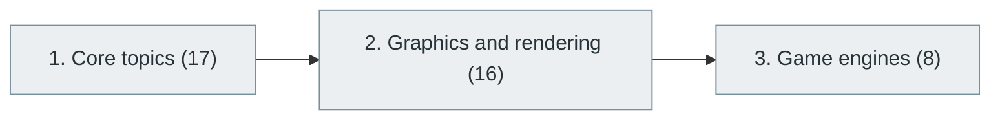

# 47. Game Development

> [Home](../../../README.md) › [Part X — Specialized Software Engineering Domains](../index.md) › Subject 47

- **Status:** Not started (0 of 41 syllabus topics have a drafted lesson)
- **Source tags:** —
- **Syllabus size:** 3 chapters, 41 topics

## Introduction

Game programming, graphics and rendering, game engines and the architecture of real-time interactive software.

## Learning outcomes

After working through this subject you should be able to:

- Build a game loop and a simple entity system
- Explain the rendering pipeline
- Use a game engine productively

## Prerequisites

- [2. Mathematics for Computer Science](../../01-computer-science-foundations/02-mathematics-for-computer-science/index.md)
- [6. Programming Fundamentals](../../02-programming-and-software-development/06-programming-fundamentals/index.md)
- [9. Data Structures and Algorithms (DSA)](../../02-programming-and-software-development/09-data-structures-and-algorithms/index.md)

## Beginner-to-advanced progression

The chapters below follow the order of the source syllabus, which moves from foundational to advanced material. Colour shows documentation status (grey = not started, amber = in progress, green = drafted or better).

## Chapters and topics

### Chapter 1: Core topics

17 topics · status: **Not started** · *heading synthesized (not in source)*

*Planned location:* `docs/10-specialized-software-engineering-domains/47-game-development/01-core-topics/`. No lessons yet.

Syllabus topics in this chapter (17)

- `47.01.01` Game programming fundamentals — *not started*
- `47.01.02` Game loops — *not started*
- `47.01.03` Input handling — *not started*
- `47.01.04` Game physics — *not started*
- `47.01.05` Collision detection — *not started*
- `47.01.06` Animation — *not started*
- `47.01.07` Character controllers — *not started*
- `47.01.08` Scene management — *not started*
- `47.01.09` Game AI — *not started*
- `47.01.10` Pathfinding — *not started*
- `47.01.11` Multiplayer networking — *not started*
- `47.01.12` Game state management — *not started*
- `47.01.13` Game asset pipelines — *not started*
- `47.01.14` Rendering — *not started*
- `47.01.15` Game optimization — *not started*
- `47.01.16` Game testing — *not started*
- `47.01.17` Game distribution — *not started*

### Chapter 2: Graphics and rendering

16 topics · status: **Not started**

*Planned location:* `docs/10-specialized-software-engineering-domains/47-game-development/02-graphics-and-rendering/`. No lessons yet.

Syllabus topics in this chapter (16)

- `47.02.01` 2D graphics — *not started*
- `47.02.02` 3D graphics — *not started*
- `47.02.03` Coordinate systems — *not started*
- `47.02.04` Vectors and matrices — *not started*
- `47.02.05` Transformations — *not started*
- `47.02.06` Camera systems — *not started*
- `47.02.07` Rasterization — *not started*
- `47.02.08` Shaders — *not started*
- `47.02.09` Lighting — *not started*
- `47.02.10` Materials — *not started*
- `47.02.11` Textures — *not started*
- `47.02.12` Ray tracing — *not started*
- `47.02.13` Global illumination — *not started*
- `47.02.14` Physically based rendering — *not started*
- `47.02.15` Real-time rendering — *not started*
- `47.02.16` GPU programming — *not started*

### Chapter 3: Game engines

8 topics · status: **Not started**

*Planned location:* `docs/10-specialized-software-engineering-domains/47-game-development/03-game-engines/`. No lessons yet.

Syllabus topics in this chapter (8)

- `47.03.01` **Unity** — 2D, 3D and mobile games — *not started*
- `47.03.02` **Unreal Engine** — Advanced real-time 3D — *not started*
- `47.03.03` Godot — *not started*
- `47.03.04` GameMaker — *not started*
- `47.03.05` Defold — *not started*
- `47.03.06` CryEngine — *not started*
- `47.03.07` O3DE — *not started*
- `47.03.08` Bevy — *not started*

## Recommended reading order

1. Chapter 1 — Core topics
2. Chapter 2 — Graphics and rendering
3. Chapter 3 — Game engines

Within a chapter, read lessons in numeric order. Pick the later chapters only when the earlier ones feel comfortable; the syllabus orders them from fundamental to advanced.

## Related subjects

- [48. AR, VR, MR and Spatial Computing](../48-ar-vr-mr-and-spatial-computing/index.md)
- [53. High-Performance Computing (HPC)](../53-high-performance-computing/index.md)

## Suggested practical projects

- A 2D game with physics and collision
- A software rasteriser

*Full project write-ups (requirements, architecture, stages, tests, extensions) are planned; see [ROADMAP.md](../../../ROADMAP.md).*

---

**Previous subject:** [46. Responsible AI, AI Safety and AI Governance](../../09-artificial-intelligence-and-machine-learning/46-responsible-ai-safety-and-governance/index.md) · **Up:** [Part X](../index.md) · **Next subject:** [48. AR, VR, MR and Spatial Computing](../48-ar-vr-mr-and-spatial-computing/index.md)
