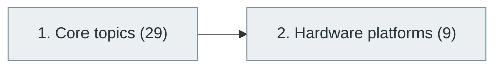

# 49. Embedded Systems and Firmware Engineering

> [Home](../../../README.md) › [Part X — Specialized Software Engineering Domains](../index.md) › Subject 49

- **Status:** Not started (0 of 38 syllabus topics have a drafted lesson)
- **Source tags:** —
- **Syllabus size:** 2 chapters, 38 topics

## Introduction

Programming constrained devices: microcontrollers, peripherals, real-time operating systems, firmware design and hardware platforms.

## Learning outcomes

After working through this subject you should be able to:

- Read a datasheet and drive peripherals
- Write interrupt-driven, resource-aware firmware
- Reason about real-time constraints

## Prerequisites

- [3. Digital Logic and Computer Organization](../../01-computer-science-foundations/03-digital-logic-and-computer-organization/index.md)
- [6. Programming Fundamentals](../../02-programming-and-software-development/06-programming-fundamentals/index.md)

## Beginner-to-advanced progression

The chapters below follow the order of the source syllabus, which moves from foundational to advanced material. Colour shows documentation status (grey = not started, amber = in progress, green = drafted or better).

## Chapters and topics

### Chapter 1: Core topics

29 topics · status: **Not started** · *heading synthesized (not in source)*

*Planned location:* `docs/10-specialized-software-engineering-domains/49-embedded-systems-and-firmware-engineering/01-core-topics/`. No lessons yet.

Syllabus topics in this chapter (29)

- `49.01.01` Digital electronics — *not started*
- `49.01.02` Microprocessors — *not started*
- `49.01.03` Microcontrollers — *not started*
- `49.01.04` Firmware — *not started*
- `49.01.05` C programming — *not started*
- `49.01.06` C++ programming — *not started*
- `49.01.07` Assembly — *not started*
- `49.01.08` Memory-mapped I/O — *not started*
- `49.01.09` GPIO — *not started*
- `49.01.10` Interrupts — *not started*
- `49.01.11` Timers — *not started*
- `49.01.12` ADC — *not started*
- `49.01.13` DAC — *not started*
- `49.01.14` UART — *not started*
- `49.01.15` SPI — *not started*
- `49.01.16` I2C — *not started*
- `49.01.17` CAN — *not started*
- `49.01.18` USB — *not started*
- `49.01.19` PWM — *not started*
- `49.01.20` DMA — *not started*
- `49.01.21` Bootloaders — *not started*
- `49.01.22` Device drivers — *not started*
- `49.01.23` RTOS — *not started*
- `49.01.24` Embedded Linux — *not started*
- `49.01.25` Firmware updates — *not started*
- `49.01.26` Secure boot — *not started*
- `49.01.27` Hardware debugging — *not started*
- `49.01.28` Power management — *not started*
- `49.01.29` Real-time constraints — *not started*

### Chapter 2: Hardware platforms

9 topics · status: **Not started**

*Planned location:* `docs/10-specialized-software-engineering-domains/49-embedded-systems-and-firmware-engineering/02-hardware-platforms/`. No lessons yet.

Syllabus topics in this chapter (9)

- `49.02.01` Arduino — *not started*
- `49.02.02` ESP32 — *not started*
- `49.02.03` Raspberry Pi — *not started*
- `49.02.04` STM32 — *not started*
- `49.02.05` ARM Cortex-M — *not started*
- `49.02.06` RISC-V microcontrollers — *not started*
- `49.02.07` BeagleBone — *not started*
- `49.02.08` NVIDIA Jetson — *not started*
- `49.02.09` FPGA development boards — *not started*

## Recommended reading order

1. Chapter 1 — Core topics
2. Chapter 2 — Hardware platforms

Within a chapter, read lessons in numeric order. Pick the later chapters only when the earlier ones feel comfortable; the syllabus orders them from fundamental to advanced.

## Related subjects

- [4. Operating Systems](../../01-computer-science-foundations/04-operating-systems/index.md)
- [50. Internet of Things (IoT)](../50-internet-of-things/index.md)
- [51. Robotics and Autonomous Systems](../51-robotics-and-autonomous-systems/index.md)

## Suggested practical projects

- A sensor-logging device on a microcontroller
- A small RTOS-based multitasking application

*Full project write-ups (requirements, architecture, stages, tests, extensions) are planned; see [ROADMAP.md](../../../ROADMAP.md).*

---

**Previous subject:** [48. AR, VR, MR and Spatial Computing](../48-ar-vr-mr-and-spatial-computing/index.md) · **Up:** [Part X](../index.md) · **Next subject:** [50. Internet of Things (IoT)](../50-internet-of-things/index.md)
