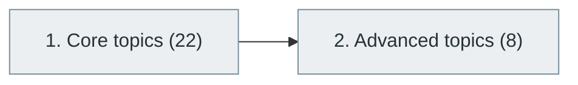

# 51. Robotics and Autonomous Systems

> [Home](../../../README.md) › [Part X — Specialized Software Engineering Domains](../index.md) › Subject 51

- **Status:** Not started (0 of 30 syllabus topics have a drafted lesson)
- **Source tags:** —
- **Syllabus size:** 2 chapters, 30 topics

## Introduction

Kinematics, sensing, control, perception, planning and the software stacks used to build robots and autonomous systems.

## Learning outcomes

After working through this subject you should be able to:

- Model robot kinematics
- Implement a feedback controller
- Explain a perception, planning and control stack

## Prerequisites

- [2. Mathematics for Computer Science](../../01-computer-science-foundations/02-mathematics-for-computer-science/index.md)
- [6. Programming Fundamentals](../../02-programming-and-software-development/06-programming-fundamentals/index.md)

## Beginner-to-advanced progression

The chapters below follow the order of the source syllabus, which moves from foundational to advanced material. Colour shows documentation status (grey = not started, amber = in progress, green = drafted or better).

## Chapters and topics

### Chapter 1: Core topics

22 topics · status: **Not started** · *heading synthesized (not in source)*

*Planned location:* `docs/10-specialized-software-engineering-domains/51-robotics-and-autonomous-systems/01-core-topics/`. No lessons yet.

Syllabus topics in this chapter (22)

- `51.01.01` Robotics fundamentals — *not started*
- `51.01.02` Robot architecture — *not started*
- `51.01.03` Mechanical systems — *not started*
- `51.01.04` Sensors — *not started*
- `51.01.05` Actuators — *not started*
- `51.01.06` Kinematics — *not started*
- `51.01.07` Forward kinematics — *not started*
- `51.01.08` Inverse kinematics — *not started*
- `51.01.09` Dynamics — *not started*
- `51.01.10` Motion planning — *not started*
- `51.01.11` Path planning — *not started*
- `51.01.12` Control systems — *not started*
- `51.01.13` PID controllers — *not started*
- `51.01.14` SLAM — *not started*
- `51.01.15` Computer vision — *not started*
- `51.01.16` Localization — *not started*
- `51.01.17` Mapping — *not started*
- `51.01.18` Sensor fusion — *not started*
- `51.01.19` Robot operating systems — *not started*
- `51.01.20` Autonomous navigation — *not started*
- `51.01.21` Manipulation — *not started*
- `51.01.22` Human-robot interaction — *not started*

### Chapter 2: Advanced topics

8 topics · status: **Not started**

*Planned location:* `docs/10-specialized-software-engineering-domains/51-robotics-and-autonomous-systems/02-advanced-topics/`. No lessons yet.

Syllabus topics in this chapter (8)

- `51.02.01` Autonomous vehicles — *not started*
- `51.02.02` Swarm robotics — *not started*
- `51.02.03` Multi-robot coordination — *not started*
- `51.02.04` Reinforcement learning for robotics — *not started*
- `51.02.05` Robot foundation models — *not started*
- `51.02.06` Vision-language-action models — *not started*
- `51.02.07` Embodied AI — *not started*
- `51.02.08` Humanoid robotics — *not started*

## Recommended reading order

1. Chapter 1 — Core topics
2. Chapter 2 — Advanced topics

Within a chapter, read lessons in numeric order. Pick the later chapters only when the earlier ones feel comfortable; the syllabus orders them from fundamental to advanced.

## Related subjects

- [39. Computer Vision](../../09-artificial-intelligence-and-machine-learning/39-computer-vision/index.md)
- [40. Reinforcement Learning](../../09-artificial-intelligence-and-machine-learning/40-reinforcement-learning/index.md)
- [49. Embedded Systems and Firmware Engineering](../49-embedded-systems-and-firmware-engineering/index.md)

## Suggested practical projects

- A simulated differential-drive robot with obstacle avoidance
- A PID controller tuned in simulation

*Full project write-ups (requirements, architecture, stages, tests, extensions) are planned; see [ROADMAP.md](../../../ROADMAP.md).*

---

**Previous subject:** [50. Internet of Things (IoT)](../50-internet-of-things/index.md) · **Up:** [Part X](../index.md) · **Next subject:** [52. Blockchain and Web3](../52-blockchain-and-web3/index.md)
