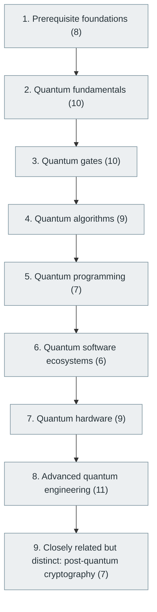

# 54. Quantum Computing

> [Home](../../../README.md) › [Part X — Specialized Software Engineering Domains](../index.md) › Subject 54

- **Status:** Not started (0 of 77 syllabus topics have a drafted lesson)
- **Source tags:** Frontier computing
- **Syllabus size:** 9 chapters, 77 topics

## Introduction

Qubits, gates, circuits and measurement, quantum algorithms, error correction, hardware, programming frameworks and post-quantum cryptography, built up from linear algebra and probability.

> This is a substantial specialization of its own. It is not just another programming framework.

## Learning outcomes

After working through this subject you should be able to:

- Simulate small quantum circuits with linear algebra
- Explain superposition, entanglement and measurement correctly
- State what quantum algorithms do and do not speed up

## Prerequisites

- [2. Mathematics for Computer Science](../../01-computer-science-foundations/02-mathematics-for-computer-science/index.md)

## Beginner-to-advanced progression

The chapters below follow the order of the source syllabus, which moves from foundational to advanced material. Colour shows documentation status (grey = not started, amber = in progress, green = drafted or better).

## Chapters and topics

### Chapter 1: Prerequisite foundations

8 topics · status: **Not started**

*Planned location:* `docs/10-specialized-software-engineering-domains/54-quantum-computing/01-prerequisite-foundations/`. No lessons yet.

Syllabus topics in this chapter (8)

- `54.01.01` Linear algebra — *not started*
- `54.01.02` Complex numbers — *not started*
- `54.01.03` Probability — *not started*
- `54.01.04` Matrix operations — *not started*
- `54.01.05` Tensor products — *not started*
- `54.01.06` Basic quantum mechanics — *not started*
- `54.01.07` Vector spaces — *not started*
- `54.01.08` Hilbert spaces — *not started*

### Chapter 2: Quantum fundamentals

10 topics · status: **Not started**

*Planned location:* `docs/10-specialized-software-engineering-domains/54-quantum-computing/02-quantum-fundamentals/`. No lessons yet.

Syllabus topics in this chapter (10)

- `54.02.01` Classical bits vs qubits — *not started*
- `54.02.02` Superposition — *not started*
- `54.02.03` Entanglement — *not started*
- `54.02.04` Quantum measurement — *not started*
- `54.02.05` Quantum states — *not started*
- `54.02.06` Bloch sphere — *not started*
- `54.02.07` Quantum gates — *not started*
- `54.02.08` Quantum circuits — *not started*
- `54.02.09` Quantum interference — *not started*
- `54.02.10` No-cloning theorem — *not started*

### Chapter 3: Quantum gates

10 topics · status: **Not started**

*Planned location:* `docs/10-specialized-software-engineering-domains/54-quantum-computing/03-quantum-gates/`. No lessons yet.

Syllabus topics in this chapter (10)

- `54.03.01` Pauli-X — *not started*
- `54.03.02` Pauli-Y — *not started*
- `54.03.03` Pauli-Z — *not started*
- `54.03.04` Hadamard — *not started*
- `54.03.05` Phase gates — *not started*
- `54.03.06` T gate — *not started*
- `54.03.07` CNOT — *not started*
- `54.03.08` Controlled gates — *not started*
- `54.03.09` Toffoli — *not started*
- `54.03.10` SWAP — *not started*

### Chapter 4: Quantum algorithms

9 topics · status: **Not started**

*Planned location:* `docs/10-specialized-software-engineering-domains/54-quantum-computing/04-quantum-algorithms/`. No lessons yet.

Syllabus topics in this chapter (9)

- `54.04.01` Deutsch-Jozsa — *not started*
- `54.04.02` Bernstein-Vazirani — *not started*
- `54.04.03` Simon's algorithm — *not started*
- `54.04.04` Grover's algorithm — *not started*
- `54.04.05` Shor's algorithm — *not started*
- `54.04.06` Quantum Fourier transform — *not started*
- `54.04.07` Quantum phase estimation — *not started*
- `54.04.08` Quantum walks — *not started*
- `54.04.09` Variational quantum algorithms — *not started*

### Chapter 5: Quantum programming

7 topics · status: **Not started**

*Planned location:* `docs/10-specialized-software-engineering-domains/54-quantum-computing/05-quantum-programming/`. No lessons yet.

Syllabus topics in this chapter (7)

- `54.05.01` Circuit creation — *not started*
- `54.05.02` Quantum simulation — *not started*
- `54.05.03` Circuit optimization — *not started*
- `54.05.04` Quantum measurement — *not started*
- `54.05.05` Hybrid quantum-classical programming — *not started*
- `54.05.06` Quantum algorithm implementation — *not started*
- `54.05.07` Quantum resource estimation — *not started*

### Chapter 6: Quantum software ecosystems

6 topics · status: **Not started**

*Planned location:* `docs/10-specialized-software-engineering-domains/54-quantum-computing/06-quantum-software-ecosystems/`. No lessons yet.

Syllabus topics in this chapter (6)

- `54.06.01` Qiskit — *not started*
- `54.06.02` Cirq — *not started*
- `54.06.03` PennyLane — *not started*
- `54.06.04` Amazon Braket — *not started*
- `54.06.05` CUDA-Q — *not started*
- `54.06.06` Q# — *not started*

### Chapter 7: Quantum hardware

9 topics · status: **Not started**

*Planned location:* `docs/10-specialized-software-engineering-domains/54-quantum-computing/07-quantum-hardware/`. No lessons yet.

Syllabus topics in this chapter (9)

- `54.07.01` Superconducting qubits — *not started*
- `54.07.02` Trapped-ion systems — *not started*
- `54.07.03` Neutral atoms — *not started*
- `54.07.04` Photonic quantum computing — *not started*
- `54.07.05` Spin qubits — *not started*
- `54.07.06` Quantum annealing — *not started*
- `54.07.07` Quantum processors — *not started*
- `54.07.08` Quantum control systems — *not started*
- `54.07.09` Quantum networking — *not started*

### Chapter 8: Advanced quantum engineering

11 topics · status: **Not started**

*Planned location:* `docs/10-specialized-software-engineering-domains/54-quantum-computing/08-advanced-quantum-engineering/`. No lessons yet.

Syllabus topics in this chapter (11)

- `54.08.01` Quantum error correction — *not started*
- `54.08.02` Logical qubits — *not started*
- `54.08.03` Surface codes — *not started*
- `54.08.04` Fault-tolerant quantum computing — *not started*
- `54.08.05` Error mitigation — *not started*
- `54.08.06` Quantum circuit compilation — *not started*
- `54.08.07` Quantum-classical integration — *not started*
- `54.08.08` Quantum resource optimization — *not started*
- `54.08.09` Distributed quantum computing — *not started*
- `54.08.10` Quantum machine learning — *not started*
- `54.08.11` Quantum simulation — *not started*

### Chapter 9: Closely related but distinct: post-quantum cryptography

7 topics · status: **Not started**

*Planned location:* `docs/10-specialized-software-engineering-domains/54-quantum-computing/09-closely-related-but-distinct-post-quantum-cryptography/`. No lessons yet.

Syllabus topics in this chapter (7)

- `54.09.01` Quantum-resistant cryptography — *not started*
- `54.09.02` Lattice-based cryptography — *not started*
- `54.09.03` Hash-based signatures — *not started*
- `54.09.04` Code-based cryptography — *not started*
- `54.09.05` Post-quantum key exchange — *not started*
- `54.09.06` Cryptographic migration — *not started*
- `54.09.07` Crypto agility — *not started*

## Recommended reading order

1. Chapter 1 — Prerequisite foundations
2. Chapter 2 — Quantum fundamentals
3. Chapter 3 — Quantum gates
4. Chapter 4 — Quantum algorithms
5. Chapter 5 — Quantum programming
6. Chapter 6 — Quantum software ecosystems
7. Chapter 7 — Quantum hardware
8. Chapter 8 — Advanced quantum engineering
9. Chapter 9 — Closely related but distinct: post-quantum cryptography

Within a chapter, read lessons in numeric order. Pick the later chapters only when the earlier ones feel comfortable; the syllabus orders them from fundamental to advanced.

## Related subjects

- [31. Cybersecurity and Software Security](../../07-software-quality-and-cybersecurity/31-cybersecurity-and-software-security/index.md)
- [53. High-Performance Computing (HPC)](../53-high-performance-computing/index.md)

## Suggested practical projects

- A state-vector simulator in Python
- Grover's algorithm on a small search space

*Full project write-ups (requirements, architecture, stages, tests, extensions) are planned; see [ROADMAP.md](../../../ROADMAP.md).*

---

**Previous subject:** [53. High-Performance Computing (HPC)](../53-high-performance-computing/index.md) · **Up:** [Part X](../index.md) · **Next subject:** [55. Edge Computing and Fog Computing](../55-edge-and-fog-computing/index.md)
