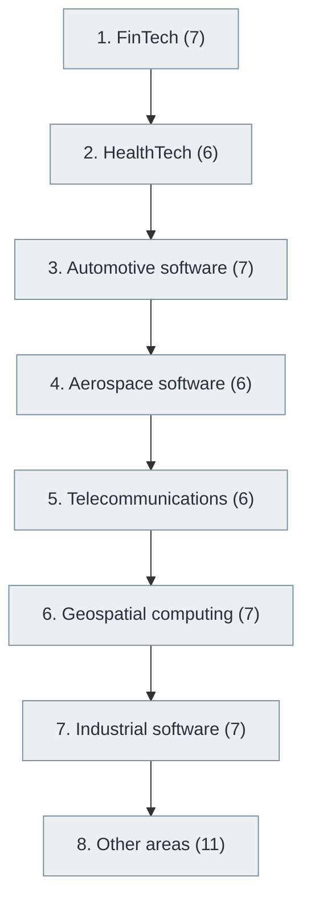

# 57. Other Specialized Domains

> [Home](../../../README.md) › [Part X — Specialized Software Engineering Domains](../index.md) › Subject 57

- **Status:** Not started (0 of 57 syllabus topics have a drafted lesson)
- **Source tags:** —
- **Syllabus size:** 8 chapters, 57 topics

## Introduction

Fields where software meets another industry: FinTech, HealthTech, automotive, aerospace, telecommunications, geospatial, industrial software and others.

> Software engineers can also work in fields where software intersects with another industry.

## Learning outcomes

After working through this subject you should be able to:

- Identify the regulatory and safety constraints of a domain
- Adapt general engineering practice to a regulated setting
- Find authoritative domain standards

## Prerequisites

None. This subject can be started without knowledge of another subject in this library.

## Beginner-to-advanced progression

The chapters below follow the order of the source syllabus, which moves from foundational to advanced material. Colour shows documentation status (grey = not started, amber = in progress, green = drafted or better).

## Chapters and topics

### Chapter 1: FinTech

7 topics · status: **Not started**

*Planned location:* `docs/10-specialized-software-engineering-domains/57-other-specialized-domains/01-fintech/`. No lessons yet.

Syllabus topics in this chapter (7)

- `57.01.01` Digital payments — *not started*
- `57.01.02` Banking systems — *not started*
- `57.01.03` Trading platforms — *not started*
- `57.01.04` Risk engines — *not started*
- `57.01.05` Fraud detection — *not started*
- `57.01.06` Financial data processing — *not started*
- `57.01.07` Regulatory reporting — *not started*

### Chapter 2: HealthTech

6 topics · status: **Not started**

*Planned location:* `docs/10-specialized-software-engineering-domains/57-other-specialized-domains/02-healthtech/`. No lessons yet.

Syllabus topics in this chapter (6)

- `57.02.01` Electronic health records — *not started*
- `57.02.02` Medical imaging — *not started*
- `57.02.03` Clinical software — *not started*
- `57.02.04` Hospital information systems — *not started*
- `57.02.05` Health data interoperability — *not started*
- `57.02.06` Medical AI — *not started*

### Chapter 3: Automotive software

7 topics · status: **Not started**

*Planned location:* `docs/10-specialized-software-engineering-domains/57-other-specialized-domains/03-automotive-software/`. No lessons yet.

Syllabus topics in this chapter (7)

- `57.03.01` Vehicle operating systems — *not started*
- `57.03.02` ECU programming — *not started*
- `57.03.03` CAN bus — *not started*
- `57.03.04` ADAS — *not started*
- `57.03.05` Autonomous driving — *not started*
- `57.03.06` Automotive cybersecurity — *not started*
- `57.03.07` Functional safety — *not started*

### Chapter 4: Aerospace software

6 topics · status: **Not started**

*Planned location:* `docs/10-specialized-software-engineering-domains/57-other-specialized-domains/04-aerospace-software/`. No lessons yet.

Syllabus topics in this chapter (6)

- `57.04.01` Flight software — *not started*
- `57.04.02` Real-time control systems — *not started*
- `57.04.03` Navigation systems — *not started*
- `57.04.04` Satellite software — *not started*
- `57.04.05` Space communications — *not started*
- `57.04.06` Mission-critical systems — *not started*

### Chapter 5: Telecommunications

6 topics · status: **Not started**

*Planned location:* `docs/10-specialized-software-engineering-domains/57-other-specialized-domains/05-telecommunications/`. No lessons yet.

Syllabus topics in this chapter (6)

- `57.05.01` Mobile core networks — *not started*
- `57.05.02` Radio access networks — *not started*
- `57.05.03` Network orchestration — *not started*
- `57.05.04` 5G and 6G — *not started*
- `57.05.05` Network slicing — *not started*
- `57.05.06` Software-defined networking — *not started*

### Chapter 6: Geospatial computing

7 topics · status: **Not started**

*Planned location:* `docs/10-specialized-software-engineering-domains/57-other-specialized-domains/06-geospatial-computing/`. No lessons yet.

Syllabus topics in this chapter (7)

- `57.06.01` Geographic information systems — *not started*
- `57.06.02` GIS — *not started*
- `57.06.03` Spatial databases — *not started*
- `57.06.04` Remote sensing — *not started*
- `57.06.05` Satellite imagery — *not started*
- `57.06.06` Geospatial analytics — *not started*
- `57.06.07` GPS and positioning systems — *not started*

### Chapter 7: Industrial software

7 topics · status: **Not started**

*Planned location:* `docs/10-specialized-software-engineering-domains/57-other-specialized-domains/07-industrial-software/`. No lessons yet.

Syllabus topics in this chapter (7)

- `57.07.01` PLC programming — *not started*
- `57.07.02` SCADA — *not started*
- `57.07.03` Industrial automation — *not started*
- `57.07.04` Robotics — *not started*
- `57.07.05` Digital twins — *not started*
- `57.07.06` Industrial IoT — *not started*
- `57.07.07` Manufacturing execution systems — *not started*

### Chapter 8: Other areas

11 topics · status: **Not started**

*Planned location:* `docs/10-specialized-software-engineering-domains/57-other-specialized-domains/08-other-areas/`. No lessons yet.

Syllabus topics in this chapter (11)

- `57.08.01` Education technology — *not started*
- `57.08.02` Legal technology — *not started*
- `57.08.03` Retail technology — *not started*
- `57.08.04` Logistics — *not started*
- `57.08.05` Supply-chain software — *not started*
- `57.08.06` Agriculture technology — *not started*
- `57.08.07` Energy software — *not started*
- `57.08.08` Climate technology — *not started*
- `57.08.09` Scientific computing — *not started*
- `57.08.10` Computational finance — *not started*
- `57.08.11` Digital identity — *not started*

## Recommended reading order

1. Chapter 1 — FinTech
2. Chapter 2 — HealthTech
3. Chapter 3 — Automotive software
4. Chapter 4 — Aerospace software
5. Chapter 5 — Telecommunications
6. Chapter 6 — Geospatial computing
7. Chapter 7 — Industrial software
8. Chapter 8 — Other areas

Within a chapter, read lessons in numeric order. Pick the later chapters only when the earlier ones feel comfortable; the syllabus orders them from fundamental to advanced.

## Related subjects

- [31. Cybersecurity and Software Security](../../07-software-quality-and-cybersecurity/31-cybersecurity-and-software-security/index.md)
- [62. Software Ethics, Law and Governance](../../12-professional-engineering-practices/62-software-ethics-law-and-governance/index.md)

## Suggested practical projects

- A domain brief on the standards that govern one industry
- A small simulated domain system with its compliance notes

*Full project write-ups (requirements, architecture, stages, tests, extensions) are planned; see [ROADMAP.md](../../../ROADMAP.md).*

---

**Previous subject:** [56. Bioinformatics and Computational Biology](../56-bioinformatics-and-computational-biology/index.md) · **Up:** [Part X](../index.md) · **Next subject:** [58. AI Tools Used by Modern Software Engineers](../../11-ai-assisted-software-engineering/58-ai-tools-for-software-engineers/index.md)
