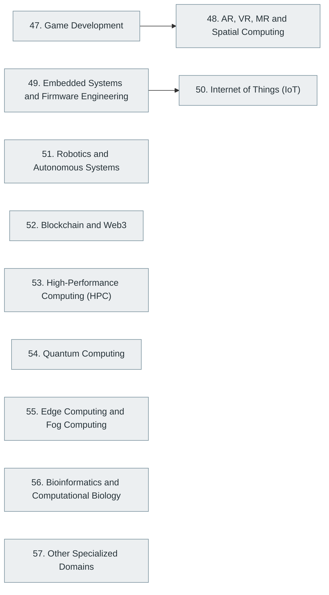

# Part X — Specialized Software Engineering Domains

> [Home](../../README.md) › Part X

**Status:** Not started

Domains with their own bodies of knowledge: games and graphics, spatial computing, embedded systems, IoT, robotics, blockchain, HPC, quantum computing and more.

## Subjects in this part

| # | Subject | What it covers | Topics | Status |
| --- | --- | --- | --- | --- |
| 47 | [Game Development](47-game-development/index.md) | Game programming, graphics and rendering, game engines and the architecture of real-time interactive software. | 41 | Not started |
| 48 | [AR, VR, MR and Spatial Computing](48-ar-vr-mr-and-spatial-computing/index.md) | Augmented, virtual and mixed reality: tracking, rendering for head-mounted displays, interaction design and spatial computing platforms. | 20 | Not started |
| 49 | [Embedded Systems and Firmware Engineering](49-embedded-systems-and-firmware-engineering/index.md) | Programming constrained devices: microcontrollers, peripherals, real-time operating systems, firmware design and hardware platforms. | 38 | Not started |
| 50 | [Internet of Things (IoT)](50-internet-of-things/index.md) | Connected devices end to end: device firmware, protocols, gateways, cloud platforms, security and operations at scale. | 23 | Not started |
| 51 | [Robotics and Autonomous Systems](51-robotics-and-autonomous-systems/index.md) | Kinematics, sensing, control, perception, planning and the software stacks used to build robots and autonomous systems. | 30 | Not started |
| 52 | [Blockchain and Web3](52-blockchain-and-web3/index.md) | Distributed ledgers, consensus, cryptographic foundations, smart contracts, decentralised applications and their security and limits. | 30 | Not started |
| 53 | [High-Performance Computing (HPC)](53-high-performance-computing/index.md) | Parallel programming, vectorisation, GPUs, cluster computing and the performance models used in scientific and large-scale computing. | 21 | Not started |
| 54 | [Quantum Computing](54-quantum-computing/index.md) | Qubits, gates, circuits and measurement, quantum algorithms, error correction, hardware, programming frameworks and post-quantum cryptography, built up from linear algebra and probability. | 77 | Not started |
| 55 | [Edge Computing and Fog Computing](55-edge-and-fog-computing/index.md) | Moving computation towards data sources: edge architectures, constraints, orchestration and the relationship to cloud and IoT. | 14 | Not started |
| 56 | [Bioinformatics and Computational Biology](56-bioinformatics-and-computational-biology/index.md) | Computational methods for biological data: sequences, alignment, genomics pipelines and machine learning in biology. | 13 | Not started |
| 57 | [Other Specialized Domains](57-other-specialized-domains/index.md) | Fields where software meets another industry: FinTech, HealthTech, automotive, aerospace, telecommunications, geospatial, industrial software and others. | 57 | Not started |

## How the subjects depend on each other

Solid arrows point from a prerequisite to the subject that builds on it. Only dependencies inside this part are drawn.

## What you need from other parts

| Subject in this part | Prerequisite elsewhere |
| --- | --- |
| [47. Game Development](47-game-development/index.md) | [2. Mathematics for Computer Science](../01-computer-science-foundations/02-mathematics-for-computer-science/index.md) |
| [47. Game Development](47-game-development/index.md) | [6. Programming Fundamentals](../02-programming-and-software-development/06-programming-fundamentals/index.md) |
| [47. Game Development](47-game-development/index.md) | [9. Data Structures and Algorithms (DSA)](../02-programming-and-software-development/09-data-structures-and-algorithms/index.md) |
| [48. AR, VR, MR and Spatial Computing](48-ar-vr-mr-and-spatial-computing/index.md) | [2. Mathematics for Computer Science](../01-computer-science-foundations/02-mathematics-for-computer-science/index.md) |
| [49. Embedded Systems and Firmware Engineering](49-embedded-systems-and-firmware-engineering/index.md) | [3. Digital Logic and Computer Organization](../01-computer-science-foundations/03-digital-logic-and-computer-organization/index.md) |
| [49. Embedded Systems and Firmware Engineering](49-embedded-systems-and-firmware-engineering/index.md) | [6. Programming Fundamentals](../02-programming-and-software-development/06-programming-fundamentals/index.md) |
| [50. Internet of Things (IoT)](50-internet-of-things/index.md) | [5. Computer Networking](../01-computer-science-foundations/05-computer-networking/index.md) |
| [51. Robotics and Autonomous Systems](51-robotics-and-autonomous-systems/index.md) | [2. Mathematics for Computer Science](../01-computer-science-foundations/02-mathematics-for-computer-science/index.md) |
| [51. Robotics and Autonomous Systems](51-robotics-and-autonomous-systems/index.md) | [6. Programming Fundamentals](../02-programming-and-software-development/06-programming-fundamentals/index.md) |
| [52. Blockchain and Web3](52-blockchain-and-web3/index.md) | [22. Distributed Systems](../05-distributed-systems-and-system-design/22-distributed-systems/index.md) |
| [52. Blockchain and Web3](52-blockchain-and-web3/index.md) | [31. Cybersecurity and Software Security](../07-software-quality-and-cybersecurity/31-cybersecurity-and-software-security/index.md) |
| [53. High-Performance Computing (HPC)](53-high-performance-computing/index.md) | [3. Digital Logic and Computer Organization](../01-computer-science-foundations/03-digital-logic-and-computer-organization/index.md) |
| [53. High-Performance Computing (HPC)](53-high-performance-computing/index.md) | [4. Operating Systems](../01-computer-science-foundations/04-operating-systems/index.md) |
| [54. Quantum Computing](54-quantum-computing/index.md) | [2. Mathematics for Computer Science](../01-computer-science-foundations/02-mathematics-for-computer-science/index.md) |
| [55. Edge Computing and Fog Computing](55-edge-and-fog-computing/index.md) | [5. Computer Networking](../01-computer-science-foundations/05-computer-networking/index.md) |
| [55. Edge Computing and Fog Computing](55-edge-and-fog-computing/index.md) | [24. Cloud Computing](../06-cloud-devops-and-infrastructure/24-cloud-computing/index.md) |
| [56. Bioinformatics and Computational Biology](56-bioinformatics-and-computational-biology/index.md) | [2. Mathematics for Computer Science](../01-computer-science-foundations/02-mathematics-for-computer-science/index.md) |
| [56. Bioinformatics and Computational Biology](56-bioinformatics-and-computational-biology/index.md) | [9. Data Structures and Algorithms (DSA)](../02-programming-and-software-development/09-data-structures-and-algorithms/index.md) |

---

**Previous part:** [Part IX](../09-artificial-intelligence-and-machine-learning/index.md) · **Up:** [Master index](../../MASTER-INDEX.md) · **Next part:** [Part XI](../11-ai-assisted-software-engineering/index.md)
