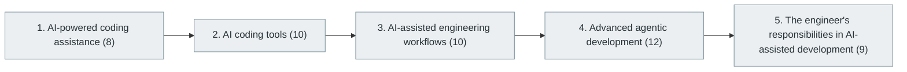

# 58. AI Tools Used by Modern Software Engineers

> [Home](../../../README.md) › [Part XI — AI-Assisted Software Engineering](../index.md) › Subject 58

- **Status:** Not started (0 of 49 syllabus topics have a drafted lesson)
- **Source tags:** —
- **Syllabus size:** 5 chapters, 49 topics

## Introduction

AI-assisted coding, the tools engineers use, AI-assisted workflows, agentic development and the engineer's continuing responsibilities.

> This deserves its own category because AI is changing how engineers write, review, test and maintain software.

## Learning outcomes

After working through this subject you should be able to:

- Use AI assistants productively and critically
- Review AI-generated code as rigorously as human code
- Set boundaries for agentic development

## Prerequisites

- [6. Programming Fundamentals](../../02-programming-and-software-development/06-programming-fundamentals/index.md)
- [13. Version Control and Developer Workflow](../../03-professional-software-engineering/13-version-control-and-developer-workflow/index.md)

## Beginner-to-advanced progression

The chapters below follow the order of the source syllabus, which moves from foundational to advanced material. Colour shows documentation status (grey = not started, amber = in progress, green = drafted or better).

## Chapters and topics

### Chapter 1: AI-powered coding assistance

8 topics · status: **Not started**

*Planned location:* `docs/11-ai-assisted-software-engineering/58-ai-tools-for-software-engineers/01-ai-powered-coding-assistance/`. No lessons yet.

Syllabus topics in this chapter (8)

- `58.01.01` Code completion — *not started*
- `58.01.02` Code explanation — *not started*
- `58.01.03` Code generation — *not started*
- `58.01.04` Refactoring assistance — *not started*
- `58.01.05` Documentation generation — *not started*
- `58.01.06` Test generation — *not started*
- `58.01.07` Debugging assistance — *not started*
- `58.01.08` Code review assistance — *not started*

### Chapter 2: AI coding tools

10 topics · status: **Not started**

*Planned location:* `docs/11-ai-assisted-software-engineering/58-ai-tools-for-software-engineers/02-ai-coding-tools/`. No lessons yet.

Syllabus topics in this chapter (10)

- `58.02.01` GitHub Copilot — *not started*
- `58.02.02` Cursor — *not started*
- `58.02.03` Windsurf — *not started*
- `58.02.04` Claude Code — *not started*
- `58.02.05` OpenAI Codex — *not started*
- `58.02.06` Gemini Code Assist — *not started*
- `58.02.07` Amazon Q Developer — *not started*
- `58.02.08` JetBrains AI Assistant — *not started*
- `58.02.09` Continue — *not started*
- `58.02.10` Aider — *not started*

### Chapter 3: AI-assisted engineering workflows

10 topics · status: **Not started**

*Planned location:* `docs/11-ai-assisted-software-engineering/58-ai-tools-for-software-engineers/03-ai-assisted-engineering-workflows/`. No lessons yet.

Syllabus topics in this chapter (10)

- `58.03.01` Natural-language specifications — *not started*
- `58.03.02` Codebase understanding — *not started*
- `58.03.03` Repository-level reasoning — *not started*
- `58.03.04` Automated bug fixing — *not started*
- `58.03.05` Automated test creation — *not started*
- `58.03.06` Documentation maintenance — *not started*
- `58.03.07` PR review — *not started*
- `58.03.08` Refactoring — *not started*
- `58.03.09` Dependency updates — *not started*
- `58.03.10` CI failure analysis — *not started*

### Chapter 4: Advanced agentic development

12 topics · status: **Not started**

*Planned location:* `docs/11-ai-assisted-software-engineering/58-ai-tools-for-software-engineers/04-advanced-agentic-development/`. No lessons yet.

Syllabus topics in this chapter (12)

- `58.04.01` Autonomous coding agents — *not started*
- `58.04.02` Multi-file changes — *not started*
- `58.04.03` Repository exploration — *not started*
- `58.04.04` Tool-using agents — *not started*
- `58.04.05` Parallel agent execution — *not started*
- `58.04.06` Agent orchestration — *not started*
- `58.04.07` Code verification — *not started*
- `58.04.08` Test-driven AI development — *not started*
- `58.04.09` Sandboxed execution — *not started*
- `58.04.10` Human approval — *not started*
- `58.04.11` Change validation — *not started*
- `58.04.12` Agent evaluation — *not started*

### Chapter 5: The engineer's responsibilities in AI-assisted development

9 topics · status: **Not started**

*Planned location:* `docs/11-ai-assisted-software-engineering/58-ai-tools-for-software-engineers/05-the-engineers-responsibilities-in-ai-assisted-development/`. No lessons yet.

Syllabus topics in this chapter (9)

- `58.05.01` Verify generated code — *not started*
- `58.05.02` Check correctness — *not started*
- `58.05.03` Validate dependencies — *not started*
- `58.05.04` Review security — *not started*
- `58.05.05` Evaluate performance — *not started*
- `58.05.06` Check licensing — *not started*
- `58.05.07` Test edge cases — *not started*
- `58.05.08` Understand system architecture — *not started*
- `58.05.09` Maintain accountability for shipped software — *not started*

## Recommended reading order

1. Chapter 1 — AI-powered coding assistance
2. Chapter 2 — AI coding tools
3. Chapter 3 — AI-assisted engineering workflows
4. Chapter 4 — Advanced agentic development
5. Chapter 5 — The engineer's responsibilities in AI-assisted development

Within a chapter, read lessons in numeric order. Pick the later chapters only when the earlier ones feel comfortable; the syllabus orders them from fundamental to advanced.

## Related subjects

- [30. Software Testing and Quality Assurance](../../07-software-quality-and-cybersecurity/30-software-testing-and-quality-assurance/index.md)
- [44. AI Agents and Agentic Systems](../../09-artificial-intelligence-and-machine-learning/44-ai-agents-and-agentic-systems/index.md)

## Suggested practical projects

- A documented AI-assisted workflow with review checkpoints
- An evaluation of an assistant on your own codebase

*Full project write-ups (requirements, architecture, stages, tests, extensions) are planned; see [ROADMAP.md](../../../ROADMAP.md).*

---

**Previous subject:** [57. Other Specialized Domains](../../10-specialized-software-engineering-domains/57-other-specialized-domains/index.md) · **Up:** [Part XI](../index.md) · **Next subject:** [59. Engineering Standards and Software Quality](../../12-professional-engineering-practices/59-engineering-standards-and-software-quality/index.md)
