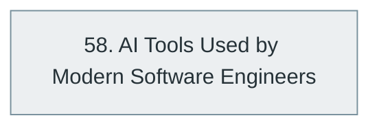

# Part XI — AI-Assisted Software Engineering

> [Home](../../README.md) › Part XI

**Status:** Not started

How AI coding assistants and agents change the way software is written, reviewed, tested and maintained, and the responsibilities that stay with the engineer.

## Subjects in this part

| # | Subject | What it covers | Topics | Status |
| --- | --- | --- | --- | --- |
| 58 | [AI Tools Used by Modern Software Engineers](58-ai-tools-for-software-engineers/index.md) | AI-assisted coding, the tools engineers use, AI-assisted workflows, agentic development and the engineer's continuing responsibilities. | 49 | Not started |

## How the subjects depend on each other

Solid arrows point from a prerequisite to the subject that builds on it. Only dependencies inside this part are drawn.

## What you need from other parts

| Subject in this part | Prerequisite elsewhere |
| --- | --- |
| [58. AI Tools Used by Modern Software Engineers](58-ai-tools-for-software-engineers/index.md) | [6. Programming Fundamentals](../02-programming-and-software-development/06-programming-fundamentals/index.md) |
| [58. AI Tools Used by Modern Software Engineers](58-ai-tools-for-software-engineers/index.md) | [13. Version Control and Developer Workflow](../03-professional-software-engineering/13-version-control-and-developer-workflow/index.md) |

---

**Previous part:** [Part X](../10-specialized-software-engineering-domains/index.md) · **Up:** [Master index](../../MASTER-INDEX.md) · **Next part:** [Part XII](../12-professional-engineering-practices/index.md)
