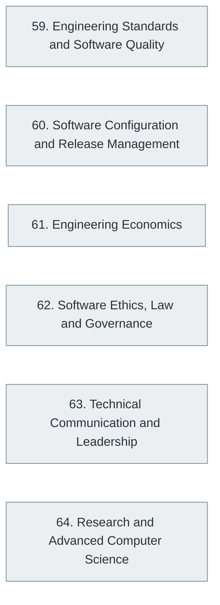

# Part XII — Professional Engineering Practices

> [Home](../../README.md) › Part XII

**Status:** Not started

Standards, release management, engineering economics, ethics and law, communication and leadership, and the research-level computer science behind the field.

## Subjects in this part

| # | Subject | What it covers | Topics | Status |
| --- | --- | --- | --- | --- |
| 59 | [Engineering Standards and Software Quality](59-engineering-standards-and-software-quality/index.md) | Standards, quality models, process improvement, compliance and metrics for software engineering organisations. | 17 | Not started |
| 60 | [Software Configuration and Release Management](60-software-configuration-and-release-management/index.md) | Configuration management, versioning, release processes, feature flags, rollbacks and change control. | 17 | Not started |
| 61 | [Engineering Economics](61-engineering-economics/index.md) | The economics of engineering decisions: cost, value, technical debt, build-versus-buy and cloud cost management. | 15 | Not started |
| 62 | [Software Ethics, Law and Governance](62-software-ethics-law-and-governance/index.md) | Professional ethics, intellectual property, licensing, privacy and data-protection law, accessibility obligations and organisational governance. | 19 | Not started |
| 63 | [Technical Communication and Leadership](63-technical-communication-and-leadership/index.md) | Writing, presenting and documenting technical work, collaborating, mentoring and leading engineering teams. | 17 | Not started |
| 64 | [Research and Advanced Computer Science](64-research-and-advanced-computer-science/index.md) | Computability, complexity, formal methods, type theory, advanced algorithms and the research frontier in systems, languages and AI. | 25 | Not started |

## How the subjects depend on each other

Solid arrows point from a prerequisite to the subject that builds on it. Only dependencies inside this part are drawn.

## What you need from other parts

| Subject in this part | Prerequisite elsewhere |
| --- | --- |
| [59. Engineering Standards and Software Quality](59-engineering-standards-and-software-quality/index.md) | [11. Software Development Lifecycle (SDLC)](../03-professional-software-engineering/11-software-development-lifecycle/index.md) |
| [60. Software Configuration and Release Management](60-software-configuration-and-release-management/index.md) | [13. Version Control and Developer Workflow](../03-professional-software-engineering/13-version-control-and-developer-workflow/index.md) |
| [60. Software Configuration and Release Management](60-software-configuration-and-release-management/index.md) | [26. DevOps Engineering](../06-cloud-devops-and-infrastructure/26-devops-engineering/index.md) |
| [61. Engineering Economics](61-engineering-economics/index.md) | [11. Software Development Lifecycle (SDLC)](../03-professional-software-engineering/11-software-development-lifecycle/index.md) |
| [64. Research and Advanced Computer Science](64-research-and-advanced-computer-science/index.md) | [2. Mathematics for Computer Science](../01-computer-science-foundations/02-mathematics-for-computer-science/index.md) |
| [64. Research and Advanced Computer Science](64-research-and-advanced-computer-science/index.md) | [9. Data Structures and Algorithms (DSA)](../02-programming-and-software-development/09-data-structures-and-algorithms/index.md) |

---

**Previous part:** [Part XI](../11-ai-assisted-software-engineering/index.md) · **Up:** [Master index](../../MASTER-INDEX.md) · **Next part:** [Part XIII](../13-complete-technology-ecosystem/index.md)
