# Part XIV — How the Entire Field Fits Together

> [Home](../../README.md) › Part XIV

How the layers of computing depend on each other, from foundations through applications and infrastructure to data, intelligence and frontier computing.

> The following is a simplified map of the relationships between major areas.

## The source map

The syllabus draws the field as seven layers. The arrows below show the order in which the source lists them; it is a simplified picture, because real dependencies cross layers in many places.

```mermaid
flowchart TB
    subgraph L1["Computer Science Foundations"]
        direction LR
        A1_1["Mathematics"]
        A1_2["Logic"]
        A1_3["Architecture"]
        A1_4["Algorithms"]
        A1_5["Operating Systems"]
        A1_6["Networks"]
    end
    subgraph L2["Programming and Software Engineering"]
        direction LR
        A2_1["Programming languages"]
        A2_2["DSA"]
        A2_3["OOP"]
        A2_4["Design"]
        A2_5["Testing"]
        A2_6["Git"]
        A2_7["SDLC"]
    end
    subgraph L3["Application Engineering"]
        direction LR
        A3_1["Frontend"]
        A3_2["Backend"]
        A3_3["Mobile"]
        A3_4["Desktop"]
        A3_5["APIs"]
    end
    subgraph L4["Systems Engineering"]
        direction LR
        A4_1["Architecture"]
        A4_2["Distributed systems"]
        A4_3["Databases"]
        A4_4["Networking"]
    end
    subgraph L5["Infrastructure"]
        direction LR
        A5_1["Cloud"]
        A5_2["DevOps"]
        A5_3["Containers"]
        A5_4["SRE"]
        A5_5["Security"]
    end
    subgraph L6["Data and Intelligence"]
        direction LR
        A6_1["Data engineering"]
        A6_2["Analytics"]
        A6_3["ML"]
        A6_4["AI"]
        A6_5["LLMs"]
    end
    subgraph L7["Advanced and Frontier Computing"]
        direction LR
        A7_1["AI agents"]
        A7_2["Robotics"]
        A7_3["HPC"]
        A7_4["Quantum"]
        A7_5["Blockchain"]
        A7_6["Spatial computing"]
        A7_7["Emerging hardware"]
    end
    L1 --> L2 --> L3 --> L4 --> L5 --> L6 --> L7
    X["Professional practices, security, quality, ethics and communication"]
    X -.-> L1
    X -.-> L2
    X -.-> L3
    X -.-> L4
    X -.-> L5
    X -.-> L6
    X -.-> L7
```

> Professional practices, security, quality, ethics and communication apply across every layer.

## Where each layer lives in this library

| Layer | Areas named in the source | Subjects |
| --- | --- | --- |
| Computer Science Foundations | Mathematics · Logic · Architecture · Algorithms · Operating Systems · Networks | [1](../01-computer-science-foundations/01-computer-fundamentals/index.md), [2](../01-computer-science-foundations/02-mathematics-for-computer-science/index.md), [3](../01-computer-science-foundations/03-digital-logic-and-computer-organization/index.md), [4](../01-computer-science-foundations/04-operating-systems/index.md), [5](../01-computer-science-foundations/05-computer-networking/index.md) |
| Programming and Software Engineering | Programming languages · DSA · OOP · Design · Testing · Git · SDLC | [6](../02-programming-and-software-development/06-programming-fundamentals/index.md), [7](../02-programming-and-software-development/07-programming-paradigms/index.md), [8](../02-programming-and-software-development/08-programming-languages-and-ecosystem/index.md), [9](../02-programming-and-software-development/09-data-structures-and-algorithms/index.md), [10](../02-programming-and-software-development/10-compilers-and-language-internals/index.md), [11](../03-professional-software-engineering/11-software-development-lifecycle/index.md), [12](../03-professional-software-engineering/12-software-design-principles-and-architecture/index.md), [13](../03-professional-software-engineering/13-version-control-and-developer-workflow/index.md), [14](../03-professional-software-engineering/14-development-environments-and-tools/index.md), [30](../07-software-quality-and-cybersecurity/30-software-testing-and-quality-assurance/index.md) |
| Application Engineering | Frontend · Backend · Mobile · Desktop · APIs | [16](../04-building-software-products/16-backend-development/index.md), [17](../04-building-software-products/17-frontend-development/index.md), [18](../04-building-software-products/18-ui-ux-and-human-computer-interaction/index.md), [19](../04-building-software-products/19-mobile-application-development/index.md), [20](../04-building-software-products/20-desktop-application-development/index.md), [21](../04-building-software-products/21-api-integration-and-messaging-systems/index.md) |
| Systems Engineering | Architecture · Distributed systems · Databases · Networking | [12](../03-professional-software-engineering/12-software-design-principles-and-architecture/index.md), [15](../04-building-software-products/15-database-management-systems/index.md), [22](../05-distributed-systems-and-system-design/22-distributed-systems/index.md), [23](../05-distributed-systems-and-system-design/23-system-design/index.md), [5](../01-computer-science-foundations/05-computer-networking/index.md) |
| Infrastructure | Cloud · DevOps · Containers · SRE · Security | [24](../06-cloud-devops-and-infrastructure/24-cloud-computing/index.md), [25](../06-cloud-devops-and-infrastructure/25-containers-and-orchestration/index.md), [26](../06-cloud-devops-and-infrastructure/26-devops-engineering/index.md), [27](../06-cloud-devops-and-infrastructure/27-site-reliability-engineering/index.md), [28](../06-cloud-devops-and-infrastructure/28-observability-and-monitoring/index.md), [29](../06-cloud-devops-and-infrastructure/29-performance-engineering/index.md), [31](../07-software-quality-and-cybersecurity/31-cybersecurity-and-software-security/index.md) |
| Data and Intelligence | Data engineering · Analytics · ML · AI · LLMs | [32](../08-data-engineering-data-science-and-analytics/32-data-engineering/index.md), [33](../08-data-engineering-data-science-and-analytics/33-data-science-and-business-intelligence/index.md), [34](../09-artificial-intelligence-and-machine-learning/34-artificial-intelligence-fundamentals/index.md), [35](../09-artificial-intelligence-and-machine-learning/35-mathematics-for-machine-learning/index.md), [36](../09-artificial-intelligence-and-machine-learning/36-machine-learning/index.md), [37](../09-artificial-intelligence-and-machine-learning/37-deep-learning/index.md), [38](../09-artificial-intelligence-and-machine-learning/38-natural-language-processing/index.md), [39](../09-artificial-intelligence-and-machine-learning/39-computer-vision/index.md), [40](../09-artificial-intelligence-and-machine-learning/40-reinforcement-learning/index.md), [41](../09-artificial-intelligence-and-machine-learning/41-generative-ai/index.md), [42](../09-artificial-intelligence-and-machine-learning/42-large-language-models/index.md), [43](../09-artificial-intelligence-and-machine-learning/43-retrieval-augmented-generation/index.md), [45](../09-artificial-intelligence-and-machine-learning/45-ai-engineering-and-mlops/index.md) |
| Advanced and Frontier Computing | AI agents · Robotics · HPC · Quantum · Blockchain · Spatial computing · Emerging hardware | [44](../09-artificial-intelligence-and-machine-learning/44-ai-agents-and-agentic-systems/index.md), [48](../10-specialized-software-engineering-domains/48-ar-vr-mr-and-spatial-computing/index.md), [51](../10-specialized-software-engineering-domains/51-robotics-and-autonomous-systems/index.md), [52](../10-specialized-software-engineering-domains/52-blockchain-and-web3/index.md), [53](../10-specialized-software-engineering-domains/53-high-performance-computing/index.md), [54](../10-specialized-software-engineering-domains/54-quantum-computing/index.md), [3](../01-computer-science-foundations/03-digital-logic-and-computer-organization/index.md) |

Subjects the simplified source map does not name, but which belong to the library: [47](../10-specialized-software-engineering-domains/47-game-development/index.md), [49](../10-specialized-software-engineering-domains/49-embedded-systems-and-firmware-engineering/index.md), [50](../10-specialized-software-engineering-domains/50-internet-of-things/index.md), [55](../10-specialized-software-engineering-domains/55-edge-and-fog-computing/index.md), [56](../10-specialized-software-engineering-domains/56-bioinformatics-and-computational-biology/index.md), [57](../10-specialized-software-engineering-domains/57-other-specialized-domains/index.md) (game development, embedded systems, IoT, edge computing, bioinformatics and other specialised domains).

Cross-cutting subjects (practices that apply in every layer): [46](../09-artificial-intelligence-and-machine-learning/46-responsible-ai-safety-and-governance/index.md), [58](../11-ai-assisted-software-engineering/58-ai-tools-for-software-engineers/index.md), [59](../12-professional-engineering-practices/59-engineering-standards-and-software-quality/index.md), [60](../12-professional-engineering-practices/60-software-configuration-and-release-management/index.md), [61](../12-professional-engineering-practices/61-engineering-economics/index.md), [62](../12-professional-engineering-practices/62-software-ethics-law-and-governance/index.md), [63](../12-professional-engineering-practices/63-technical-communication-and-leadership/index.md), [64](../12-professional-engineering-practices/64-research-and-advanced-computer-science/index.md).

## Reading the map

Each layer depends on the ones before it, and that dependency is concrete. A database index (subject 15) is usually a B-tree, which is a data structure from subject 9, and its performance depends on how storage and the memory hierarchy behave (subjects 3 and 4). A transformer language model (subject 42) is built from linear algebra (subjects 2 and 35) and neural-network training (subject 37). A reliable web service (subject 27) depends on networking (subject 5), distributed-systems theory (subject 22) and observability (subject 28).

The practical consequence is that gaps in a lower layer show up as confusion in a higher one. When a topic resists understanding, look at its prerequisites in the [prerequisite map](../../curriculum/prerequisite-map.md) before re-reading it.

---

**Previous part:** [Part XIII](../13-complete-technology-ecosystem/index.md) · **Next part:** [Part XV](../15-practical-learning-order/index.md)
