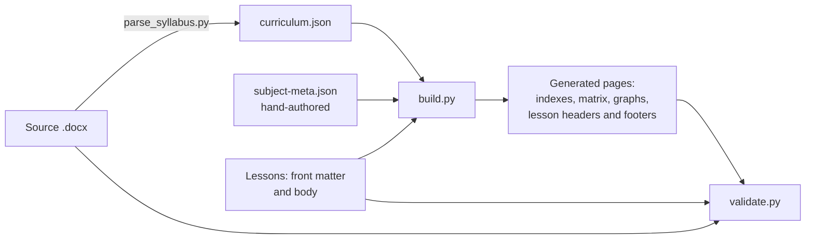

# Tools

Three scripts keep the repository honest. Python 3.10 or newer and PyYAML are required (`pip install -r tools/requirements.txt`).

| Script | What it does |
|---|---|
| `parse_syllabus.py` | Reads `curriculum/source/Software_Engineering_Topics.docx` and writes `curriculum/curriculum.json`, the single source of truth for the curriculum. Run it only if the `.docx` changes. |
| `build.py` | Regenerates every derived page (inventory, coverage matrix, indexes, graphs, lesson headers and footers, README and PROGRESS statistics). `--check` fails if any generated file is stale. |
| `validate.py` | Runs the checks below. `--only a,b` runs a subset. |

Supporting modules: `curlib.py` (shared loading and status logic), `gen_inventory.py` and `gen_navigation.py` (the generators).

## Validation checks

| Check | Verifies |
|---|---|
| `source` | Re-counts parts, subjects, bullets and tables in the `.docx` independently of the parser, and that `curriculum.json` was parsed from this exact file |
| `coverage` | Every syllabus topic ID appears exactly once in the coverage matrix; lesson `covers` entries are valid and stay inside their own subject and chapter |
| `frontmatter` | Required keys, valid status, file location and naming, one H1 equal to the title, existing `prerequisites` and `related` paths, header status equal to front-matter status |
| `markdown` | Balanced code fences, no heading-level jumps, no placeholder text, and every code block classified as `run`, `illustrative` or `expect` |
| `links` | Every relative link and heading anchor resolves |
| `mermaid` | Every Mermaid diagram is parsed by the Mermaid CLI (needs `mmdc` and Chromium; set `PUPPETEER_EXECUTABLE_PATH` if Chromium is not found). Results are cached in `.cache/` |
| `code` | Every `<!-- run:python -->` and `<!-- run:c -->` block is executed (C is compiled with `-Wall -Wextra -pedantic`; warnings fail) and its output is compared with the following `<!-- expect -->` block |
| `fresh` | `build.py --check`: generated files are up to date |

> **Security:** the `code` check executes code from Markdown. Run it in a container or CI runner, not on a machine holding secrets, when validating contributions you have not read. See [SECURITY.md](../SECURITY.md).
